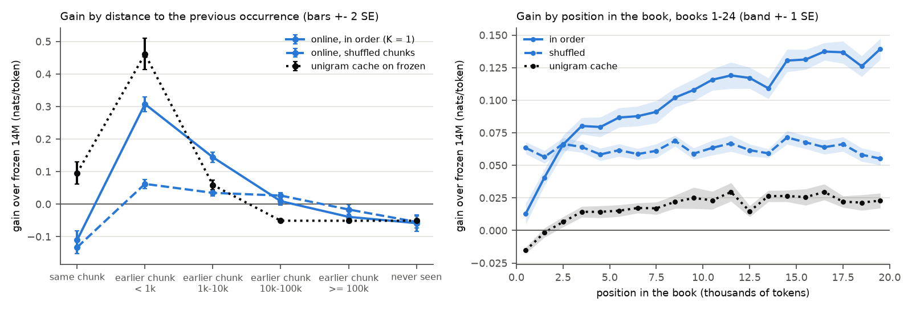

# E1: how far back, how local, which book, more than a unigram cache? (claims C1-C4)

**Question:** when Pythia-14M learns online on books read in order, how far back does the gain
reach (C1), does it disappear when the chunks are shuffled (C2), is it about the same book or
about recency (C3), and is it more than a word-frequency cache (C4)?

## Setup

- **Main set:** 25 PG-19 test books, 78 chunks of L = 256 tokens each (first 19,968 tokens, the
  rest dropped); every chunk is scored on its own, with no context from earlier chunks.
- **Runs:** frozen Pythia-14M; plain SGD on all parameters, lr 1e-4 (E0 pick), one step per chunk
  after scoring it, on K = 1 (book after book) and on the same chunks shuffled.
- **Unigram cache baseline:** the frozen model mixed with a decaying count cache of the tokens
  read so far (lambda 0.05, half-life 1000 tokens), on the K = 1 order.
- **Bins:** each token by the distance to the previous occurrence of the same id in the K = 1
  stream (the 1000 most frequent ids are excluded from the earlier-chunk bins), split by whether
  that occurrence is in the same book or an earlier one. Gain = frozen loss - run loss;
  locality = gain in order - gain shuffled; SE over books (books with < 50 tokens in a bin are
  dropped). `distance.csv`, `position.csv`.

## Results (gain over frozen, nats/token, ± SE over books)

| bin | tokens | in order | shuffled | locality | unigram cache | in order - unigram |
|---|---|---|---|---|---|---|
| all tokens | 497,250 | +0.100 ± 0.006 | +0.062 ± 0.003 | +0.038 ± 0.004 | +0.018 ± 0.004 | +0.082 ± 0.004 |
| same chunk | 9,886 | -0.111 ± 0.014 | -0.133 ± 0.010 | +0.022 ± 0.013* | +0.096 ± 0.017 | -0.206 ± 0.022 |
| earlier chunk, < 1k | 17,036 | +0.307 ± 0.011 | +0.062 ± 0.007 | +0.245 ± 0.009 | +0.461 ± 0.024 | -0.154 ± 0.026 |
| earlier chunk, 1k-10k | 33,973 | +0.144 ± 0.008 | +0.035 ± 0.005 | +0.109 ± 0.007 | +0.059 ± 0.008 | +0.085 ± 0.008 |
| — same book | 29,577 | +0.154 ± 0.008 | +0.034 ± 0.005 | +0.120 ± 0.007 | +0.070 ± 0.009 | +0.084 ± 0.008 |
| — earlier book | 4,396 | +0.076 ± 0.012 | +0.040 ± 0.009 | +0.035 ± 0.010 | -0.016 ± 0.004 | +0.092 ± 0.011 |
| earlier chunk, 10k-100k | 44,109 | +0.009 ± 0.006* | +0.026 ± 0.005 | -0.017 ± 0.006 | -0.051 ± 0.000 | +0.060 ± 0.006 |
| — same book | 4,798 | +0.060 ± 0.011 | +0.024 ± 0.007 | +0.036 ± 0.010 | -0.050 ± 0.000 | +0.110 ± 0.011 |
| — earlier book | 39,311 | +0.003 ± 0.006* | +0.027 ± 0.005 | -0.024 ± 0.006 | -0.051 ± 0.000 | +0.054 ± 0.006 |
| earlier chunk, >= 100k (all earlier book) | 13,125 | -0.039 ± 0.009 | -0.017 ± 0.008 | -0.023 ± 0.008 | -0.051 ± 0.000 | +0.012 ± 0.009* |
| never seen | 20,976 | -0.059 ± 0.013 | -0.055 ± 0.009 | -0.004 ± 0.010* | -0.051 ± 0.000 | -0.008 ± 0.013* |

\* under 2 SE. The < 1k bin is almost all same book (16,967 of 17,036 tokens).

By position in the book (`position.csv`), the in-order gain grows from +0.013 ± 0.008 in the first
1k tokens to +0.139 ± 0.008 at 19k-20k; the shuffled gain stays flat at about +0.06.

## Findings

- **C1, distance:** the gain reaches about 10k tokens back: +0.307 within 1k, +0.144 at 1k-10k,
  and still +0.060 ± 0.011 for same-book repeats 10k-100k back; nothing beyond (earlier-book
  tokens 10k-100k back: +0.003 ± 0.006, under 2 SE).
- **C2, local:** shuffling keeps 62% of the overall gain but only 20% within 1k and 24% at
  1k-10k (locality +0.245 and +0.109). The overall gain is mostly general adaptation to PG-19.
- **C3, same book:** at 1k-10k the locality is +0.120 for same-book tokens against +0.035 for
  earlier-book ones at the same distance; same-book tokens 10k-100k back keep +0.036 of locality,
  earlier-book ones have none (-0.024).
- **C4, more than a unigram cache beyond 1k:** the count cache wins within 1k (+0.461 against
  +0.307) but the online learner wins at 1k-10k (+0.144 against +0.059) and beyond, and +0.082
  overall.

## Contamination (no runs; kept from old test 4)

Pythia was trained on the Pile, which has a "Gutenberg (PG-19)" component.
- **Identity:** the Pile paper (Gao et al. 2020, section 2.12) says it is PG-19 itself: "The
  specific Project Gutenberg derived dataset we used, PG-19, consists of Project Gutenberg books
  from before 1919 (Rae et al. 2019)."
- **Size:** the Datasheet for the Pile (Biderman, Bicheno and Gao 2022, Dataset Composition) gives
  the component as "28,602 documents, totaling 10.88 GiB". 28,602 is exactly the number of books
  in PG-19's *training* split (the splits are 28,602 train, 50 validation, 100 test).
- **Wording:** the same datasheet also says "The entire Project Gutenberg 1919 dataset is
  contained in the Pile", but the document count contradicts a reading that includes validation
  and test.
- **Silence:** neither document mentions the PG-19 splits or excludes the test books explicitly.

**Conclusion:** the 25 test books are very likely not in the Pile's PG-19 component. The count
match is strong evidence but not a statement from the authors. The books could still be in the
Pile in other forms (other components with book text, web copies of Gutenberg pages, another
edition in PG-19's training split); this was not checked. The frozen loss on these books (4.393
nats/token) does not look like memorized text.

## Caveats

- One model (14M), one rate, one seed; books are cut to 20k tokens, so distances over 20k are
  always earlier-book.
- The unigram cache parameters were fixed (not tuned); within 1k a tuned cache would win by more.
- Where the unigram cache has no count for a token, mixing it in costs exactly -log(0.95) = 0.051 nats,
  so those bins have a constant loss and an SE of 0.
- Same-chunk repeats lose under both orders: a chunk is scored before the update on it, so the
  loss there reflects updates from earlier chunks only.

Runtime: frozen 4 min, K = 1 7 min, shuffled 25 min (snapshots on), unigram cache seconds
(`runtime.txt`).
