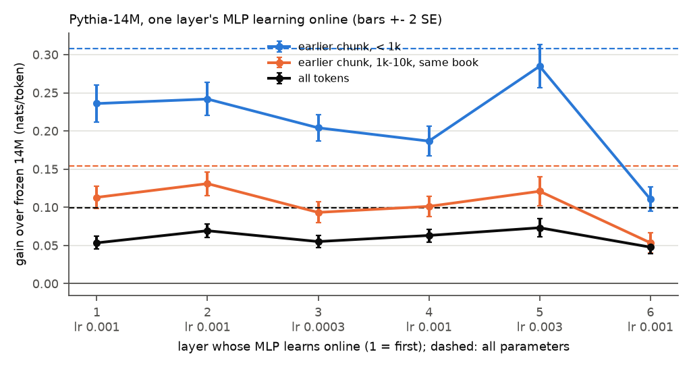

# E2: which weights hold the memory? (claim C5)

**Question:** when only part of Pythia-14M is updated online, how much of the long-range gain is
kept, and which layers' MLPs can hold it?

## Setup

- Main set, K = 1 (as E1). Plain SGD, one step per chunk, on one parameter subset: all
  parameters; output embedding only; all but the output embedding; the MLPs of all six layers;
  the attention of all six layers; one layer's MLP (layers 1-6, 131,712 parameters each).
- Each subset at its own val-pick learning rate (E0). Gain over frozen 14M per distance bin (E1's
  bins), SE over books; "- full" = paired difference with the all-parameter run.
  `results.csv` (all bins).

## Results (gain over frozen, ± SE over books)

| subset | lr | all tokens | earlier chunk < 1k | 1k-10k, same book | never seen |
|---|---|---|---|---|---|
| all parameters | 1e-4 | +0.100 ± 0.006 | +0.308 ± 0.011 | +0.154 ± 0.008 | -0.059 ± 0.013 |
| output only | 3e-3 | +0.072 ± 0.006 | +0.252 ± 0.017 | +0.072 ± 0.006 | -0.143 ± 0.012 |
| all but output | 1e-4 | +0.094 ± 0.005 | +0.294 ± 0.011 | +0.151 ± 0.009 | -0.058 ± 0.013 |
| MLP only | 3e-4 | +0.107 ± 0.007 | +0.415 ± 0.016 | +0.175 ± 0.011 | -0.077 ± 0.014 |
| attention only | 3e-4 | +0.066 ± 0.005 | +0.259 ± 0.011 | +0.110 ± 0.009 | -0.074 ± 0.014 |
| MLP of layer 1 | 1e-3 | +0.053 ± 0.004 | +0.236 ± 0.012 | +0.113 ± 0.007 | -0.055 ± 0.010 |
| MLP of layer 2 | 1e-3 | +0.069 ± 0.004 | +0.242 ± 0.011 | +0.131 ± 0.008 | -0.051 ± 0.010 |
| MLP of layer 3 | 3e-4 | +0.055 ± 0.004 | +0.204 ± 0.009 | +0.093 ± 0.007 | -0.056 ± 0.011 |
| MLP of layer 4 | 1e-3 | +0.063 ± 0.004 | +0.187 ± 0.010 | +0.101 ± 0.007 | -0.063 ± 0.010 |
| MLP of layer 5 | 3e-3 | +0.073 ± 0.006 | +0.285 ± 0.014 | +0.121 ± 0.009 | -0.090 ± 0.014 |
| MLP of layer 6 | 1e-3 | +0.048 ± 0.004 | +0.111 ± 0.008 | +0.054 ± 0.007 | -0.084 ± 0.012 |

Paired differences with the all-parameter run (`minus_full`): MLP only +0.007 ± 0.002 overall,
+0.108 ± 0.008 within 1k, +0.021 ± 0.004 at 1k-10k same book; all but output -0.006 ± 0.001,
-0.013 ± 0.002, -0.004 ± 0.001; output only -0.028 ± 0.003, -0.055 ± 0.018, -0.082 ± 0.010.

## Findings

- **The memory is in the MLPs below the output layer.** Updating only the six MLPs (0.79M
  parameters) at their own rate gives more than the full learner at every distance up to 10k
  (+0.415 against +0.308 within 1k, +0.175 against +0.154 at 1k-10k same book, +0.107 against
  +0.100 overall, all beyond 2 SE paired). Freezing the output embedding costs little (-0.004 at
  1k-10k same book); the output embedding alone is a short-range cache (+0.252 within 1k, +0.072 at
  1k-10k same book) that loses the most on never-seen tokens (-0.143).
- Attention only keeps less: +0.259 within 1k and +0.110 at 1k-10k same book.
- **Single layers:** each of the six MLPs alone keeps 36-93% of the full learner's within-1k gain
  and 35-85% at 1k-10k same book, and every one is below the full learner at both. Layers 2 and 5
  are the strongest (+0.131 and +0.121 at 1k-10k same book); the last layer is clearly the weakest
  (+0.111 within 1k, +0.054 at 1k-10k same book).

## Caveats

- One model, one seed. Rates are picked on overall val-pick loss, not on long-range gain; the
  single-layer gains within 1k depend strongly on the rate (old test 6's picks on the check books,
  3e-3 for layers 2 and 4, gave +0.395 and +0.357 within 1k, with lower gains on never-seen tokens).
- The "1k-10k" column is same-book tokens only (the bulk of that bin; all tokens in `results.csv`).

Runtime: about 2 min per subset run, 20 min total (`runtime.txt`).
