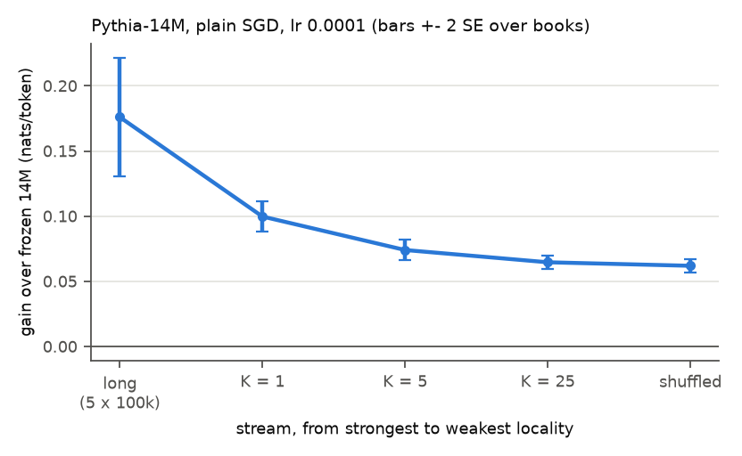

# E3: gain against locality of the stream (claim C6)

**Question:** does the online gain fall steadily as the stream becomes less local?

## Setup

- Pythia-14M, plain SGD on all parameters, lr 1e-4 (E0 pick), one step per chunk.
- **Streams**, from most to least local:
  - long: 5 PG-19 test books (all also in the main set, which holds only their first 20k tokens)
    of 100k tokens each, 390 chunks per book, book after book (497,250 tokens, same total as the
    main set);
  - K = 1: the main set (25 books x 78 chunks) book after book;
  - K = 5 / K = 25: the main set with 5 / 25 books interleaved chunk by chunk;
  - shuffled: the main set's chunks in a random order.
- Gain = frozen 14M loss - online loss on the same stream, all tokens, SE over books. Drop =
  paired difference with the next more local stream (same 25 books; long covers mostly different
  text, so no paired drop from long to K = 1). `results.csv`.

## Results

| stream | gain over frozen | drop from previous |
|---|---|---|
| long (5 x 100k) | +0.176 ± 0.023 | |
| K = 1 | +0.100 ± 0.006 | |
| K = 5 | +0.074 ± 0.004 | -0.026 ± 0.002 |
| K = 25 | +0.065 ± 0.003 | -0.010 ± 0.002 |
| shuffled | +0.062 ± 0.003 | -0.003 ± 0.001 |

## Findings

- The gain falls with every step down in locality: long > K = 1 > K = 5 > K = 25 > shuffled; each
  paired drop among the main-set streams is beyond 2 SE.
- Most of the in-order advantage is lost by interleaving only 5 books (-0.026 of the -0.038 from
  K = 1 to shuffled); K = 25 is already close to shuffled.
- Longer books give more: +0.176 on 100k-token books, against +0.100 on 20k-token ones.

## Caveats

- Long covers mostly different text than the main set (only the first 20k tokens of its 5 books are
  shared), so long > K = 1 is not a paired comparison (5 books; its SE is large).
- One model, one rate, one seed.

Runtime: K = 5 and K = 25 2.5 min each, long 3 min; K = 1 and shuffled from E1 (`runtime.txt`).
