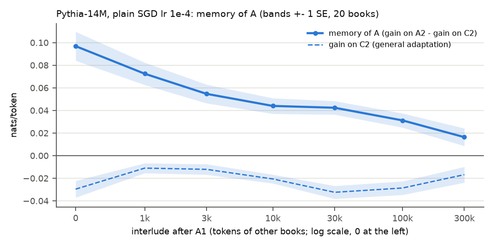

# E4: eviction (claim C7)

**Question:** after a book's first half, how much book-specific memory is left after I tokens of
other books, with general adaptation removed?

## Setup

- 20 A books (main books 0-19), each paired with a control C (i <-> i + 10). A1 = tokens 0-10239
  (40 chunks), A2 = tokens 10240-19999; C2 = the same range of C, never read.
- Stream per A: A1, then an interlude of PG-19 validation books (cyclic, starting at validation
  book 2A). Pythia-14M, plain SGD on all parameters, lr 1e-4, one step per chunk.
- After A1 + I tokens (I = 0, 1k, 3k, 10k, 30k, 100k, 300k, rounded to chunks), A2 and C2 are
  scored frozen with the snapshot. **memory of A** = gain on A2 - gain on C2 (gains over the
  pretrained model). Rare tokens: the 1000 most frequent ids excluded, split by whether the id
  occurs in A1 (the control uses C1). SE over the 20 books.

## Results

| I (tokens) | gain on A2 | gain on C2 | memory of A | rare, id in A1 | rare, id not in A1 |
|---|---|---|---|---|---|
| 0 | +0.067 ± 0.007 | -0.030 ± 0.007 | +0.097 ± 0.013 | +0.223 ± 0.029 | +0.056 ± 0.011 |
| 1k | +0.062 ± 0.007 | -0.011 ± 0.004 | +0.073 ± 0.010 | +0.164 ± 0.022 | +0.038 ± 0.010 |
| 3k | +0.043 ± 0.006 | -0.012 ± 0.005 | +0.055 ± 0.008 | +0.109 ± 0.022 | +0.015 ± 0.011* |
| 10k | +0.023 ± 0.005 | -0.021 ± 0.004 | +0.044 ± 0.007 | +0.080 ± 0.022 | +0.024 ± 0.009 |
| 30k | +0.010 ± 0.005* | -0.032 ± 0.006 | +0.042 ± 0.006 | +0.070 ± 0.021 | +0.024 ± 0.013* |
| 100k | +0.003 ± 0.005* | -0.029 ± 0.006 | +0.031 ± 0.006 | +0.040 ± 0.024* | +0.009 ± 0.017* |
| 300k | -0.000 ± 0.006* | -0.017 ± 0.007 | +0.016 ± 0.008 | +0.027 ± 0.027* | -0.005 ± 0.018* |

\* under 2 SE.

| quantity | at I = 0 | halves at | at 300k |
|---|---|---|---|
| memory of A | +0.097 | 6.1k tokens | +0.016 ± 0.008 |
| memory, rare ids in A1 | +0.223 | 2.9k tokens | +0.027 ± 0.027 |
| gain on A2 | +0.067 | 5.3k tokens | -0.000 ± 0.006 |

Fits of memory of A against I (weighted by 1 / SE², `fits.csv`): exponential with a floor
(tau 3.7k tokens, floor +0.034) chi² 8.7, RMS error 0.008; power law a (1 + I / 253)^-0.20 chi²
2.0, RMS error 0.004 (4 degrees of freedom each).

## Findings

- The memory is evicted: +0.097 after A1, half of it gone after about 6k tokens of other text.
- The tail is long: +0.031 after 100k and +0.016 ± 0.008 after 300k tokens. A power law fits the
  curve better than an exponential with a floor (chi² 2.0 against 8.7).
- Snapshots never beat the pretrained model on the unseen control book (-0.011 to -0.032), so
  the decline is not general adaptation catching up.
- Rare tokens whose id occurs in A1 carry most of the memory (+0.223 at I = 0), and are evicted
  faster (half-life 2.9k tokens).

## Caveats

- One model, one rate, one seed. The 7 points of the fit share the same 20 books, so they are
  not independent, and the chi² values only rank the two shapes.
- The interlude is PG-19 validation text (in domain); other text may evict differently.

Same run as old test 11 (full_1e-4): probe losses identical (100% of tokens in float16).
Runtime: 55 min (`runtime.txt`).
