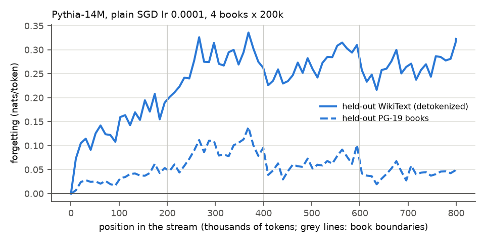

# E5: what does online learning cost in general knowledge? (claim C8)

**Question:** while Pythia-14M learns a stream of books online, how much does it lose on
held-out text it never trains on, in and out of the domain?

## Setup

- Pythia-14M, plain SGD on all parameters, lr 1e-4 (E0 pick), on main K = 1, main shuffled and
  very long (4 PG-19 test books x 200k tokens, book after book).
- Every 40 chunks a snapshot of the weights is scored frozen on two held-out sets:
  - **WikiText:** detokenized WikiText-103 test text, 76 chunks (outside the domain);
  - **held-out books:** 6 PG-19 validation books never read, 15 chunks each (inside the domain).
- Forgetting(t) = snapshot loss - pretrained loss on the held-out set (positive: knowledge
  lost). Last half: mean over the snapshots after half the stream; final: last snapshot. SE over
  the WikiText chunks, or over the 6 held-out books. Exchange rate = stream gain / last-half
  WikiText forgetting. `summary.csv`, `k1_vs_shuffled.csv`, `curve.csv`.

## Results

| stream | stream gain | WikiText, last half | WikiText, final | held-out books, last half | held-out books, final | exchange rate |
|---|---|---|---|---|---|---|
| K = 1 | +0.100 ± 0.006 | +0.196 ± 0.006 | +0.252 ± 0.007 | -0.006 ± 0.010* | -0.002 ± 0.009* | 0.51 |
| shuffled | +0.062 ± 0.003 | +0.112 ± 0.004 | +0.102 ± 0.005 | -0.045 ± 0.008 | -0.052 ± 0.008 | 0.55 |
| very long (4 x 200k) | +0.170 ± 0.011 | +0.268 ± 0.008 | +0.323 ± 0.009 | +0.052 ± 0.013 | +0.050 ± 0.022 | 0.63 |

\* under 2 SE. Pretrained losses: WikiText 4.633, held-out books 4.354 nats/token.

Shuffled - K = 1 (paired, last-half snapshots): WikiText -0.084 ± 0.003, held-out books
-0.040 ± 0.002.

## Findings

- Online learning forgets general text: on WikiText the last-half forgetting is about twice the
  stream gain (exchange rate 0.51 on K = 1: 0.51 nats gained per nat lost).
- In the domain it costs nothing on books read in order: held-out PG-19 books are unchanged
  (-0.006 ± 0.010); with shuffled chunks they even improve (-0.045 ± 0.008), as general PG-19
  adaptation.
- Locality costs general knowledge: K = 1 forgets more than shuffled on both held-out sets
  (WikiText +0.084 ± 0.003, books +0.040 ± 0.002), at about the same exchange rate.
- On the very long stream, forgetting keeps growing on WikiText (+0.323 at the end) and reaches
  the held-out books (+0.052 ± 0.013 last half), while the exchange rate is 0.63.

## Caveats

- One model, one rate, one seed; 6 held-out books only.
- Raw (un-detokenized) WikiText is not used: much of its forgetting was on formatting markers.

Same runs as old test 12 (14M full_1e-4): stream and snapshot losses identical in float16.
Runtime: K = 1 7 min, shuffled 25 min, very long 27 min, snapshots included (`runtime.txt`).
