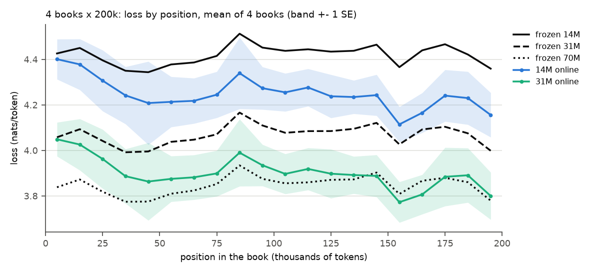

# E6: on very long books, how much of a bigger model's advantage does online learning buy? (claim C9)

**Question:** over 200k-token books, does Pythia-14M learning online reach frozen Pythia-31M, and
how does 31M learning online compare?

## Setup

- **Very long set:** the first 4 PG-19 test books with at least 200k tokens, cut to 200k (781
  chunks of 256 each), read book after book.
- **Runs:** frozen 14M, 31M and 70M; 14M (lr 1e-4) and 31M (lr 3e-4) plain SGD on all parameters
  at their E0 picks, one step per chunk.
- Gain over frozen 14M, SE over the 4 books; gap closed = (frozen 14M - run) / (frozen 14M -
  frozen 31M). `results.csv`, `pairs.csv` (paired per-book differences), `position.csv` (10k-token
  bins).

## Results

| run | loss | gain over frozen 14M | share of the 14M-31M gap |
|---|---|---|---|
| frozen 14M | 4.419 | | 0 |
| 14M online | 4.249 | +0.170 ± 0.011 | 0.49 |
| frozen 31M | 4.069 | +0.351 ± 0.010 | 1 |
| 31M online | 3.901 | +0.518 ± 0.013 | 1.48 |
| frozen 70M | 3.847 | +0.573 ± 0.013 | 1.63 |

| paired difference | mean ± SE |
|---|---|
| 14M online - frozen 14M | +0.170 ± 0.011 |
| 31M online - frozen 31M | +0.168 ± 0.013 |
| frozen 31M - 14M online (still ahead) | +0.180 ± 0.019 |
| 31M online - 14M online | +0.348 ± 0.013 |
| frozen 70M - 31M online (still ahead) | +0.054 ± 0.010 |

Share of the 14M-31M gap closed by 14M online, per 10k-token bin of the book: 0.07 in the first
10k, about 0.5 from 50k to 120k, 0.79 at its peak (160k-170k), 0.55-0.56 at the end.

## Findings

- Learning online, 14M closes about half of the gap to frozen 31M over 200k-token books (0.49),
  rising to 0.79 late in a book, but never reaches it (frozen 31M still ahead by +0.180 ± 0.019).
- 31M gains as much from online learning as 14M (+0.168 against +0.170), so it stays far ahead.
- 31M online gets most of the way to frozen 70M, but not all (70M ahead by +0.054 ± 0.010).

## Caveats

- 4 books, one seed; the gap share per bin is a ratio of 4-book means and is noisy.
- Each model uses its own picked rate; no other rule here (E7 compares rules on the main set).

Same runs as old test 10C: losses identical in float16.
Runtime: frozen 6-11 min, 14M online 27 min (snapshots on, shared with E5), 31M online 10 min
(`runtime.txt`).
