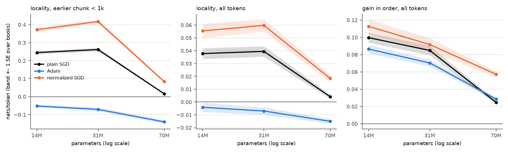

# E7: does the update rule decide whether there is a cache, and how does it scale? (claim C10)

**Question:** with plain SGD, Adam and per-tensor normalized SGD each tuned the same way, how
much in-order gain and locality do Pythia-14M, 31M and 70M get, and at what cost in general
knowledge?

## Setup

- **Step 1 (diagnostics):** plain SGD at each size's pick, first 40 chunks of main book 0; per
  tensor the relative update ||dW|| / ||W|| = lr ||g|| / ||W||. `diagnostics*.csv`,
  `plots/update_sizes.png`.
- **Step 2 (runs):** 3 sizes x {sgd: torch SGD; adam: Adam on all parameters; nsgd: each tensor's
  gradient divided by its own norm}, each at its val-pick rate (E0), on main K = 1 and shuffled,
  all parameters, one step per chunk, snapshots every 40 chunks (as E5).
- Gain over the model's own frozen loss, locality = in order - shuffled (paired), SE over books.
  Forgetting and exchange rate as in E5 (WikiText, last half). `results.csv`, `exchange.csv`.

## Results

| size | rule | lr | gain K = 1 | locality, all tokens | locality, < 1k | locality, 1k-10k same book | WikiText forgetting | exchange rate |
|---|---|---|---|---|---|---|---|---|
| 14M | sgd | 1e-4 | +0.100 ± 0.006 | +0.038 ± 0.004 | +0.245 ± 0.009 | +0.120 ± 0.007 | +0.196 ± 0.006 | 0.51 |
| 14M | adam | 3e-6 | +0.087 ± 0.005 | -0.004 ± 0.004* | -0.052 ± 0.009 | +0.038 ± 0.006 | +0.141 ± 0.005 | 0.61 |
| 14M | nsgd | 1e-4 | +0.113 ± 0.008 | +0.056 ± 0.006 | +0.373 ± 0.012 | +0.157 ± 0.008 | +0.316 ± 0.008 | 0.36 |
| 31M | sgd | 3e-4 | +0.085 ± 0.006 | +0.040 ± 0.004 | +0.262 ± 0.010 | +0.135 ± 0.006 | +0.228 ± 0.005 | 0.37 |
| 31M | adam | 3e-6 | +0.070 ± 0.004 | -0.007 ± 0.003 | -0.071 ± 0.011 | +0.027 ± 0.006 | +0.137 ± 0.004 | 0.51 |
| 31M | nsgd | 1e-4 | +0.092 ± 0.008 | +0.060 ± 0.005 | +0.418 ± 0.013 | +0.188 ± 0.008 | +0.348 ± 0.006 | 0.26 |
| 70M | sgd | 1e-5 | +0.025 ± 0.002 | +0.004 ± 0.002* | +0.016 ± 0.003 | +0.008 ± 0.003 | +0.010 ± 0.002 | 2.57 |
| 70M | adam | 3e-7 | +0.029 ± 0.002 | -0.015 ± 0.002 | -0.140 ± 0.010 | -0.044 ± 0.005 | +0.061 ± 0.003 | 0.47 |
| 70M | nsgd | 3e-6 | +0.057 ± 0.004 | +0.019 ± 0.003 | +0.084 ± 0.006 | +0.050 ± 0.003 | +0.039 ± 0.002 | 1.48 |

\* under 2 SE.

Relative update per step with plain SGD (all layers): MLP 1.2e-4 (14M), 9.9e-5 (31M), 1.1e-6
(70M); attention 4.1e-6, 8.2e-6, 3.8e-7; output embedding 7.2e-6, 1.8e-5, 4.2e-7.

## Findings

- **Plain SGD starves 70M's MLPs.** At its picked rate, the relative
  MLP update at 70M is about 100x smaller than at 14M and 31M (1.1e-6 against 1.2e-4 and 9.9e-5),
  and the cache nearly vanishes (locality +0.016 within 1k, against +0.245 at 14M).
- **Normalized SGD recovers part of it.** At 70M it more than doubles the gain (+0.057 against
  +0.025) and gives a clear but much smaller cache (+0.084 within 1k). At 14M and 31M it gives the
  largest cache of any rule (+0.373 and +0.418 within 1k), at the highest forgetting.
- **Adam produces no cache at any size:** its overall locality is about zero or negative and its
  locality within 1k is negative at 14M, 31M and 70M (-0.052, -0.071, -0.140); it learns about as
  much in order as shuffled. Only a small same-book effect is left at 1k-10k at 14M and 31M
  (+0.038, +0.027; -0.044 at 70M).
- **Smaller models do not pay more general knowledge per nat of gain:** with every rule tuned the
  same way, exchange rates are 0.36-0.61 at 14M, 0.26-0.51 at 31M and 0.47-2.57 at 70M.

## Caveats

- One seed, one pick stream per (size, rule); 70M's sgd and Adam gains are small, so their
  exchange rates are ratios of small numbers.
- Adam's moments start fresh at the start of the stream and are kept across books.

Same runs as old test 13 (stream losses identical in float16; diagnostics identical). Exchange
rates here use every snapshot (every 40 chunks); on test 13's grid (every 80) they equal test
13's, and the two differ by at most 0.01 except 70M sgd (2.57 against 2.68).
Runtime: 8 h 29 min of process time for the 18 runs, run 3 at a time; diagnostics 1 min
(`runtime.txt`, `runtime_diag.txt`).
