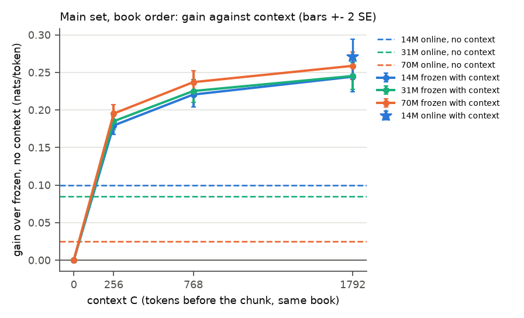
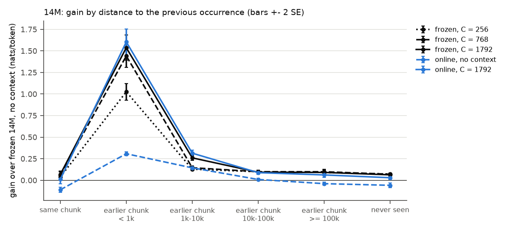

# E8: more context, less cache (claim C11)

**Question:** the other experiments score each chunk with no earlier context, so that any help from
earlier chunks must come through the weights. With up to 1792 tokens of the preceding text in the
input, do the weights still hold a memory beyond what the input contains, and how large is it?
This is a control on the main design, not a new main setup.

## Setup

- **Context:** each chunk (book b, chunk k) is scored with the last C tokens of the same book before
  it (chunks[b, :k] concatenated) in front of it; only the chunk's tokens are scored, and its first
  token stays unscored, so the scored tokens are exactly those of the registry runs and every
  comparison is paired per token. Context never crosses a book boundary (a book's first chunks get
  less). C = 0, 256, 768, 1792; 1792 + 256 = 2048 = Pythia's `max_position_embeddings` (asserted).
- **Frozen runs:** main set in book order (K = 1), Pythia-14M / 31M / 70M at each C; very long set
  (4 x 200k), 14M and 31M at C = 1792.
- **Online with context:** Pythia-14M, plain SGD on all parameters, lr 1e-4 (E0 pick, made without
  context), K = 1, C = 1792: each chunk is scored with its context, then one step on the mean loss
  of the chunk's scored tokens (context tokens are input, not loss); reset at the start.
- **Checks:** C = 0 reproduces the registry frozen runs exactly (all three sizes, float16
  identical); batched against one-at-a-time scoring of a few chunks per run, identical (chunks are
  batched by context length, no padding); the online-with-context code at C = 0 reproduces the
  first 20 chunks of the registry online run exactly.
- Gain = frozen loss with no context - run loss, same tokens, SE over books (paired). Distance bins
  as in E1; `window.csv` splits the earlier-chunk tokens at 2048 tokens back, the farthest the input
  at C = 1792 reaches. Runs in `runs/` (layout of `runs.py`); tables: `results.csv`,
  `distance.csv`, `window.csv`, `verylong.csv`.

## Results (gain over frozen with no context, nats/token, ± SE over books)

Main set, K = 1:

| model | C = 256 | C = 768 | C = 1792 | online, no context |
|---|---|---|---|---|
| 14M | +0.179 ± 0.006 | +0.221 ± 0.008 | +0.244 ± 0.010 | +0.100 ± 0.006 |
| 31M | +0.185 ± 0.006 | +0.225 ± 0.008 | +0.245 ± 0.009 | +0.085 ± 0.006 |
| 70M | +0.195 ± 0.006 | +0.237 ± 0.008 | +0.259 ± 0.009 | +0.025 ± 0.002 |

14M online with context (C = 1792): +0.271 ± 0.011, that is **+0.027 ± 0.003** over frozen 14M
with the same context.

Pythia-14M by distance to the previous occurrence (`distance.csv`, `window.csv`):

| bin | frozen, C = 1792 | online, no context | online, C = 1792 | online - frozen, both C = 1792 |
|---|---|---|---|---|
| same chunk | +0.068 ± 0.020 | -0.111 ± 0.014 | +0.012 ± 0.026 | -0.056 ± 0.011 |
| earlier chunk, < 1k | +1.537 ± 0.073 | +0.307 ± 0.011 | +1.604 ± 0.076 | +0.067 ± 0.009 |
| earlier chunk, 1k-10k | +0.260 ± 0.015 | +0.144 ± 0.008 | +0.314 ± 0.017 | +0.054 ± 0.005 |
| earlier chunk, 10k-100k | +0.093 ± 0.008 | +0.009 ± 0.006 | +0.088 ± 0.010 | -0.005 ± 0.005 |
| earlier chunk, >= 100k | +0.091 ± 0.015 | -0.039 ± 0.009 | +0.062 ± 0.015 | -0.029 ± 0.007 |
| never seen | +0.063 ± 0.007 | -0.059 ± 0.013 | +0.030 ± 0.011 | -0.034 ± 0.009 |
| same book, 1k-2048 back | +0.647 ± 0.048 | +0.224 ± 0.010 | +0.732 ± 0.051 | +0.084 ± 0.008 |
| same book, >= 2048 back | +0.136 ± 0.011 | +0.115 ± 0.008 | +0.177 ± 0.013 | **+0.041 ± 0.006** |
| earlier book, >= 2048 back | +0.093 ± 0.007 | -0.002 ± 0.006 | +0.083 ± 0.009 | -0.010 ± 0.005 |

Very long set (4 x 200k, `verylong.csv`):

| run | loss | gain over frozen 14M, no context |
|---|---|---|
| frozen 14M, no context | 4.419 | |
| 14M online, no context (E6) | 4.249 | +0.170 ± 0.011 |
| frozen 14M, C = 1792 | 4.180 | +0.239 ± 0.013 |
| frozen 31M, no context | 4.069 | +0.351 ± 0.010 |
| frozen 31M, C = 1792 | 3.819 | +0.601 ± 0.013 |

Share of the frozen 14M - frozen 31M gap (0.351 nats without context, 0.362 with C = 1792):
closed by 14M online without context 0.49 (E6, gap without context); by context alone (frozen 14M
at C = 1792) 0.68; by 14M online without context measured against the context baselines -0.19.
Paired: frozen 14M at C = 1792 is ahead of 14M online without context by +0.069 ± 0.005; frozen 31M
without context is ahead of frozen 14M at C = 1792 by +0.112 ± 0.020.

## Findings

- With 1792 tokens of context in the input, the weights still hold a memory beyond it: tokens whose
  previous occurrence is in the same book at least 2048 tokens back gain +0.041 ± 0.006 from online
  learning over the frozen model with the same context, about a third of the +0.115 ± 0.008 that
  online learning gives there without context. Across books there is none (-0.010 ± 0.005).
- Overall, online learning on top of full context adds +0.027 ± 0.003, about a quarter of its gain
  without context (+0.100); the costs on same-chunk, never-seen and >= 100k tokens remain.
- A plausible explanation, not tested here: less is written into the weights when the input
  already predicts the text well (a smaller loss gives a smaller gradient). The experiment does not
  separate this from plain overlap (part of what the weights would hold is now also in the input),
  and the learning rate was picked without context.
- Context helps every size about equally (+0.24 to +0.26 at C = 1792), while the online gain without
  context falls with size; the 14M - 31M gap barely changes with context (0.351 to 0.362 nats).
- On the very long books, C9 (14M online closes 49% of the gap to frozen 31M) holds only against
  baselines without context: frozen 14M with 1792 tokens of context alone closes 68% of that gap,
  and 14M online without context stays below it.

## Caveats

- The learning rate (1e-4) was picked on val-pick without context; a rate picked with context
  might give a different online gain on top of it.
- Context never crosses a book boundary, so the first chunks of each book get less context (the
  first chunk none).
- Only 4 very long books; the gap shares are ratios of 4-book means and have no SE (the paired
  differences do).
- Online with context was run only for 14M on the main set in book order (no 31M / 70M, no very
  long books, no shuffled control, so no locality gain with context).
- The protocol is 1792 tokens of context plus a 256-token chunk, with updates on the chunk's tokens
  only; it is not dynamic evaluation on 2048-token chunks.
- Online runs are numerically sensitive: a ~2e-4 difference in the loss computation grows to
  ~0.9 nats on single tokens within 20 chunks, though the mean loss is unchanged to 4 decimals.
- One seed.

Runtime: frozen main set 1.4-5.5 min per run (C = 1792: 14M 2 min, 31M 3 min, 70M 5.5 min),
very long 3.5 and 6 min, 14M online with context 3.3 min; about 41 min in all (`runtime.txt`).
