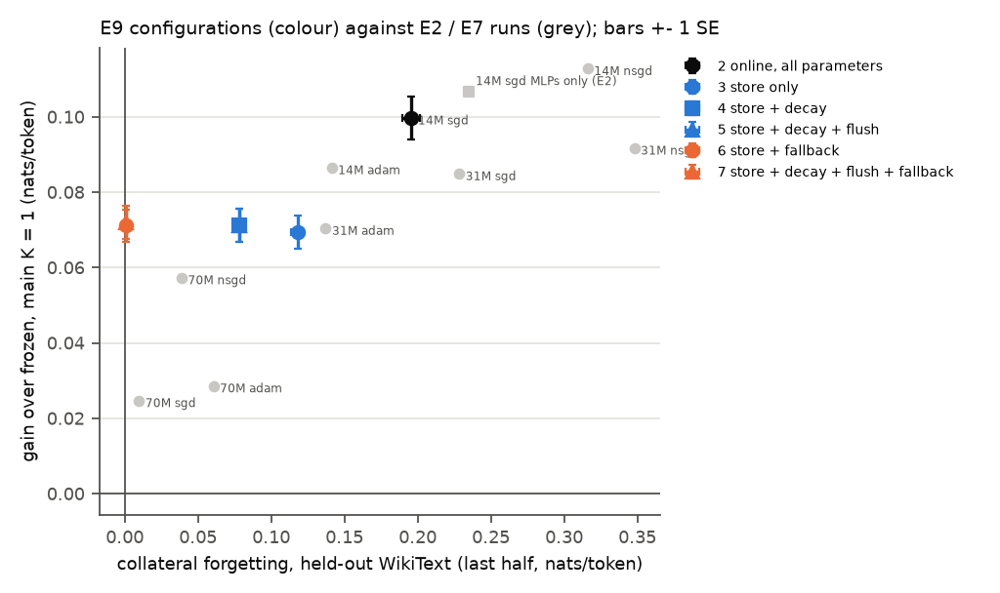
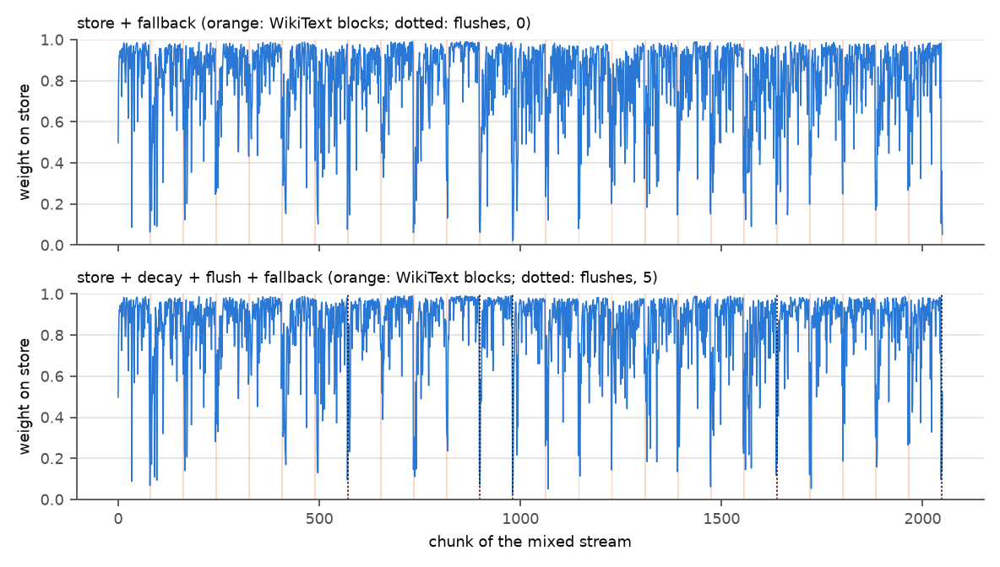
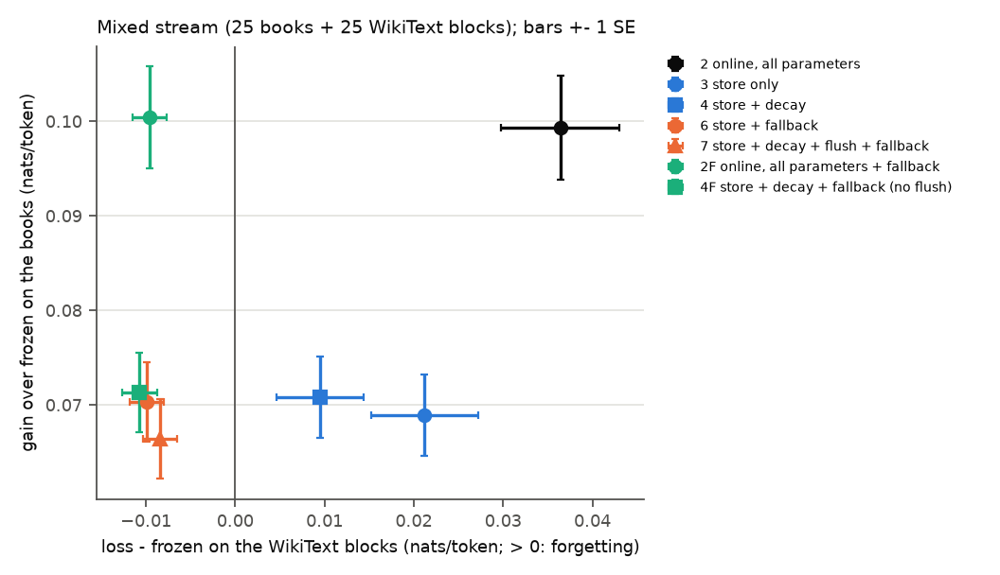

# E9: managed cache and fallback (not in the paper)

Exploratory follow-up to the paper's open question on decoupling the cache from general knowledge; it
is not part of the paper's claims.

**Question:** can the cache be kept while avoiding collateral forgetting?

## Setup

- Pythia-14M, the paper's protocol: 256-token chunks scored with no earlier context, one update per
  chunk after scoring it.
- **Configurations:**
  - 2: online, plain SGD on all parameters, lr 1e-4 (registry runs);
  - 3: **store**: only the MLP of layer 2 (`mlp@1`, E2's single layer with the most gain at 1k-10k
    same book) learns, as a delta D over the frozen weights (D = 0 at the start), plain SGD, lr 1e-3;
  - 4: store + **decay** (D <- (1 - lam) D after each step, lam 1e-3);
  - 5: store + decay + **flush** (D = 0 when the store's loss exceeds frozen by more than 0.05 on
    average over the last 2 chunks);
  - 6 / 7: the store (3) / store + decay + flush (5) with a **fallback**: each token is predicted by a
    fixed-share mixture (Herbster & Warmuth 1998) of the online expert and the frozen model, weight
    updated token by token (alpha 1e-3), and the mixture is what is scored. The store always learns on
    its own loss, so the mixer does not change it;
  - offline (`e9_offline.py`): **2F** = all parameters + fallback, **4F** = store + decay + fallback
    (no flush), alpha 1e-3 each.
- **Streams:** main K = 1 and shuffled (registry), and a **mixed** stream: the 25 main books in order,
  each followed by 4 chunks of WikiText-103 validation (2,050 chunks). Loss - frozen on its WikiText
  blocks measures forgetting while reading. Held-out forgetting as E5 (snapshots every 40 chunks, on
  main K = 1 and mixed).
- **Picks:** on a validation mixed stream only (the 10 val-pick books, each followed by 4 chunks of
  WikiText-103 train), by mean loss over all its tokens: lam, flush threshold and window, alpha
  (`grid_*.csv`, `picks.json`, `offline_grid_alpha.csv`, `offline_picks.json`). Learning rates are
  the E0 picks.
- **Offline configurations:** the mixer applied to saved float16 per-token losses (the online run's
  and the frozen run's). Check (`offline_check.txt`): recomputing 6 and 7 this way reproduces E9's
  gains and WikiText-block means within 5e-5; per token they differ by up to 0.03 nats, because the
  float16 rounding of the inputs is carried by the mixer weight.
- **Checks** (`check.txt`): the store with lam = 0, no flush and no mixer reproduces the registry
  `mlp@1` run exactly; the mixer forced to frozen reproduces the frozen run exactly; the mixer passes
  synthetic tests (Bayesian mixture at alpha = 0, convergence, recovery after a switch).

## Results (gain over frozen on the book chunks, nats/token, ± SE over books)

| configuration | gain, K = 1 | locality | gain, mixed books | WikiText blocks, loss - frozen |
|---|---|---|---|---|
| 2 all parameters | +0.100 ± 0.006 | +0.038 ± 0.004 | +0.099 ± 0.006 | +0.036 ± 0.007 |
| 2F all parameters + fallback | +0.101 ± 0.006 | +0.039 ± 0.004 | +0.100 ± 0.005 | -0.010 ± 0.002 |
| 4 store + decay | +0.071 ± 0.004 | +0.034 ± 0.003 | +0.071 ± 0.004 | +0.010 ± 0.005 |
| 4F store + decay + fallback | +0.072 ± 0.004 | +0.035 ± 0.003 | +0.071 ± 0.004 | -0.011 ± 0.002 |
| 6 store + fallback | +0.071 ± 0.004 | +0.028 ± 0.003 | +0.070 ± 0.004 | -0.010 ± 0.002 |
| 7 store + decay + flush + fallback | +0.072 ± 0.004 | +0.041 ± 0.003* | +0.066 ± 0.004 | -0.008 ± 0.002 |

WikiText-block SEs are over the 25 blocks. \* Inflated: 7 never flushes on K = 1, but flushed once on
the shuffled stream. Store only (3): +0.069 ± 0.004 on K = 1, +0.021 ± 0.006 on the WikiText blocks.
Held-out WikiText forgetting (last half, K = 1): 2 +0.196, 3 +0.118, 4 +0.078, 6 and 7 +0.001
(`table.csv`).

Paired differences (`offline_paired.csv`):

| comparison | gain, K = 1 | gain, mixed books | WikiText blocks |
|---|---|---|---|
| 2F - 4F | +0.029 ± 0.002 | +0.029 ± 0.002 | +0.001 ± 0.001 |
| 2F - 7 | +0.029 ± 0.002 | +0.034 ± 0.002 | -0.001 ± 0.001 |
| 4F - 7 | 0 (identical) | +0.005 ± 0.001 | -0.002 ± 0.001 |

Mixer weight on the online expert, mixed stream (`mixer.csv`, `offline_mixer.csv`):

| configuration | books | WikiText blocks | first 4 chunks of a book | last 4 chunks of a book |
|---|---|---|---|---|
| 2F | 0.87 | 0.36 | 0.59 | 0.93 |
| 4F | 0.86 | 0.47 | 0.62 | 0.92 |
| 6 | 0.83 | 0.40 | 0.57 | 0.90 |
| 7 | 0.86 | 0.47 | 0.58 | 0.93 |





## Findings

- The fallback removes forgetting at the output whichever learner it sits on: with it, the WikiText
  blocks are slightly better than frozen (-0.008 to -0.011) instead of worse (+0.036 for all
  parameters, +0.021 for the store alone).
- With the fallback, the all-parameters learner keeps its full gain (+0.101) and beats the one-layer
  store by about 0.03 nats/token (2F - 4F +0.029 ± 0.002), with the same WikiText blocks. The separate
  store adds no quality, only a memory saving: one MLP layer instead of a second full copy of the model.
- Decay helps the store alone: held-out WikiText forgetting +0.118 to +0.078 at the same gain.
- Flush adds nothing: it never fires on K = 1, and on the mixed stream 4F (no flush) is slightly
  better than 7 (+0.005 ± 0.001 on the books).
- The mixer does what it should: weight on the online expert rises within a book (0.6 to 0.9) and
  drops on WikiText (0.36 for 2F). But the fallback hides forgetting at the output; it does not
  prevent it in the online model's weights.

## Caveats

- Held-out snapshot forgetting is near zero by construction for any fallback system (the mixer,
  started fresh, falls back to frozen within a few tokens); the in-stream WikiText blocks are the
  fair measure.
- The fallback doubles inference compute: two forward passes per chunk (frozen and online).
- 14M only, one seed, one layer for the store.
- WikiText is 5% of the mixed stream, with SEs over only 25 blocks; the validation objective is
  therefore dominated by books, and the flush and alpha picks are near ties.
- Offline configurations (2F, 4F) use float16 inputs.
- Learning rates are not re-picked (E0 picks); only lam, flush and alpha are.

## How to run (from `experiments/`)

```
../venv/bin/python e9_managed_cache/e9_managed_cache.py check     # store and mixer checks
../venv/bin/python e9_managed_cache/e9_managed_cache.py pick      # validation grids
../venv/bin/python e9_managed_cache/e9_managed_cache.py run all   # test runs (jobs can run in parallel)
../venv/bin/python e9_managed_cache/e9_managed_cache.py report
../venv/bin/python e9_managed_cache/e9_offline.py check           # offline 6 / 7 against E9
../venv/bin/python e9_managed_cache/e9_offline.py pick            # alpha for 2F, 4F (3 small validation runs)
../venv/bin/python e9_managed_cache/e9_offline.py report
```

Runtime: validation grids 9 min; test runs 2-16 min each (13-16 min with snapshots), 108 min of
process time in all (two jobs in parallel); offline validation runs 1.5 min, the rest
seconds (`runtime.txt`, `offline_runtime.txt`).
