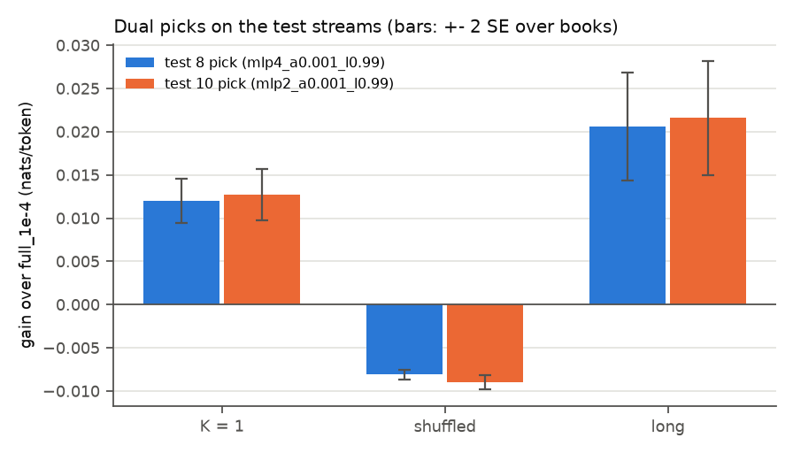
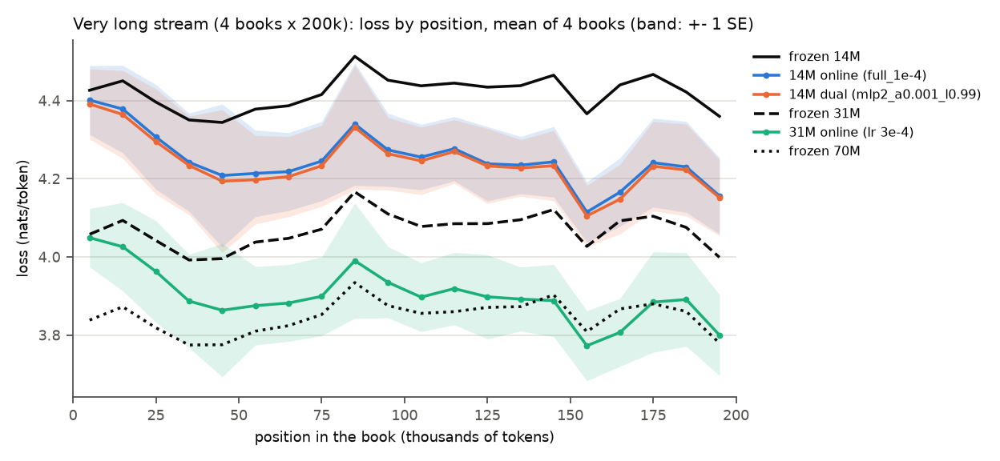

# Test 10: follow-ups (error bars, a wider dual grid, longer contexts)

**Questions.**
- **A:** which of the earlier comparisons are larger than their uncertainty across books?
- **B:** does a wider grid find a better dual config than test 8's?
- **C:** with 200k-token books, does Pythia-14M learning online reach a frozen Pythia-31M, and how
  does it compare with 31M learning online?

**Answers.**
- **A: most comparisons hold, some small ones do not.** Test 8's dual advantage is well beyond
  noise (+0.012 ± 0.001 on K = 1, +0.021 ± 0.003 on long, -0.008 ± 0.000 on shuffled). Three
  earlier statements are within 2 SE:
  - online + cache vs online overall (+0.002 ± 0.002);
  - 31M vs 14M locality overall (+0.000 ± 0.001; on same-book tokens 31M is ahead, +0.018 ± 0.004);
  - the layer-4 MLP vs the full learner on same-book tokens (+0.008 ± 0.006).
- **B: no better config.** The pick is layer 2's MLP (alpha 1e-3, lambda 0.99). It ties test 8's
  layer-4 pick: within 0.001 nats/token overall on every test stream, against +0.013 ± 0.002 (K =
  1), +0.022 ± 0.003 (long) and -0.009 ± 0.000 (shuffled) over `full_1e-4`. A smaller alpha (3e-4)
  costs almost nothing on shuffled but gains less on K = 1.
- **C: no.** Over 200k-token books, 14M learning online closes 49% of the gap to frozen 31M (51%
  with the dual config), and at most 84% in any 10k-token stretch; it is above frozen 31M at every
  position. 31M learning online (lr 3e-4) gains about as much as 14M does (+0.168 against +0.170),
  so it stays far ahead (by 0.348 ± 0.013), and late in the books it comes close to frozen 70M.

## Part A: error bars (reanalysis, no new runs)

**Method.** For each run, the gain over frozen 14M is computed per book (mean over that book's
scored tokens); the table gives the mean and the standard error over books (SE = sd / sqrt(books)).
Comparisons of two runs on the same chunks use the paired per-book differences. Two bins, as in
tests 5 and 7:
- **same book < 10k:** previous occurrence of the token id in an earlier chunk of the same book,
  under 10k tokens back;
- **never seen:** first occurrence (in stream order for tests 1, 4 and 6; in book order for tests 7
  and 8).

The 1000 most frequent ids are excluded from both bins, and only books with at least 50 tokens in
a bin count. No book was dropped: every row has 25 books (5 on the long stream). Tokens of a shuffled
stream are assigned to their book as usual. Test 7's K = 5 and K = 25 runs saved no per-token
losses, so they have no SE here.

**Book-weighted means.** These means weight every book equally. For all tokens they match the
earlier token-level means, since the books are the same length. For the bins they can differ:
never-seen tokens are concentrated in the first books of the stream, so the book-weighted
never-seen gains are more negative than the token-level ones. For example, `full_1e-4` on K = 1 is
-0.092 book-weighted against -0.059 token-weighted.

`errorbars.csv` holds all 249 rows. In the tables below, * marks a comparison whose difference is
under 2 SE.

**Test 1**

| stream | comparison | all tokens | same book < 10k | never seen | books |
|---|---|---|---|---|---|
| stream | online - frozen | +0.099 ± 0.006 | +0.204 ± 0.009 | -0.097 ± 0.013 | 25 / 25 / 25 |

**Test 4**

| stream | comparison | all tokens | same book < 10k | never seen | books |
|---|---|---|---|---|---|
| stream | shuffled - frozen | +0.061 ± 0.003 | +0.044 ± 0.005 | -0.084 ± 0.011 | 25 / 25 / 25 |
| stream | mlp - frozen | +0.085 ± 0.005 | +0.158 ± 0.007 | -0.084 ± 0.011 | 25 / 25 / 25 |
| stream | attention - frozen | +0.061 ± 0.004 | +0.110 ± 0.007 | -0.085 ± 0.011 | 25 / 25 / 25 |
| stream | online_cache - frozen | +0.102 ± 0.007 | +0.373 ± 0.017 | -0.148 ± 0.013 | 25 / 25 / 25 |
| stream | unigram - frozen | +0.017 ± 0.003 | +0.212 ± 0.015 | -0.051 ± 0.000 | 25 / 25 / 25 |
| stream | output_lr3e-3 - frozen | +0.072 ± 0.005 | +0.138 ± 0.009 | -0.192 ± 0.012 | 25 / 25 / 25 |
| stream | locality (online - shuffled) | +0.038 ± 0.004 | +0.160 ± 0.008 | -0.012 ± 0.009 * | 25 / 25 / 25 |
| stream | online_cache - online | +0.002 ± 0.002 * | +0.168 ± 0.012 | -0.051 ± 0.000 | 25 / 25 / 25 |
| stream | online_cache - unigram | +0.085 ± 0.005 | +0.161 ± 0.007 | -0.097 ± 0.013 | 25 / 25 / 25 |
| stream | mlp - attention | +0.024 ± 0.001 | +0.049 ± 0.004 | +0.000 ± 0.004 * | 25 / 25 / 25 |

**Test 6**

| stream | comparison | all tokens | same book < 10k | never seen | books |
|---|---|---|---|---|---|
| stream | 31M online - frozen | +0.085 ± 0.005 | +0.241 ± 0.011 | -0.058 ± 0.012 | 25 / 25 / 25 |
| stream | 31M locality | +0.039 ± 0.004 | +0.179 ± 0.007 | -0.023 ± 0.009 | 25 / 25 / 25 |
| stream | 70M online - frozen | +0.024 ± 0.002 | +0.039 ± 0.004 | -0.055 ± 0.007 | 25 / 25 / 25 |
| stream | 70M locality | +0.004 ± 0.002 | +0.012 ± 0.002 | -0.017 ± 0.004 | 25 / 25 / 25 |
| stream | 31M locality - 14M locality | +0.000 ± 0.001 * | +0.018 ± 0.004 | -0.011 ± 0.007 * | 25 / 25 / 25 |
| stream | mlp_l1 - frozen | +0.052 ± 0.004 | +0.154 ± 0.008 | -0.088 ± 0.011 | 25 / 25 / 25 |
| stream | mlp_l1 - online (all params) | -0.048 ± 0.003 | -0.050 ± 0.007 | +0.009 ± 0.009 * | 25 / 25 / 25 |
| stream | mlp_l2 - frozen | +0.055 ± 0.007 | +0.225 ± 0.013 | -0.172 ± 0.015 | 25 / 25 / 25 |
| stream | mlp_l2 - online (all params) | -0.044 ± 0.003 | +0.020 ± 0.008 | -0.076 ± 0.009 | 25 / 25 / 25 |
| stream | mlp_l3 - frozen | +0.055 ± 0.004 | +0.129 ± 0.007 | -0.087 ± 0.011 | 25 / 25 / 25 |
| stream | mlp_l3 - online (all params) | -0.044 ± 0.002 | -0.075 ± 0.005 | +0.010 ± 0.006 * | 25 / 25 / 25 |
| stream | mlp_l4 - frozen | +0.067 ± 0.006 | +0.212 ± 0.011 | -0.150 ± 0.013 | 25 / 25 / 25 |
| stream | mlp_l4 - online (all params) | -0.032 ± 0.002 | +0.008 ± 0.006 * | -0.053 ± 0.005 | 25 / 25 / 25 |
| stream | mlp_l5 - frozen | +0.072 ± 0.006 | +0.177 ± 0.010 | -0.129 ± 0.015 | 25 / 25 / 25 |
| stream | mlp_l5 - online (all params) | -0.027 ± 0.002 | -0.027 ± 0.004 | -0.033 ± 0.005 | 25 / 25 / 25 |
| stream | mlp_l6 - frozen | +0.047 ± 0.004 | +0.071 ± 0.006 | -0.121 ± 0.012 | 25 / 25 / 25 |
| stream | mlp_l6 - online (all params) | -0.052 ± 0.002 | -0.134 ± 0.006 | -0.024 ± 0.006 | 25 / 25 / 25 |
| stream | mlp_last2 - frozen | +0.070 ± 0.006 | +0.145 ± 0.008 | -0.136 ± 0.015 | 25 / 25 / 25 |
| stream | mlp_last2 - online (all params) | -0.029 ± 0.001 | -0.059 ± 0.004 | -0.039 ± 0.006 | 25 / 25 / 25 |

**Test 7**

| stream | comparison | all tokens | same book < 10k | never seen | books |
|---|---|---|---|---|---|
| long | fast4_d0.9 - frozen | -0.046 ± 0.019 | +0.109 ± 0.017 | -0.177 ± 0.019 | 5 / 5 / 5 |
| long | fast4_d0.9 - full_1e-4 | -0.222 ± 0.017 | -0.125 ± 0.024 | -0.076 ± 0.020 | 5 / 5 / 5 |
| long | fast4_d0.99 - frozen | +0.097 ± 0.023 | +0.292 ± 0.032 | -0.231 ± 0.034 | 5 / 5 / 5 |
| long | fast4_d0.99 - full_1e-4 | -0.080 ± 0.008 | +0.058 ± 0.025 | -0.131 ± 0.012 | 5 / 5 / 5 |
| long | full_1e-4 - frozen | +0.176 ± 0.023 | +0.234 ± 0.031 | -0.100 ± 0.037 | 5 / 5 / 5 |
| long | mlp4_1e-2 - frozen | +0.131 ± 0.030 | +0.306 ± 0.048 | -0.320 ± 0.043 | 5 / 5 / 5 |
| long | mlp4_1e-2 - full_1e-4 | -0.045 ± 0.011 | +0.073 ± 0.033 | -0.220 ± 0.011 | 5 / 5 / 5 |
| long | mlp4_3e-3 - frozen | +0.147 ± 0.023 | +0.241 ± 0.034 | -0.180 ± 0.041 | 5 / 5 / 5 |
| long | mlp4_3e-3 - full_1e-4 | -0.029 ± 0.006 | +0.007 ± 0.013 * | -0.080 ± 0.011 | 5 / 5 / 5 |
| long | frozen 31m - frozen 14M | +0.354 ± 0.020 | +0.486 ± 0.026 | +0.433 ± 0.018 | 5 / 5 / 5 |
| long | frozen 70m - frozen 14M | +0.572 ± 0.031 | +0.818 ± 0.040 | +0.807 ± 0.019 | 5 / 5 / 5 |
| K1 | fast4_d0.9 - frozen | -0.099 ± 0.011 | +0.136 ± 0.016 | -0.189 ± 0.013 | 25 / 25 / 25 |
| K1 | fast4_d0.9 - full_1e-4 | -0.199 ± 0.009 | -0.071 ± 0.011 | -0.097 ± 0.014 | 25 / 25 / 25 |
| K1 | fast4_d0.99 - frozen | +0.008 ± 0.013 * | +0.291 ± 0.021 | -0.229 ± 0.017 | 25 / 25 / 25 |
| K1 | fast4_d0.99 - full_1e-4 | -0.092 ± 0.009 | +0.084 ± 0.015 | -0.137 ± 0.013 | 25 / 25 / 25 |
| K1 | full_1e-4 - frozen | +0.100 ± 0.006 | +0.207 ± 0.009 | -0.092 ± 0.013 | 25 / 25 / 25 |
| K1 | mlp4_1e-2 - frozen | +0.018 ± 0.013 * | +0.262 ± 0.020 | -0.284 ± 0.016 | 25 / 25 / 25 |
| K1 | mlp4_1e-2 - full_1e-4 | -0.082 ± 0.009 | +0.056 ± 0.015 | -0.192 ± 0.013 | 25 / 25 / 25 |
| K1 | mlp4_3e-3 - frozen | +0.067 ± 0.006 | +0.211 ± 0.011 | -0.148 ± 0.013 | 25 / 25 / 25 |
| K1 | mlp4_3e-3 - full_1e-4 | -0.032 ± 0.002 | +0.005 ± 0.006 * | -0.056 ± 0.006 | 25 / 25 / 25 |
| K1 | frozen 31m - frozen 14M | +0.353 ± 0.007 | +0.479 ± 0.013 | +0.462 ± 0.016 | 25 / 25 / 25 |
| K1 | frozen 70m - frozen 14M | +0.575 ± 0.009 | +0.820 ± 0.019 | +0.858 ± 0.023 | 25 / 25 / 25 |
| shuffled | fast4_d0.9 - frozen | -0.190 ± 0.005 | -0.182 ± 0.006 | -0.231 ± 0.010 | 25 / 25 / 25 |
| shuffled | fast4_d0.9 - full_1e-4 | -0.252 ± 0.004 | -0.227 ± 0.005 | -0.149 ± 0.011 | 25 / 25 / 25 |
| shuffled | fast4_d0.99 - frozen | -0.108 ± 0.004 | -0.153 ± 0.007 | -0.247 ± 0.013 | 25 / 25 / 25 |
| shuffled | fast4_d0.99 - full_1e-4 | -0.170 ± 0.002 | -0.198 ± 0.004 | -0.165 ± 0.011 | 25 / 25 / 25 |
| shuffled | full_1e-4 - frozen | +0.062 ± 0.003 | +0.045 ± 0.005 | -0.082 ± 0.009 | 25 / 25 / 25 |
| shuffled | mlp4_1e-2 - frozen | -0.051 ± 0.004 | -0.079 ± 0.009 | -0.252 ± 0.013 | 25 / 25 / 25 |
| shuffled | mlp4_1e-2 - full_1e-4 | -0.113 ± 0.003 | -0.123 ± 0.006 | -0.170 ± 0.009 | 25 / 25 / 25 |
| shuffled | mlp4_3e-3 - frozen | +0.021 ± 0.003 | +0.004 ± 0.006 * | -0.125 ± 0.009 | 25 / 25 / 25 |
| shuffled | mlp4_3e-3 - full_1e-4 | -0.041 ± 0.001 | -0.041 ± 0.003 | -0.043 ± 0.006 | 25 / 25 / 25 |
| shuffled | frozen 31m - frozen 14M | +0.353 ± 0.007 | +0.479 ± 0.013 | +0.462 ± 0.016 | 25 / 25 / 25 |
| shuffled | frozen 70m - frozen 14M | +0.575 ± 0.009 | +0.820 ± 0.019 | +0.858 ± 0.023 | 25 / 25 / 25 |

**Test 8**

| stream | comparison | all tokens | same book < 10k | never seen | books |
|---|---|---|---|---|---|
| K1 | full_1e-4 - frozen | +0.100 ± 0.006 | +0.207 ± 0.009 | -0.092 ± 0.013 | 25 / 25 / 25 |
| K1 | mlp4_a0.001_l0.9 - frozen | +0.106 ± 0.006 | +0.234 ± 0.010 | -0.094 ± 0.013 | 25 / 25 / 25 |
| K1 | mlp4_a0.001_l0.9 - full_1e-4 | +0.006 ± 0.001 | +0.027 ± 0.002 | -0.002 ± 0.002 * | 25 / 25 / 25 |
| K1 | mlp4_a0.001_l0.99 - frozen | +0.112 ± 0.007 | +0.264 ± 0.011 | -0.098 ± 0.014 | 25 / 25 / 25 |
| K1 | mlp4_a0.001_l0.99 - full_1e-4 | +0.012 ± 0.001 | +0.058 ± 0.004 | -0.006 ± 0.003 | 25 / 25 / 25 |
| shuffled | full_1e-4 - frozen | +0.062 ± 0.003 | +0.045 ± 0.005 | -0.082 ± 0.009 | 25 / 25 / 25 |
| shuffled | mlp4_a0.001_l0.9 - frozen | +0.057 ± 0.003 | +0.040 ± 0.005 | -0.086 ± 0.009 | 25 / 25 / 25 |
| shuffled | mlp4_a0.001_l0.9 - full_1e-4 | -0.005 ± 0.000 | -0.005 ± 0.001 | -0.004 ± 0.002 | 25 / 25 / 25 |
| shuffled | mlp4_a0.001_l0.99 - frozen | +0.054 ± 0.003 | +0.036 ± 0.005 | -0.094 ± 0.010 | 25 / 25 / 25 |
| shuffled | mlp4_a0.001_l0.99 - full_1e-4 | -0.008 ± 0.000 | -0.009 ± 0.001 | -0.012 ± 0.003 | 25 / 25 / 25 |
| long | full_1e-4 - frozen | +0.176 ± 0.023 | +0.234 ± 0.031 | -0.100 ± 0.037 | 5 / 5 / 5 |
| long | mlp4_a0.001_l0.9 - frozen | +0.183 ± 0.023 | +0.257 ± 0.030 | -0.099 ± 0.038 | 5 / 5 / 5 |
| long | mlp4_a0.001_l0.9 - full_1e-4 | +0.007 ± 0.001 | +0.023 ± 0.002 | +0.001 ± 0.002 * | 5 / 5 / 5 |
| long | mlp4_a0.001_l0.99 - frozen | +0.197 ± 0.025 | +0.290 ± 0.033 | -0.103 ± 0.036 | 5 / 5 / 5 |
| long | mlp4_a0.001_l0.99 - full_1e-4 | +0.021 ± 0.003 | +0.056 ± 0.004 | -0.002 ± 0.004 * | 5 / 5 / 5 |
| K1 vs shuffled | full_1e-4 locality | +0.038 ± 0.004 | +0.162 ± 0.008 | -0.011 ± 0.010 * | 25 / 25 / 25 |
| K1 vs shuffled | mlp4_a0.001_l0.9 locality | +0.049 ± 0.004 | +0.194 ± 0.009 | -0.008 ± 0.010 * | 25 / 25 / 25 |
| K1 vs shuffled | mlp4_a0.001_l0.99 locality | +0.058 ± 0.005 | +0.228 ± 0.010 | -0.004 ± 0.012 * | 25 / 25 / 25 |
| K1 vs shuffled | mlp4_a0.001_l0.9 locality - full_1e-4 locality | +0.011 ± 0.001 | +0.032 ± 0.002 | +0.003 ± 0.003 * | 25 / 25 / 25 |
| K1 vs shuffled | mlp4_a0.001_l0.99 locality - full_1e-4 locality | +0.020 ± 0.001 | +0.067 ± 0.004 | +0.006 ± 0.004 * | 25 / 25 / 25 |

## Part B: a wider dual grid

**Configs** (rule of test 8, `dual.py`: slow part plain SGD at lr 1e-4 on all parameters, fast part
on one MLP's two weight matrices):
- layer 4 MLP: alpha 3e-4, lambda 0.99 and 0.9;
- layer 2 MLP: alpha 1e-3 and 3e-4, each with lambda 0.99;
- test 8's pick, rerun for reference (it reproduced test 8's validation losses exactly).

**Pick:** the best on val-pick K = 1 among all dual configs of tests 8 and 10. If the pick is at an
edge of the values tried for its layer, the grid is extended once by one step outward in each such
direction: alpha on the 1-3-10 ladder; lambda on 0.5, 0.9, 0.99, 0.999. For layer 2 only lambda
0.99 had been tried, so lambda was extended both up (0.999) and down (0.9).

**Validation** (val-pick; mean loss; `full_1e-4` 4.2565 / 4.2841). Test 8's four all-MLP configs,
all far worse, are omitted.

| config | layer | alpha | lambda | source | val-pick K = 1 | shuffled | vs full_1e-4 (K = 1 / shuffled) |
|---|---|---|---|---|---|---|---|
| `mlp4_a0.001_l0.9` | 4 | 0.001 | 0.9 | test 8 | 4.2531 | 4.2899 | +0.003 / -0.006 |
| `mlp4_a0.001_l0.99` | 4 | 0.001 | 0.99 | test 8 | 4.2496 | 4.2912 | +0.007 / -0.007 |
| `mlp4_a0.003_l0.9` | 4 | 0.003 | 0.9 | test 8 | 4.2585 | 4.3067 | -0.002 / -0.023 |
| `mlp4_a0.003_l0.99` | 4 | 0.003 | 0.99 | test 8 | 4.2575 | 4.3132 | -0.001 / -0.029 |
| `mlp4_a0.001_l0.99 (rerun)` | 4 | 0.001 | 0.99 | test 10 | 4.2496 | 4.2912 | +0.007 / -0.007 |
| `mlp4_a0.0003_l0.99` | 4 | 0.0003 | 0.99 | test 10 | 4.2523 | 4.2858 | +0.004 / -0.002 |
| `mlp4_a0.0003_l0.9` | 4 | 0.0003 | 0.9 | test 10 | 4.2543 | 4.2858 | +0.002 / -0.002 |
| `mlp2_a0.001_l0.99` | 2 | 0.001 | 0.99 | test 10 | 4.2495 | 4.2920 | +0.007 / -0.008 |
| `mlp2_a0.0003_l0.99` | 2 | 0.0003 | 0.99 | test 10 | 4.2518 | 4.2854 | +0.005 / -0.001 |
| `mlp2_a0.003_l0.99` | 2 | 0.003 | 0.99 | test 10 | 4.2699 | 4.3196 | -0.013 / -0.035 |
| `mlp2_a0.001_l0.999` | 2 | 0.001 | 0.999 | test 10 | 4.2528 | 4.2894 | +0.004 / -0.005 |
| `mlp2_a0.001_l0.9` | 2 | 0.001 | 0.9 | test 10 | 4.2528 | 4.2907 | +0.004 / -0.007 |

The first pick was layer 2, alpha 1e-3, lambda 0.99 (4.2495, against 4.2496 for test 8's pick).
All three extensions were worse (alpha 3e-3, lambda 0.999, lambda 0.9), so it stayed the pick.

**Test streams** (pick: layer 2 MLP, alpha 1e-3, lambda 0.99; mean ± SE over books; * = under 2 SE):

| stream | comparison | all tokens | same book < 10k | never seen |
|---|---|---|---|---|
| K1 | gain over frozen 14M | +0.113 ± 0.007 | +0.270 ± 0.010 | -0.094 ± 0.013 |
| K1 | vs full_1e-4 | +0.013 ± 0.002 | +0.064 ± 0.004 | -0.001 ± 0.002 * |
| K1 | vs test 8 pick | +0.001 ± 0.001 * | +0.006 ± 0.002 | +0.004 ± 0.002 |
| shuffled | gain over frozen 14M | +0.053 ± 0.003 | +0.036 ± 0.005 | -0.092 ± 0.009 |
| shuffled | vs full_1e-4 | -0.009 ± 0.000 | -0.009 ± 0.001 | -0.011 ± 0.003 |
| shuffled | vs test 8 pick | -0.001 ± 0.000 | -0.000 ± 0.002 * | +0.002 ± 0.002 * |
| long | gain over frozen 14M | +0.198 ± 0.025 | +0.296 ± 0.035 | -0.104 ± 0.039 |
| long | vs full_1e-4 | +0.022 ± 0.003 | +0.062 ± 0.006 | -0.004 ± 0.003 * |
| long | vs test 8 pick | +0.001 ± 0.000 | +0.006 ± 0.003 | -0.002 ± 0.003 * |

## Part C: longer contexts

**Stream:** the "very long" chunk set. It is the first 4 PG-19 test books in dataset order (check
books excluded) with at least 200k tokens, each cut to 200k and chunked per book like test 7: 781
chunks per book, 798,720 scored tokens. The books are *Carmen Ariza*, *The Stones of Venice Volume
I*, *The Ragged Trousered Philanthropists* and *The Life of Thomas Paine Vol. II*. The first two
are also among the 25 stream books (their first 20k tokens). The 4 books are read one after the
other.

**Runs:**
- frozen 14M, 31M and 70M;
- 14M `full_1e-4`;
- 14M with part B's dual pick;
- 31M with full online learning at lr 3e-4 (test 6's pick for 31M, plain SGD on all parameters).

| run | loss | gain over frozen 14M (± SE over books) | share of the 14M-31M gap closed | vs frozen 31M | seconds |
|---|---|---|---|---|---|
| frozen14m | 4.4192 | +0.000 ± 0.000 | -0% | -0.351 | 126 |
| 14m full_1e-4 | 4.2490 | +0.170 ± 0.011 | 49% | -0.180 | 113 |
| 14m dual mlp2_a0.001_l0.99 | 4.2387 | +0.180 ± 0.012 | 51% | -0.170 | 113 |
| frozen31m | 4.0686 | +0.351 ± 0.010 | 100% | -0.000 | 142 |
| 31m online lr3e-4 | 3.9008 | +0.518 ± 0.013 | 148% | +0.168 | 182 |
| frozen70m | 3.8465 | +0.573 ± 0.013 | 163% | +0.222 | 193 |

"Share of the gap closed" is (frozen 14M - run) / (frozen 14M - frozen 31M), over the whole stream.

Paired differences (token-level mean ± SE over the 4 books; `partC_pairs.csv`, from `test10_followups.py C_pairs`):
- 14M dual vs 14M `full_1e-4`: +0.010 ± 0.001;
- 31M online vs 14M `full_1e-4`: +0.348 ± 0.013;
- 31M online vs frozen 31M: +0.168 ± 0.013;
- 31M online vs frozen 70M: -0.054 ± 0.010.

**Loss by position** (`partC_position.csv`, 10k-token bins, mean of 4 books). The bands (± 1 SE
over books) mostly show how much harder some books are than others. The paired differences above
are much tighter.
- **14M with online learning stays above frozen 31M in every bin.** The share of the gap closed
  rises from 7% (`full_1e-4`) and 10% (dual) in the first 10k tokens to a maximum of 79% and 84% at
  160k-170k; it is 56% and 58% in the last bin.
- **31M learning online is below frozen 31M in every bin.** It is below frozen 70M in 3 bins
  (140k-170k), but frozen 70M is better over the whole stream.

**Runtimes** (CPU; 798,720 scored tokens per run): frozen 14M 126 s, 31M 142 s, 70M 193 s; 14M
`full_1e-4` 113 s, 14M dual 113 s; 31M online 182 s. Part C took 14 min 35 s, part B 11 min 6 s
and part A 2 s.

## Findings

1. **Most effects reported in tests 1-8 are several SE away from zero.** The ones that are not:
   online + cache over online (overall), 31M over 14M in locality (overall), the layer-4 MLP over
   the full learner on same-book tokens, and the dual configs' small changes on never-seen tokens.
2. **The dual result is robust but its location is not unique:** layer 2 and layer 4 give the same
   short-term cache. A smaller fast learning rate trades gain on K = 1 for less cost on shuffled.
3. **Long contexts make online learning worth about half a model size, not a full one.** A 14M
   model learning online over 200k-token books closes about half of the gap to a frozen 31M, and
   up to 84% late in a book. But 31M learning online gains just as much in absolute terms, so the
   two sizes stay as far apart as when frozen.

## Caveats

- One seed. The SE is across books (25, or 5 and 4 for the long streams), not across seeds or
  model initializations. With 4-5 books the SE is itself uncertain.
- Part B's grid is still small and two of its picks sit within 0.0001 of each other on validation.
- Part C has 4 books, and the 31M learning rate comes from test 6 (picked on 2 check books), not
  re-tuned on validation books.
- Wall time is only a rough compute proxy: frozen runs score 16 chunks per batch, online runs one
  chunk and one update at a time.
