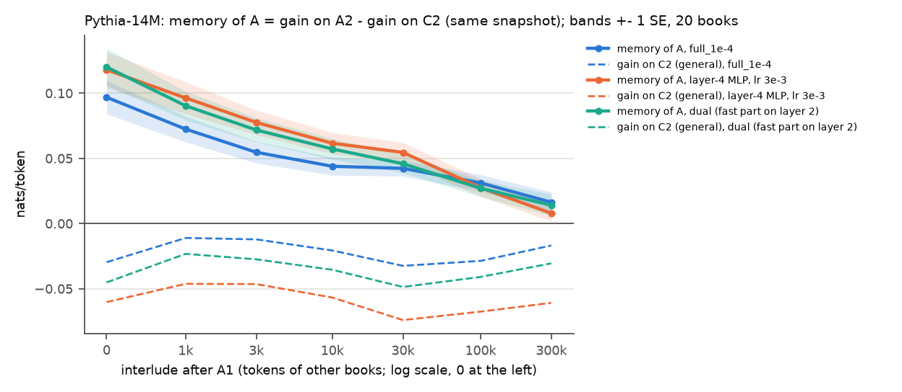

# Test 11: eviction with a probe

**Question.** After reading a book's first half A1, how much book-specific memory of A is left after
I tokens of other books, with general adaptation removed?

**Answer.** The memory is evicted, fast at first and then slowly. The conservative measure is the
gain on A2 against the pretrained model (`full_1e-4`): +0.067 ± 0.007 nats/token right after A1,
half of that after about 5k tokens of other books, +0.023 ± 0.005 at 10k and within noise from 30k
on (+0.010 ± 0.005; +0.003 ± 0.005 at 100k). Memory of A, the gain on A2 minus the gain on a
never-read control book C2 scored with the same snapshot, is larger because the control loses: it
is +0.097 ± 0.013 at I = 0, halves after about 6k tokens, and is +0.044 ± 0.007 at 10k, +0.031 ±
0.006 at 100k and +0.016 ± 0.008 at 300k (2.1 SE). The decline comes from losing A, not from the
control catching up: the gain on the control book is never positive (-0.030 at I = 0, -0.011 to
-0.032 later). The memory is mostly about tokens of A1: rare tokens of A2 that occur in A1 carry
+0.223 at I = 0, against +0.056 for rare tokens that do not. The aggressive layer-4 MLP (lr 3e-3)
and the dual rule start with more memory_A (+0.118 and +0.120) and are back to the full learner's
level by 100k. Their extra memory comes largely from doing worse on the control book; only the dual
rule also gains more on A2 itself (+0.008 ± 0.003).

## Setup

- **A and C books:** books 0-19 of the main stream, paired (i, i + 10). When A = book i, its control
  C is book i + 10, and the other way round, so every book is an A once and a C once (20 A books).
  A1 = tokens 0-10239 (40 chunks), A2 = tokens 10240-19999. C2 is the same range of C, never read in
  that run.
- **Interlude:** PG-19 validation books (`data.val_books()`, 42 x 20k tokens) concatenated in dataset
  order, cyclic, starting at validation book 2A (mod 42), so each A has a different interlude.
- **Stream per A:** A1 + interlude, read online from the pretrained Pythia-14M (one SGD step per
  256-token chunk after scoring it). Checkpoints: before A1 ("pre") and after A1 + I tokens,
  I in {0, 1k, 3k, 10k, 30k, 100k, 300k} (rounded to multiples of 256: 1024, 3072, 9984, 29952,
  100096, 300032).
- **Probe:** at each checkpoint, A2 and C2 are scored frozen with the snapshot (chunks of 256, no
  updates); both are also scored once with the pretrained model.
  gain_A2 = loss_frozen(A2) - loss_snapshot(A2); gain_C2 likewise (general adaptation);
  **memory_A = gain_A2 - gain_C2.** Means and SE are over the 20 A books. Differences between
  settings are paired per book (same A, C and interlude).
- **Token subsets** (the 1000 most frequent ids of the 25-book stream left out): rare A2 tokens whose
  id occurs in A1 (11.2% of A2's tokens) or does not (16.0%). The control is the same split of C2
  relative to C1, which is never read, so memory on a subset compares like with like.
- **Settings:** `full_1e-4` (all parameters, lr 1e-4); `mlp4_3e-3` (layer 4's MLP only, lr 3e-3,
  test 6's pick); `dual` (slow `full_1e-4` + a fast part on layer 2's MLP weights, alpha 1e-3,
  lambda 0.99, test 10's pick; fast-part half-life 69 chunks, about 18k tokens).
- **Test 2's metric** (`full_1e-4`, A = 0, 1, 2): loss(A2 | snapshot after C1 + I) - loss(A2 |
  snapshot after A1 + I), with C1 = C's first 40 chunks in place of A1 and the same interlude.
- **Shared tool** (`snapshot.py`): a `Learner` that reads a stream in segments and keeps its state
  (plain SGD through `online.stream_losses` with init = the current state; the dual rule with the same
  in-place ops as `dual.dual_losses`), plus frozen scoring of a snapshot. Check on book 0 (78
  chunks, with a frozen score in between segments): segmented and single runs give identical
  per-token losses (max abs difference 0) for both rules. Shared code (`online.py`, `dual.py`) is
  unchanged.

## Results

`results.csv` (one row per setting, A and I), `means.csv` (means, SE, and a flag when under 2 SE),
`pairs.csv` (paired differences between settings), `halving.csv`, `test2_metric.csv`, probe losses
in `losses_<setting>.npz` (float16 [A, checkpoint, A2/C2, token]).

**Sanity check ("pre", before A1):** memory_A = 0.0000 ± 0.0000 in all three settings, and so are
gain_A2, gain_C2 and the subset columns (the snapshot is the pretrained model; float16 storage of the
probe losses leaves per-book differences under 1e-4). The pipeline scores snapshot and frozen model
on exactly the same chunks.

**Means over 20 A books** (nats/token, ± 1 SE):

| setting | I | gain_A2 | gain_C2 | memory_A | memory, rare in A1 | memory, rare not in A1 |
|---|---|---|---|---|---|---|
| `full_1e-4` | 0 | +0.067 ± 0.007 | -0.030 ± 0.007 | **+0.097 ± 0.013** | +0.223 ± 0.029 | +0.056 ± 0.011 |
|  | 1k | +0.061 ± 0.006 | -0.011 ± 0.004 | +0.072 ± 0.010 | +0.164 ± 0.021 | +0.038 ± 0.010 |
|  | 3k | +0.043 ± 0.006 | -0.012 ± 0.005 | +0.055 ± 0.008 | +0.109 ± 0.022 | +0.015 ± 0.011 * |
|  | 10k | +0.023 ± 0.005 | -0.021 ± 0.004 | +0.044 ± 0.007 | +0.080 ± 0.022 | +0.024 ± 0.009 |
|  | 30k | +0.010 ± 0.005 * | -0.032 ± 0.006 | +0.042 ± 0.006 | +0.070 ± 0.021 | +0.024 ± 0.013 * |
|  | 100k | +0.003 ± 0.005 * | -0.029 ± 0.006 | +0.031 ± 0.006 | +0.040 ± 0.024 * | +0.009 ± 0.017 * |
|  | 300k | -0.000 ± 0.006 * | -0.017 ± 0.007 | **+0.016 ± 0.008** | +0.027 ± 0.026 * | -0.005 ± 0.018 * |
| `mlp4_3e-3` | 0 | +0.058 ± 0.009 | -0.060 ± 0.007 | **+0.118 ± 0.014** | +0.290 ± 0.029 | +0.057 ± 0.011 |
|  | 1k | +0.050 ± 0.009 | -0.046 ± 0.006 | +0.096 ± 0.012 | +0.230 ± 0.025 | +0.040 ± 0.010 |
|  | 3k | +0.031 ± 0.007 | -0.046 ± 0.005 | +0.078 ± 0.009 | +0.171 ± 0.023 | +0.014 ± 0.010 * |
|  | 10k | +0.005 ± 0.006 * | -0.057 ± 0.005 | +0.062 ± 0.008 | +0.124 ± 0.023 | +0.019 ± 0.010 * |
|  | 30k | -0.019 ± 0.005 | -0.074 ± 0.007 | +0.055 ± 0.008 | +0.094 ± 0.025 | +0.024 ± 0.011 |
|  | 100k | -0.040 ± 0.006 | -0.068 ± 0.007 | +0.028 ± 0.007 | +0.044 ± 0.020 | +0.005 ± 0.010 * |
|  | 300k | -0.053 ± 0.006 | -0.061 ± 0.008 | **+0.008 ± 0.006** * | +0.015 ± 0.021 * | -0.009 ± 0.014 * |
| `dual` | 0 | +0.075 ± 0.009 | -0.045 ± 0.007 | **+0.120 ± 0.014** | +0.280 ± 0.032 | +0.067 ± 0.012 |
|  | 1k | +0.067 ± 0.008 | -0.023 ± 0.005 | +0.090 ± 0.011 | +0.202 ± 0.025 | +0.041 ± 0.012 |
|  | 3k | +0.044 ± 0.007 | -0.027 ± 0.006 | +0.072 ± 0.009 | +0.144 ± 0.027 | +0.018 ± 0.013 * |
|  | 10k | +0.022 ± 0.006 | -0.035 ± 0.004 | +0.057 ± 0.008 | +0.111 ± 0.025 | +0.028 ± 0.010 |
|  | 30k | -0.003 ± 0.006 * | -0.049 ± 0.007 | +0.046 ± 0.007 | +0.076 ± 0.023 | +0.025 ± 0.013 * |
|  | 100k | -0.014 ± 0.005 | -0.041 ± 0.006 | +0.027 ± 0.006 | +0.032 ± 0.025 * | +0.007 ± 0.018 * |
|  | 300k | -0.016 ± 0.007 | -0.030 ± 0.007 | **+0.014 ± 0.008** * | +0.027 ± 0.028 * | -0.005 ± 0.019 * |

\* under 2 SE.

**Half-lives** (interlude at which a quantity first falls to half its I = 0 value, linear in log I;
`halving.csv`):

| setting | gain_A2 at 0 | gain_A2 halves at | memory_A at 0 | memory_A halves at | memory, rare in A1, halves at |
|---|---|---|---|---|---|
| `full_1e-4` | +0.067 | **5k** | +0.097 | **6k** | 3k |
| `mlp4_3e-3` | +0.058 | 3k | +0.118 | 15k | 6k |
| `dual` | +0.075 | 4k | +0.120 | 8k | 4k |

gain_A2 against the pretrained model is the conservative measure: it reaches noise level by 30k
(`full_1e-4`) and turns negative for the other two settings (layer-4 MLP from 30k, dual from 100k).

**Paired differences against `full_1e-4`** (± SE over the 20 books):

| I | mlp4: memory_A | mlp4: gain_A2 | mlp4: gain_C2 | dual: memory_A | dual: gain_A2 | dual: gain_C2 |
|---|---|---|---|---|---|---|
| 0 | +0.021 ± 0.003 | -0.010 ± 0.002 | -0.031 ± 0.002 | +0.023 ± 0.002 | +0.008 ± 0.003 | -0.016 ± 0.002 |
| 1k | +0.024 ± 0.004 | -0.011 ± 0.004 | -0.035 ± 0.003 | +0.018 ± 0.002 | +0.006 ± 0.002 | -0.012 ± 0.002 |
| 3k | +0.023 ± 0.003 | -0.011 ± 0.003 | -0.034 ± 0.003 | +0.017 ± 0.002 | +0.002 ± 0.002 * | -0.015 ± 0.002 |
| 10k | +0.018 ± 0.003 | -0.019 ± 0.003 | -0.036 ± 0.002 | +0.013 ± 0.002 | -0.002 ± 0.001 * | -0.015 ± 0.001 |
| 30k | +0.012 ± 0.003 | -0.029 ± 0.002 | -0.042 ± 0.004 | +0.004 ± 0.002 * | -0.013 ± 0.002 | -0.016 ± 0.003 |
| 100k | -0.004 ± 0.003 * | -0.043 ± 0.002 | -0.039 ± 0.003 | -0.004 ± 0.002 | -0.016 ± 0.001 | -0.012 ± 0.002 |
| 300k | -0.009 ± 0.004 | -0.053 ± 0.003 | -0.044 ± 0.003 | -0.002 ± 0.001 * | -0.016 ± 0.002 | -0.014 ± 0.002 |

**Test 2's metric with frozen probes** (`full_1e-4`, books 0-2, ± SE over 3 books):

| I | test 2's metric, frozen probe | test 2's published value (scored online) | memory_A, same 3 books |
|---|---|---|---|
| 0 | +0.123 ± 0.031 | +0.038 | +0.084 ± 0.011 |
| 10k | +0.040 ± 0.003 | +0.027 | +0.034 ± 0.018 * |
| 100k | +0.021 ± 0.001 | +0.019 | +0.010 ± 0.020 * |

Runtime: the three settings ran as three parallel processes on an 8-core CPU: 56 min
(`full_1e-4`, plus 1 min for test 2's metric), 46 min (`mlp4_3e-3`) and 56 min (`dual`). A 2-book
smoke test took 1.3 min per setting.

## Findings

1. **Real eviction.** The gain on A2 against the pretrained model halves in about 5k tokens and is
   within noise from 30k. With the control book scored on the same snapshot, memory of A falls from
   +0.097 to +0.044 after 10k tokens of other books, +0.031 after 100k and +0.016 after 300k
   (`full_1e-4`). It halves in about 6k tokens, then has a long tail; it is not clearly zero by
   300k (2.1 SE). The flat curve of test 2 does not hold up as "the weights keep A".
2. **No positive general adaptation on a new book.** A snapshot is never better than the pretrained
   model on an unseen book's text (gain_C2 between -0.011 and -0.032 for `full_1e-4`, worse for the
   other settings). Reading books one after the other, the learner is specialised to what it read
   last. So in test 2 the B1 run did not catch up through general adaptation; it most likely caught
   up by learning A2 while scoring it. (This does not extend to shuffled streams: test 12 finds that
   snapshots of a learner reading shuffled chunks of 25 books are better than the pretrained model
   on unseen PG-19 books, by 0.045 nats/token.)
3. **The memory is mostly about the book's own tokens.** Rare A2 tokens seen in A1 carry about 4
   times more memory than rare tokens not in A1 (+0.223 against +0.056 at I = 0) and they halve
   faster (3k tokens). The rest (rare unseen tokens, +0.056, falling to about +0.024 by 10k and
   within noise by 100k) looks like style or topic.
4. **The aggressive cache is not a better cache.** The layer-4 MLP at 3e-3 has more memory_A early
   (+0.021 ± 0.003 at I = 0) but a lower gain on A2 (-0.010 ± 0.002): its higher memory is a larger
   loss on the control book (-0.031 ± 0.002). It halves later than the full learner (15k against
   6k), drops below it by 100k-300k (-0.009 ± 0.004 at 300k), and from 30k on it is worse than the
   pretrained model on A2 itself (-0.053 at 300k). "More memory early, forgets faster" holds only
   in the sense that it crosses below the full learner; most of the difference is interference.
5. **The dual rule's fast part behaves like a short cache.** Over `full_1e-4` it adds +0.023 ±
   0.002 memory at I = 0, +0.013 ± 0.002 at 10k, +0.004 ± 0.002 (within noise) at 30k, and nothing
   after. That is a half-life of roughly 10k tokens, somewhat shorter than the 18k of its decay
   alone (new gradients also overwrite it). It is the only setting with a higher gain on A2 itself
   (+0.008 ± 0.003 at I = 0), but it also costs more on the control book (-0.016 ± 0.002). From
   30k tokens on it is slightly worse than `full_1e-4` on both A2 and C2 (about -0.015).

## Caveats

- Probes are frozen: they measure what the weights hold, not what online learning would get on A2
  (it keeps learning while reading A2). That is why test 2's metric at I = 0 is +0.123 here against
  +0.038 when scored online.
- memory_A subtracts a negative gain_C2, so it mixes "better on A" and "worse on other books". Read it
  with gain_A2 next to it.
- One model (Pythia-14M), one seed, one interlude per A (different validation books for each), 10k-
  token halves. The per-book spread is large (interludes differ), so values beyond 100k are near
  noise.
- Test 2's metric uses 3 books only.
