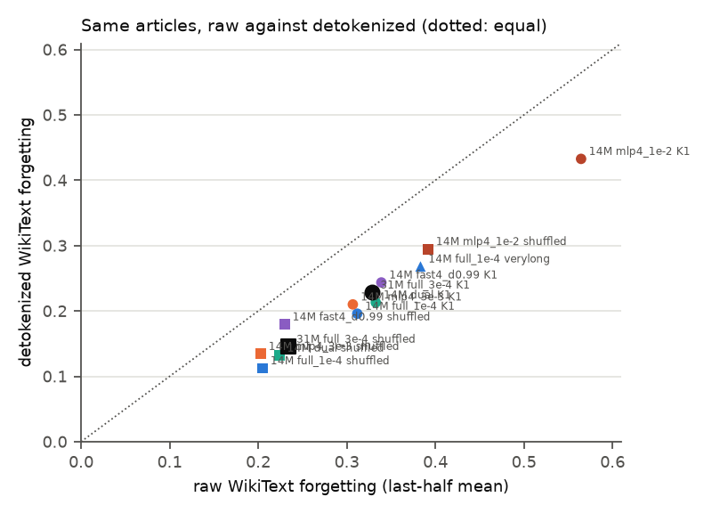
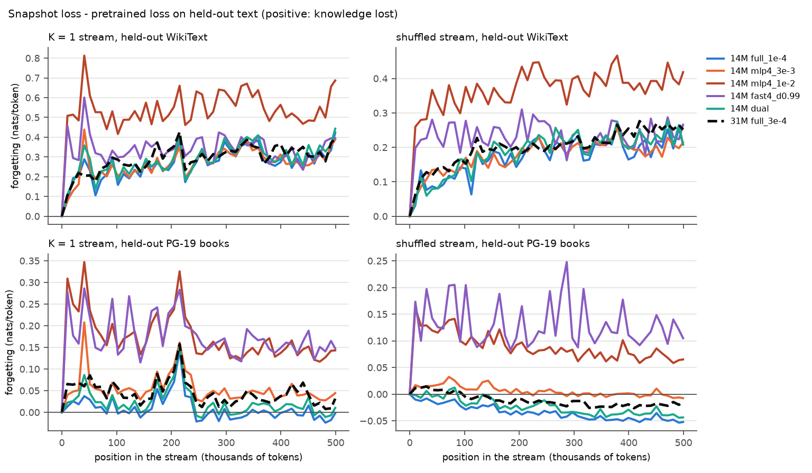
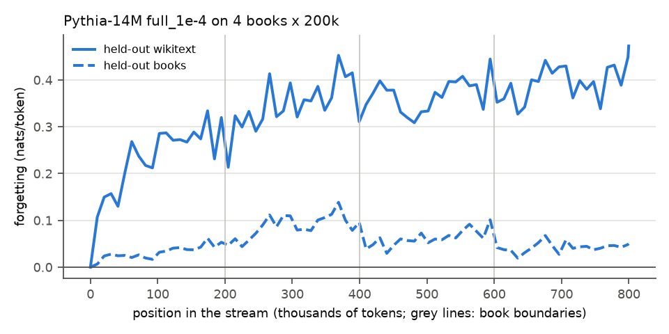
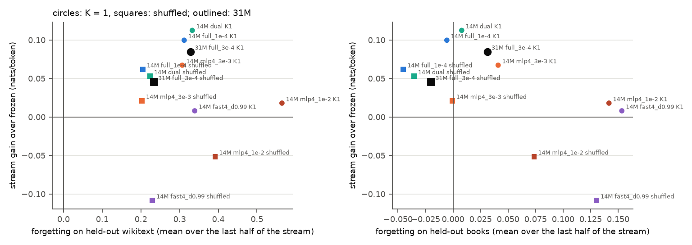

# Test 12: forgetting of general knowledge (a "thermometer")

**Question.** While the model learns a stream online, how much general knowledge does it lose,
measured directly on fixed held-out text? Is the loss larger for the aggressive settings and for the
small model?

**Answer.** General knowledge outside the stream's domain is not kept. On detokenized WikiText,
snapshots of Pythia-14M learning online (`full_1e-4`, books in order) lose +0.196 ± 0.006
nats/token on average over the last half of the stream (+0.252 ± 0.007 at the end; 4% of the
frozen loss). That is about twice the stream gain (+0.100 ± 0.006): exchange rate 0.51. Raw WikiText
gives a larger number (+0.312), and half of the raw forgetting is on its formatting markers
(" @-@ ", "=" headings, spaces before punctuation). About half of it appears within the first 30k
tokens; on an 800k-token stream it levels off around +0.23-0.27 (detokenized). On held-out PG-19
books, the same domain as the stream, there is no forgetting in order (-0.006), and the shuffled
run's snapshots are *better* than the pretrained model (-0.045, final -0.052 ± 0.008). So the gain
that survives shuffling is partly adaptation that carries over to unseen books of the same kind.
This rejects the reading suggested by test 11 (that it is only memory of the 25 stream books). The
aggressive settings of test 7 lose far more on both sets, which explains much of their low gains.
The dual rule forgets slightly more than `full_1e-4` (+0.017 ± 0.001 on detokenized WikiText).
Pythia-31M learning online (lr 3e-4) forgets more than 14M (+0.033 ± 0.005) for a smaller gain:
the capacity hypothesis is not supported at these learning rates.

## Setup

- **Held-out sets** (never trained on, scored frozen with each snapshot, chunks of 256 tokens):
  - **WikiText:** WikiText-103 test split (`Salesforce/wikitext`, `wikitext-103-raw-v1`, via
    `datasets` 5.1.0, now pinned in `requirements.txt`). The articles are joined in order and
    tokenized, and the first 20,480 tokens are kept (80 chunks; raw WikiText formatting, e.g.
    " @-@ "). **Detokenized** (the headline set): the same characters (the first 89,324 of the
    split) passed through lm-evaluation-harness's `wikitext_detokenizer` (" @-@ " -> "-",
    " @,@ " -> ",", " @.@ " -> ".", no space before punctuation or inside brackets and quotes,
    " 's" -> "'s"). "= Heading =" lines are kept and detokenized too ("= = Career = =" ->
    "== Career =="). Retokenized: 19,456 tokens (76 chunks), same articles as the raw set.
  - **Books:** the 6 val-meta-heldout PG-19 validation books (`dual.val_sets`), tokens 0-3839 of
    each (15 chunks each, 23,040 tokens).
- **Streams:** test 7's 25-book chunk set (78 chunks per book, 499,200 tokens), K = 1 (books in
  order) and shuffled (test 7's order, seed 0). Test 10's very long set (4 books x 200k), in
  order. Test 7's chunking and order are used, not test 4's, so every 14M run is the same run as in
  tests 7 and 10.
- **Runs:**
  - Pythia-14M, each on K = 1 and shuffled: `full_1e-4`, `mlp4_3e-3`, `mlp4_1e-2`, `fast4_d0.99`
    (test 7: layer 4's MLP at the given lr; or a fast part on it with decay 0.99, lr 1e-2), and
    `dual` (test 10's pick: slow `full_1e-4` + a fast part on layer 2's MLP, alpha 1e-3, lambda 0.99).
  - Pythia-31M, all parameters at lr 3e-4 (test 6's pick), on K = 1 and shuffled.
  - Pythia-14M `full_1e-4` on the very long books.
- **Snapshots** every 40 chunks (10,240 tokens) and at the end (50 per 500k stream, 79 on the very
  long one). Snapshot 0 is the pretrained model.
- **Learner** (`snapshot.Learner`, now with test 7's decaying fast part as rule "decay"). Segmented
  runs match single runs exactly for all three rules (`python snapshot.py`). Every 14M run's
  per-token stream losses are identical to the saved losses of the same run in tests 7 and 10 (100%
  of tokens equal in float16), so stream gains are those of the earlier tests.
- **Metrics:**
  - forgetting(t) = loss_snapshot(held-out) - loss_frozen(held-out); positive = knowledge lost.
  - SE is paired against frozen: over the 80 WikiText chunks, or over the 6 held-out books.
  - "final" = the last snapshot (end of stream). "last half" = the mean over the snapshots in the
    second half of the stream; it smooths out the swings between snapshots, so the comparisons use
    it.
  - Stream gain = frozen - online loss over the whole stream (SE over the 25 books).
  - Exchange rate = stream gain / last-half WikiText forgetting (detokenized unless said otherwise).
- **Detokenized rerun:** the snapshot weights were not saved, so every run was rerun to score the
  detokenized set at the same snapshots (`rescore`). Four runs (14M `full_1e-4` and 31M, K1 and
  shuffled) also saved raw WikiText losses per token for a token-type breakdown. Their raw
  per-chunk losses match the first pass exactly (max abs difference 0).

## Results

`results.csv` (run, position, set, frozen and snapshot loss, forgetting, SE), `summary.csv` (per
run), `k1_vs_shuffled.csv`, `losses_<run>.npz` (stream losses float16 [book, chunk, L]; per-chunk
mean held-out losses per snapshot). Frozen loss: WikiText 5.2394 (14M) / 4.7398 (31M); books
4.3543 / 3.9888.

**Raw against detokenized WikiText** (same articles; last-half mean and end value, ± SE paired over
the held-out chunks; `detok.csv`). Frozen loss: raw 5.2394 / detokenized 4.6331 (14M), 4.7398 /
4.2197 (31M).

| run | stream gain | raw, last half | raw, end | detok, last half | detok, end | exchange rate raw / detok |
|---|---|---|---|---|---|---|
| 14M `full_1e-4` K1 | +0.100 | +0.312 ± 0.006 | +0.424 ± 0.009 | **+0.196 ± 0.006** | +0.252 ± 0.007 | 0.32 / **0.51** |
| 14M `full_1e-4` shuffled | +0.062 | +0.205 ± 0.007 | +0.208 ± 0.008 | **+0.112 ± 0.004** | +0.102 ± 0.005 | 0.30 / **0.55** |
| 14M `mlp4_3e-3` K1 | +0.067 | +0.307 ± 0.006 | +0.388 ± 0.007 | +0.210 ± 0.006 | +0.253 ± 0.007 | 0.22 / 0.32 |
| 14M `mlp4_3e-3` shuffled | +0.021 | +0.203 ± 0.006 | +0.214 ± 0.007 | +0.134 ± 0.005 | +0.131 ± 0.006 | 0.10 / 0.16 |
| 14M `mlp4_1e-2` K1 | +0.018 | +0.565 ± 0.010 | +0.687 ± 0.011 | +0.433 ± 0.009 | +0.481 ± 0.011 | 0.03 / 0.04 |
| 14M `mlp4_1e-2` shuffled | -0.052 | +0.392 ± 0.009 | +0.418 ± 0.010 | +0.295 ± 0.008 | +0.292 ± 0.010 | -0.13 / -0.17 |
| 14M `fast4_d0.99` K1 | +0.008 | +0.339 ± 0.005 | +0.394 ± 0.007 | +0.244 ± 0.004 | +0.252 ± 0.006 | 0.02 / 0.03 |
| 14M `fast4_d0.99` shuffled | -0.108 | +0.230 ± 0.004 | +0.266 ± 0.006 | +0.180 ± 0.004 | +0.187 ± 0.006 | -0.47 / -0.60 |
| 14M `dual` K1 | +0.113 | +0.333 ± 0.006 | +0.443 ± 0.008 | +0.213 ± 0.006 | +0.269 ± 0.007 | 0.34 / 0.53 |
| 14M `dual` shuffled | +0.053 | +0.224 ± 0.007 | +0.209 ± 0.008 | +0.132 ± 0.005 | +0.111 ± 0.005 | 0.24 / 0.40 |
| 31M `full_3e-4` K1 | +0.085 | +0.329 ± 0.006 | +0.393 ± 0.008 | +0.228 ± 0.005 | +0.271 ± 0.006 | 0.26 / 0.37 |
| 31M `full_3e-4` shuffled | +0.045 | +0.234 ± 0.005 | +0.252 ± 0.005 | +0.145 ± 0.004 | +0.150 ± 0.004 | 0.19 / 0.31 |
| 14M `full_1e-4` very long | +0.170 | +0.383 ± 0.007 | +0.473 ± 0.009 | +0.268 ± 0.008 | +0.323 ± 0.009 | 0.44 / 0.63 |

Detokenizing removes 0.09-0.13 nats/token of forgetting in every run (about a third), but keeps the
order of the runs and every comparison below.

**Raw forgetting by token type** (last-half mean; `breakdown.csv`). Markup = tokens containing "@",
"=" heading markers, or a space followed by punctuation; whitespace = spaces and newlines only;
digits = any digit; other = the rest. Contribution = the type's share of the mean (they add up to
the total):

| run | markup (15.5% of tokens) | whitespace (0.9%) | digits (4.8%) | other (78.7%) | total |
|---|---|---|---|---|---|
| 14M `full_1e-4` K1: per token | +1.061 | -0.178 | +0.331 | +0.168 | |
| contribution | +0.165 (53%) | -0.002 | +0.016 (5%) | +0.133 (43%) | +0.312 |
| 14M `full_1e-4` shuffled: per token | +0.746 | -0.264 | +0.223 | +0.103 | |
| contribution | +0.116 (57%) | -0.003 | +0.011 (5%) | +0.081 (39%) | +0.205 |
| 31M `full_3e-4` K1: per token | +1.015 | +0.559 | +0.349 | +0.189 | |
| contribution | +0.158 (48%) | +0.005 (2%) | +0.017 (5%) | +0.149 (45%) | +0.329 |
| 31M `full_3e-4` shuffled: per token | +0.706 | +0.406 | +0.267 | +0.137 | |
| contribution | +0.110 (47%) | +0.004 (2%) | +0.013 (6%) | +0.108 (46%) | +0.234 |

Values at the end of the stream split the same way (47-53% markup).

**Per run, raw WikiText and held-out books** (first pass; nats/token; final ± SE paired against frozen, with the SD over the last 5 snapshots in
brackets):

| run | stream gain | WikiText final | WikiText last half | books final | books last half | exchange rate (WikiText) |
|---|---|---|---|---|---|---|
| 14M `full_1e-4` K1 | +0.100 ± 0.006 | +0.424 ± 0.009 (0.059) | +0.312 | -0.002 ± 0.009 * (0.009) | -0.006 | 0.32 |
| 14M `full_1e-4` shuffled | +0.062 ± 0.003 | +0.208 ± 0.008 (0.029) | +0.205 | **-0.052 ± 0.008** (0.003) | -0.045 | 0.30 |
| 14M `mlp4_3e-3` K1 | +0.067 ± 0.006 | +0.388 ± 0.007 (0.048) | +0.307 | +0.044 ± 0.008 (0.007) | +0.041 | 0.22 |
| 14M `mlp4_3e-3` shuffled | +0.021 ± 0.003 | +0.214 ± 0.007 (0.021) | +0.203 | -0.008 ± 0.007 * (0.003) | -0.001 | 0.10 |
| 14M `mlp4_1e-2` K1 | +0.018 ± 0.013 | +0.687 ± 0.011 (0.092) | +0.565 | +0.143 ± 0.013 (0.012) | +0.142 | 0.03 |
| 14M `mlp4_1e-2` shuffled | -0.052 ± 0.004 | +0.418 ± 0.010 (0.031) | +0.392 | +0.065 ± 0.009 (0.007) | +0.074 | -0.13 |
| 14M `fast4_d0.99` K1 | +0.008 ± 0.013 | +0.394 ± 0.007 (0.051) | +0.339 | +0.147 ± 0.011 (0.016) | +0.153 | 0.02 |
| 14M `fast4_d0.99` shuffled | -0.108 ± 0.004 | +0.266 ± 0.006 (0.031) | +0.230 | +0.105 ± 0.006 (0.018) | +0.131 | -0.47 |
| 14M `dual` K1 | +0.113 ± 0.007 | +0.443 ± 0.008 (0.056) | +0.333 | +0.010 ± 0.010 * (0.009) | +0.008 | 0.34 |
| 14M `dual` shuffled | +0.053 ± 0.003 | +0.209 ± 0.008 (0.033) | +0.224 | -0.044 ± 0.009 (0.003) | -0.035 | 0.24 |
| 31M `full_3e-4` K1 | +0.085 ± 0.006 | +0.393 ± 0.008 (0.048) | +0.329 | +0.032 ± 0.014 * (0.010) | +0.031 | 0.26 |
| 31M `full_3e-4` shuffled | +0.045 ± 0.003 | +0.252 ± 0.005 (0.008) | +0.234 | -0.014 ± 0.008 * (0.004) | -0.020 | 0.19 |
| 14M `full_1e-4` very long | +0.170 ± 0.011 | +0.473 ± 0.009 (0.031) | +0.383 | +0.050 ± 0.022 * (0.003) | +0.052 | 0.44 |

\* under 2 SE. Negative forgetting = the snapshot is better than the pretrained model.

**K = 1 against shuffled** (shuffled minus K1, last-half forgetting, paired over held-out chunks or
books at the same snapshot positions):

| setting | gain K1 | gain shuffled | WikiText: shuffled - K1 | books: shuffled - K1 |
|---|---|---|---|---|
| 14M `full_1e-4` | +0.100 | +0.062 | -0.107 ± 0.005 | -0.040 ± 0.002 |
| 14M `mlp4_3e-3` | +0.067 | +0.021 | -0.104 ± 0.002 | -0.042 ± 0.002 |
| 14M `mlp4_1e-2` | +0.018 | -0.052 | -0.173 ± 0.003 | -0.068 ± 0.006 |
| 14M `fast4_d0.99` | +0.008 | -0.108 | -0.109 ± 0.002 | -0.023 ± 0.006 |
| 14M `dual` | +0.113 | +0.053 | -0.109 ± 0.005 | -0.043 ± 0.002 |
| 31M `full_3e-4` | +0.085 | +0.045 | -0.095 ± 0.004 | -0.051 ± 0.008 |

**Paired differences in last-half forgetting** (positive: the first run forgets more):

| comparison | stream | WikiText detok | WikiText raw | books |
|---|---|---|---|---|
| `dual` - `full_1e-4` (14M) | K1 | +0.017 ± 0.001 | +0.021 ± 0.001 | +0.014 ± 0.001 |
| | shuffled | +0.020 ± 0.001 | +0.019 ± 0.001 | +0.010 ± 0.001 |
| `mlp4_3e-3` - `full_1e-4` (14M) | K1 | +0.014 ± 0.004 | -0.005 ± 0.005 * | +0.047 ± 0.004 |
| | shuffled | +0.022 ± 0.003 | -0.002 ± 0.006 * | +0.044 ± 0.003 |
| 31M `full_3e-4` - 14M `full_1e-4` | K1 | +0.033 ± 0.005 | +0.017 ± 0.005 | +0.037 ± 0.004 |
| | shuffled | +0.033 ± 0.004 | +0.029 ± 0.007 | +0.025 ± 0.004 |
| 14M `full_1e-4` shuffled - K1 | | -0.084 ± 0.003 | -0.107 ± 0.005 | -0.040 ± 0.002 |

**Very long books** (14M `full_1e-4`, 4 x 200k): detokenized WikiText forgetting +0.16 at 102k
tokens, +0.20 at 204k, +0.27 at 307k, +0.23 at 409k, +0.24 at 512k, +0.23 at 614k, +0.24 at 716k,
+0.32 at the end (800k); raw +0.29, +0.21, +0.32, +0.35, +0.37, +0.36, +0.36, +0.47. Held-out books:
+0.03 to +0.08 throughout.

Runtime: first pass, 13 runs in three parallel processes on an 8-core CPU, 91 min wall time (13-26 min per run,
most of it snapshot scoring: 50 snapshots x 43,520 frozen tokens). The 2-run smoke test estimated 7
and 10 min per run for one process alone. Detokenized rerun: two processes, 59 min wall time (6-17
min per run).

## Findings

1. **"General knowledge stays in the weights" does not hold outside the stream's domain.** On
   detokenized WikiText, forgetting reaches about +0.1 within 30k tokens of books and settles at
   +0.2-0.25 nats/token (`full_1e-4` K1: +0.196 ± 0.006 over the last half, 4% of the frozen loss),
   about twice the stream gain (exchange rate 0.51). The raw set overstates it (+0.312): half of the
   raw forgetting is on WikiText's formatting markers (+1.06 nats per markup token against +0.17 on
   ordinary tokens), a shift in formatting priors rather than lost knowledge. The forgetting on
   ordinary tokens (+0.17 per token in the raw text) agrees with the detokenized set. Within the
   domain it holds: on unseen PG-19 books, `full_1e-4` loses nothing in order (-0.006) and gains when
   shuffled.
2. **Shuffled snapshots gain on unseen books: the shuffled gain is not only memory of the 25 books.**
   The shuffled `full_1e-4` snapshots are better than the pretrained model on the 6 held-out books
   (-0.045 over the last half, -0.052 ± 0.008 at the end). The same holds for `dual` (-0.035) and,
   within noise, for 31M (-0.020). The in-order runs do not gain on them (-0.006) because each
   snapshot is specialised to the book just read. That fits test 11, whose interlude was whole books
   in order. The shuffled stream forgets less on both sets (-0.084 ± 0.003 on detokenized WikiText,
   -0.040 ± 0.002 on books against K1). So the 61% of the gain that survives shuffling (test 4) is, at least
   in part, adaptation to PG-19-style text that carries over to unseen books. Test 4's wording ("adapting to
   these books in general") stands for the PG-19 domain, but not for general text.
3. **The aggressive settings lose through forgetting.** `mlp4_1e-2` and `fast4_d0.99` lose +0.14 to
   +0.15 on held-out books in order (+0.07 to +0.13 shuffled) and, for `mlp4_1e-2`, +0.56 on
   WikiText (+0.43 detokenized), for stream gains near zero or negative. `mlp4_3e-3` forgets
   +0.014 ± 0.004 more than `full_1e-4` on detokenized WikiText (the same on raw) and +0.047 ±
   0.004 more on books. This is the cost behind test 7's "no crossover".
4. **The dual rule keeps forgetting close to the slow learner's, not lower.** It forgets +0.017 ±
   0.001 more on detokenized WikiText and +0.014 ± 0.001 more on books (K1) for +0.013 more stream
   gain, so its exchange rate is about the same (0.53 against 0.51).
5. **Size: 31M does not forget less per nat of gain.** At its picked lr (3e-4), 31M forgets more
   than 14M (`full_1e-4`) on detokenized WikiText (+0.033 ± 0.005 on K1, +0.033 ± 0.004 shuffled)
   and on books (+0.037 ± 0.004, +0.025 ± 0.004). Its gain is also smaller (+0.085 against +0.100;
   +0.045 against +0.062). Its exchange rate is worse (0.37 against 0.51 on K1, 0.31 against 0.55
   shuffled), and relative to its frozen loss it forgets more (5.4% against 4.2% on detokenized
   WikiText). The hypothesis that the small model forgets more per nat of gain is contradicted here.
   The comparison is confounded by the learning rate (3e-4 against 1e-4), which test 13 tunes
   the same way for all sizes.
6. **Forgetting mostly levels off over long streams.** On the 800k-token stream, detokenized
   WikiText forgetting climbs to about +0.2 in the first 200k tokens and then hovers at +0.23-0.27
   from 300k to 716k, with +0.32 at the very end (raw: +0.35-0.38, +0.47). Held-out books stay at
   +0.03 to +0.08.

Sentences in the paper and older READMEs that tests 11-12 contradict, with the new numbers:
[`../contradictions.md`](../contradictions.md).

## Caveats

- Raw WikiText's formatting inflates its forgetting by about a third (see above); the detokenized
  set is the one to quote. Even detokenized, WikiText measures general text in one encyclopedic
  style; what is lost may be style and topic priors as much as facts.
- The token-type breakdown covers 4 runs; the others have raw and detokenized means only.
- Forgetting swings between snapshots (SD over the last 5 snapshots 0.03-0.09 on WikiText), more
  than its SE over chunks. The last-half mean is the more stable number. "Final" values for K = 1
  depend on which book was just read.
- One held-out text per set (80 WikiText chunks from the start of the test split; 6 books). SEs are
  over held-out chunks or books, not over streams or seeds.
- 14M and 31M use different learning rates (picked on two check books in test 6).
