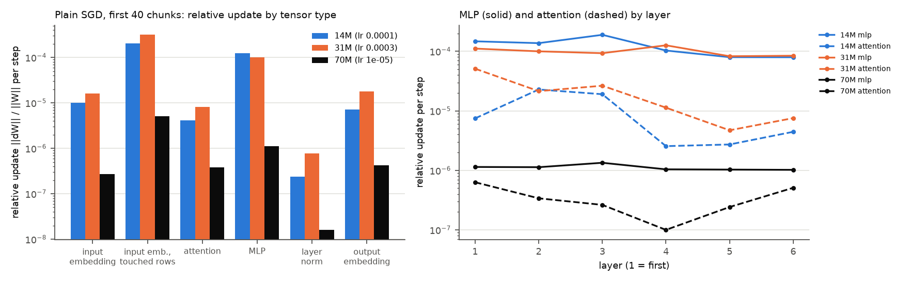
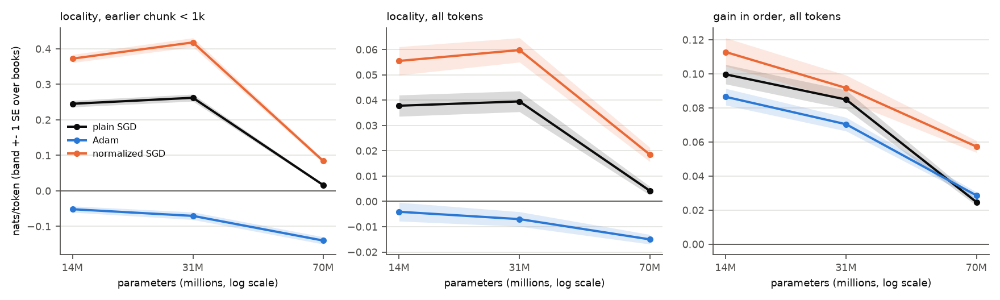

# Test 13: update rules that behave the same across sizes

**Question.** With plain SGD, Pythia-70M barely learns online, so its near-zero locality can't be
read as an effect of size. With an update rule that scales across sizes, how do gain, locality and
forgetting change with model size?

**Answer.** 70M's weak result was partly plain SGD:
- **Why plain SGD fails at 70M.** At its best rate (1e-5), the MLPs move about 100 times less per
  step than at 14M (relative update 1.1e-6 against 1.2e-4). Most of the update goes to attention
  (78%) and the output embedding (18%).
- **Normalized SGD helps 70M but doesn't close the gap.** Each tensor moves by the same relative
  amount per step. 70M's gain in order more than doubles (+0.057 against +0.025; +0.033 ± 0.002
  paired), and its locality within 1k tokens rises from +0.016 to +0.084. That is still about a
  fifth of 14M's (+0.373) and 31M's (+0.418) under the same rule. Locality is flat from 14M to 31M
  and drops at 70M under every rule, in absolute terms, relative to the frozen loss, and as a share
  of the gain.
- **Forgetting.** 70M forgets far less general text per nat of gain: on detokenized WikiText, gain
  ÷ forgetting is 1.48 (normalized SGD) and 2.7 (plain SGD), against 0.27-0.62 at 14M and 31M. But
  it only tolerates relative steps about 30 times smaller than the small models do. 14M does not
  pay more than 31M per nat of gain under any rule.
- **Adam is not a cache.** It has negative locality at every size (in-order runs gain less than
  shuffled ones) and large losses on never-seen tokens.
- **Default rule.** Normalized SGD for tests about the cache and model size: it is the only rule
  that works at all three sizes and gives the most locality. Plain SGD stays the reference for
  14M and 31M comparisons. Normalized SGD forgets more than plain SGD at 14M and 31M.
- **160M** was skipped: a full Adam run would take over 45 min.

## Setup

- **Step 1 (diagnostics):** plain SGD at the old picks (14M 1e-4, 31M 3e-4, 70M 1e-5) on the first 40
  chunks of the main stream (book 0). Per tensor and chunk: gradient norm, weight norm and relative
  update ||dW|| / ||W|| = lr ||g|| / ||W||, grouped by tensor type and layer. The input embedding's
  gradient is zero outside the rows of the chunk's tokens, so it is also given relative to those rows.
- **Update rules** (`snapshot.Learner`; one update per 256-token chunk after scoring it, all
  parameters, from the pretrained weights):
  - `sgd`: plain SGD, as in tests 1-12.
  - `adam`: `torch.optim.Adam`, betas (0.9, 0.999), eps 1e-8, no weight decay, a fresh optimizer per
    stream, its state carried through the stream.
  - `nsgd`: normalized SGD per tensor, W <- W - eta n(W) g / (||g|| + 1e-12), with n(W) = ||W|| for
    matrices and ||W|| + 1e-3 for 1-D tensors (biases and layer norms, kept in training).
  - Segmented runs match single runs exactly for both new rules (`python snapshot.py`; Adam's state
    stays attached to the same tensors across segments). Shared code (`online.py`, `dual.py`) is
    unchanged.
- **Rate picks** on the val-pick validation stream (10 PG-19 validation books, K = 1, 780 chunks;
  lowest mean online loss), with one extension step at an edge (1-3-10 ladder). Grids: Adam {1e-6
  ... 1e-4}, normalized SGD {1e-5 ... 1e-3}. Plain SGD is re-picked the same way on a 3-value grid
  around its old pick (the old picks used two test books).
- **Runs** at the picked rate on test 7's 25-book chunk set, K = 1 and shuffled (test 7's order).
  Snapshots every 80 chunks are scored frozen on test 12's detokenized WikiText and the 6 held-out
  books (raw WikiText skipped to save time). Plain SGD at 14M and 31M picked the same rates as
  before, so those are test 12's runs, reused (snapshots every 40 chunks).
- **Metrics:**
  - Gain over each model's own frozen loss and locality (in order - shuffled) on the K = 1 order's
    bins: all tokens, earlier chunk < 1k, 1k-10k same book, never seen (1000 most frequent ids left
    out of the bins). SE over the 25 books, paired for locality and for comparisons between rules.
  - Locality relative to the frozen loss on those tokens, and as a share of the in-order gain.
  - Forgetting: last-half mean of snapshot - frozen on detokenized WikiText and on the held-out
    books (test 12).
  - Exchange rate = stream gain / WikiText forgetting.
- **Sizes:** Pythia-14M, 31M, 70M. **Pythia-160M skipped:** timed on 40 chunks while two other
  runs were going (the conditions of the main runs), a full 500k-token online run takes about 40
  min with plain SGD and 76 min with Adam, plus about 40 min of snapshot scoring. That is over the
  45-min limit, before about 12 pick runs.

## Results

`diagnostics.csv` and `diagnostics_summary.csv` (step 1), `picks.csv`, `results.csv` (per size,
rule and bin), `exchange.csv` (per size and rule: gains, forgetting, exchange rates),
`losses_<size>_<rule>_<stream>.npz`, `runtime.txt`.

**Step 1: plain SGD, relative update per step** (mean over 40 chunks; share of the squared update
norm in brackets):

| tensor type | 14M (lr 1e-4) | 31M (lr 3e-4) | 70M (lr 1e-5) |
|---|---|---|---|
| input embedding | 1.0e-5 (4%) | 1.6e-5 (4%) | 2.7e-7 (0.5%) |
| input embedding, touched rows | 2.0e-4 | 3.1e-4 | 5.1e-6 |
| attention | 4.1e-6 (43%) | 8.2e-6 (63%) | 3.8e-7 (78%) |
| MLP | **1.2e-4** (50%) | **9.9e-5** (28%) | **1.1e-6** (4%) |
| layer norm | 2.4e-7 (0%) | 7.8e-7 (0%) | 1.6e-8 (0%) |
| output embedding | 7.2e-6 (3%) | 1.8e-5 (5%) | 4.2e-7 (18%) |

At 70M the MLPs, which hold the cache (tests 3-6), move about 100 times less per step than at 14M
or 31M. Every layer's MLP is affected about equally (`plots/update_sizes.png`). Three things cause
it: a 10x smaller learning rate, smaller MLP gradients (11.6 against 28.6) and larger MLP weights
(norm 104 against 23). The update is dominated by attention, whose gradient is large, and by the
output embedding. In test 6 a 3x higher plain-SGD rate (3e-5) gave 70M more locality but a worse
loss on the check books.

**Picks** (val-pick mean online loss; frozen 14M 4.3354, 31M 3.9808, 70M 3.7530):

| size | plain SGD | Adam | normalized SGD |
|---|---|---|---|
| 14M | 1e-4 (4.2565) | 3e-6 (4.2667) | 1e-4 (4.2577) |
| 31M | 3e-4 (3.9200) | 3e-6 (3.9228) | 1e-4 (3.9194) |
| 70M | 1e-5 (3.7360) | **3e-7**, extension (3.7281) | **3e-6**, extension (3.7056) |

At 70M both new rules diverge at the rates the small models use: normalized SGD gives 5.52 at
1e-4 and 10.27 at 3e-4. Both picks are at the low edge of the grid even after the one-step
extension, so a smaller rate might do slightly better (not tried; one extension only).

**Gain and locality** (nats/token, ± SE over books; locality paired):

| size | rule | gain in order, all | locality, all | locality, < 1k | locality, 1k-10k same book | gain in order, never seen |
|---|---|---|---|---|---|---|
| 14M | plain SGD | +0.100 ± 0.006 | +0.038 ± 0.004 | +0.245 ± 0.009 | +0.120 ± 0.007 | -0.059 ± 0.013 |
| 14M | Adam | +0.087 ± 0.005 | -0.004 ± 0.004 * | -0.052 ± 0.009 | +0.038 ± 0.006 | -0.262 ± 0.045 |
| 14M | normalized SGD | +0.113 ± 0.008 | +0.056 ± 0.006 | **+0.373 ± 0.012** | +0.157 ± 0.008 | -0.123 ± 0.016 |
| 31M | plain SGD | +0.085 ± 0.006 | +0.040 ± 0.004 | +0.262 ± 0.010 | +0.135 ± 0.006 | -0.037 ± 0.012 |
| 31M | Adam | +0.070 ± 0.004 | -0.007 ± 0.003 | -0.071 ± 0.011 | +0.027 ± 0.006 | -0.247 ± 0.048 |
| 31M | normalized SGD | +0.092 ± 0.008 | +0.060 ± 0.005 | **+0.418 ± 0.013** | +0.188 ± 0.008 | -0.108 ± 0.017 |
| 70M | plain SGD | +0.025 ± 0.002 | +0.004 ± 0.002 | +0.016 ± 0.003 | +0.008 ± 0.003 | -0.038 ± 0.008 |
| 70M | Adam | +0.029 ± 0.002 | -0.015 ± 0.002 | -0.140 ± 0.010 | -0.044 ± 0.005 | -0.386 ± 0.062 |
| 70M | normalized SGD | +0.057 ± 0.004 | +0.019 ± 0.003 | **+0.084 ± 0.006** | +0.050 ± 0.003 | -0.073 ± 0.010 |

\* under 2 SE.

**Relative locality** (normalized SGD / plain SGD):

| size | locality < 1k / frozen loss on those tokens | locality < 1k / gain in order there | locality, all / gain in order, all |
|---|---|---|---|
| 14M | 5.1% / 3.3% | 0.73 / 0.80 | 0.49 / 0.38 |
| 31M | 6.1% / 3.8% | 0.70 / 0.71 | 0.65 / 0.47 |
| 70M | 1.3% / 0.25% | 0.41 / 0.32 | 0.32 / 0.17 |

**Against plain SGD, same size** (paired over books):

| size | rule | gain in order, all | gain in order, < 1k | locality, all | locality, < 1k |
|---|---|---|---|---|---|
| 14M | normalized SGD | +0.013 ± 0.003 | +0.203 ± 0.011 | +0.018 ± 0.002 | +0.127 ± 0.005 |
| 31M | normalized SGD | +0.007 ± 0.003 | +0.231 ± 0.013 | +0.020 ± 0.002 | +0.156 ± 0.006 |
| 70M | normalized SGD | **+0.033 ± 0.002** | +0.152 ± 0.009 | +0.014 ± 0.002 | **+0.068 ± 0.004** |
| 14M | Adam | -0.013 ± 0.002 | -0.165 ± 0.009 | -0.042 ± 0.002 | -0.297 ± 0.011 |
| 31M | Adam | -0.015 ± 0.002 | -0.191 ± 0.009 | -0.047 ± 0.003 | -0.333 ± 0.012 |
| 70M | Adam | +0.004 ± 0.001 | -0.054 ± 0.010 | -0.019 ± 0.002 | -0.156 ± 0.011 |

**Main capacity comparison: exchange rate = stream gain / detokenized WikiText forgetting** (last
half of the stream; forgetting ± SE over held-out chunks):

| size | rule (rate) | gain K1 | WikiText forgetting K1 | **exchange rate K1** | gain shuffled | WikiText forgetting shuffled | **exchange rate shuffled** | books forgetting K1 / shuffled |
|---|---|---|---|---|---|---|---|---|
| 14M | plain SGD (1e-4) | +0.100 | +0.196 ± 0.006 | **0.51** | +0.062 | +0.112 ± 0.004 | **0.55** | -0.006 / -0.045 |
| 14M | Adam (3e-6) | +0.087 | +0.140 ± 0.005 | **0.62** | +0.091 | +0.101 ± 0.005 | **0.90** | -0.038 / -0.062 |
| 14M | normalized SGD (1e-4) | +0.113 | +0.320 ± 0.008 | **0.35** | +0.057 | +0.197 ± 0.006 | **0.29** | +0.063 / -0.012 |
| 31M | plain SGD (3e-4) | +0.085 | +0.228 ± 0.005 | **0.37** | +0.045 | +0.145 ± 0.004 | **0.31** | +0.031 / -0.020 |
| 31M | Adam (3e-6) | +0.070 | +0.136 ± 0.004 | **0.52** | +0.077 | +0.104 ± 0.004 | **0.74** | -0.012 / -0.039 |
| 31M | normalized SGD (1e-4) | +0.092 | +0.344 ± 0.006 | **0.27** | +0.032 | +0.239 ± 0.005 | **0.13** | +0.108 / +0.023 |
| 70M | plain SGD (1e-5) | +0.025 | +0.009 ± 0.002 | **2.68** | +0.021 | +0.008 ± 0.002 | **2.60** | -0.019 / -0.022 |
| 70M | Adam (3e-7) | +0.029 | +0.062 ± 0.003 | **0.46** | +0.044 | +0.066 ± 0.004 | **0.66** | -0.020 / -0.023 |
| 70M | normalized SGD (3e-6) | +0.057 | +0.039 ± 0.003 | **1.48** | +0.039 | +0.026 ± 0.002 | **1.51** | -0.010 / -0.026 |

Frozen detokenized WikiText loss: 14M 4.6331, 31M 4.2197, 70M 3.9159. 70M plain SGD's rate rests on
a forgetting of only +0.009 ± 0.002, so it is imprecise (about 2.2-3.3).

Runtime: diagnostics 2 min. Picks 38 min (two processes: 14M then 31M, and 70M; 44-200 s per pick
run). Main runs 81 min (two processes, 14 new runs, 4-17 min each).

## Findings

1. **Plain SGD starves 70M's MLPs.** The diagnostics answer the question in the brief: at 70M the
   MLPs move about 100 times less per step than at 14M, and 78% of the update norm goes to
   attention. This holds for every layer, so test 6's 70M result is not a clean size effect.
2. **A per-tensor normalized update recovers part of 70M's cache, not all of it.** Normalized SGD
   more than doubles 70M's gain (+0.057 against +0.025) and gives it clear locality (+0.084 ±
   0.006 within 1k tokens, +0.019 ± 0.003 overall). That is still far below 14M (+0.373) and 31M
   (+0.418) under the same rule. Part of the drop at 70M was the optimizer; the rest remains, at a
   pick on the edge of its grid. At 70M the rule only works at relative steps about 30 times
   smaller than at 14M and 31M (3e-6 against 1e-4); larger steps diverge.
3. **Locality is flat from 14M to 31M and falls at 70M, under every rule that has any.** The fall
   shows in absolute terms (+0.373, +0.418, +0.084 within 1k under normalized SGD), relative to the
   frozen loss (5.1%, 6.1%, 1.3%) and as a share of the gain (0.73, 0.70, 0.41). With only three
   sizes and 70M at a grid edge, this weakly supports "larger models rely less on the cache". It
   does not show "smaller models rely more" between 14M and 31M.
4. **Forgetting per nat of gain does not favour the larger model between 14M and 31M.** 14M has a
   better exchange rate than 31M under every rule (0.51 / 0.62 / 0.35 against 0.37 / 0.52 / 0.27
   in order). 70M pays far less general text per nat of gain (1.48 with normalized SGD, 2.7 with
   plain SGD), but at much smaller steps and with much smaller gains. The capacity hypothesis is
   contradicted from 14M to 31M; for 70M the gap in step size makes it unclear.
5. **Adam works against the cache.** It has negative locality at every size (-0.052, -0.071,
   -0.140 within 1k), large losses on never-seen tokens (-0.25 to -0.39) and higher shuffled than
   in-order gains. In exchange it forgets the least WikiText at 14M and 31M (exchange rates
   0.62-0.90). A likely cause, not tested: Adam's per-parameter normalization adapts to the
   recent book's gradient statistics and shrinks the steps that keep repeating.
6. **Normalized SGD is the best cache, at a cost.** At 14M and 31M it has the most gain on recent
   tokens (+0.20 to +0.23 more than plain SGD within 1k) and the most locality. It also has larger
   losses on never-seen tokens (-0.12 against -0.06) and more forgetting (WikiText +0.32 against
   +0.20 at 14M; books +0.06 to +0.11 in order).
7. **Default for future tests:** normalized SGD when model sizes are compared, because its rate is a
   relative step that means the same at every size and it is the only rule that makes 70M learn.
   Keep plain SGD as the reference for 14M and 31M results. Do not use Adam for cache experiments.

## Caveats

- The 70M picks for Adam and normalized SGD are at the low edge of their grids after one extension.
  The 70M numbers may move with a smaller rate.
- One pre-training seed per size; three sizes. SEs are over books.
- Exchange rates divide by small forgetting values at 70M and are imprecise there.
- The rates are picked on validation loss (the K = 1 stream), not on locality or forgetting. A rule
  tuned for locality or for forgetting could rank differently.
- Pythia-160M and the optional PolyPythias seeds were not run.
