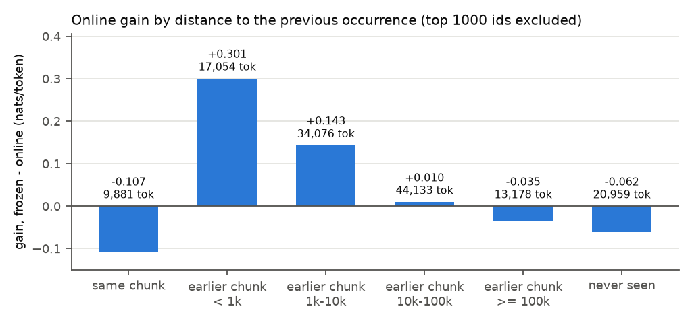

# Test 1: online gain against distance

**Question.** Does online learning help predict tokens seen beyond the attention window (256
tokens), and how far back does the help reach?

**Answer.** Yes, up to about 10k tokens. For rare tokens (the 1000 most frequent ids excluded)
whose previous occurrence is in an earlier chunk, the online learner is +0.301 nats/token better
than frozen when that occurrence is under 1k tokens back, +0.143 at 1k-10k, +0.010 at 10k-100k,
and -0.035 beyond 100k. Never-seen tokens get worse (-0.062), and so do tokens repeated within
their own chunk (-0.107). Overall gain: +0.099.

Later tests refine this: most of the gain at 1k-10k is about being in the same book, not only
about distance (test 5), and most of the long-range gain is local, i.e. it disappears when the
chunks are shuffled (test 4).

## Setup

Stream: the 25 books concatenated (500k tokens, 498046 scored), run frozen and online
(Pythia-14M, lr 1e-4; see `../README.md`). For each scored token, the distance to the previous
occurrence of the same token id anywhere earlier in the stream, in these bins:
- **same chunk**: the previous occurrence is in the token's own chunk, so attention can see it.
- **earlier chunk**: distance < 1k, 1k-10k, 10k-100k or >= 100k. The first bin also holds the few
  tokens whose previous occurrence is in the previous chunk, under 256 tokens back.
- **never seen**: first occurrence in the stream.

The 1000 most frequent token ids in the stream are left out of the bins (139281 of the 498046
scored tokens remain), since they are always "recent". The "all tokens" row has no exclusion.

## Results

`results.csv`; per-token losses in `losses.npz`. Loss in nats/token; gain = frozen - online.

| bin | tokens | frozen | online | gain (± SE over books) |
|---|---|---|---|---|
| all tokens | 498046 | 4.3922 | 4.2929 | +0.099 ± 0.006 |
| same chunk | 9881 | 5.0194 | 5.1269 | -0.107 ± 0.014 |
| earlier chunk, < 1k | 17054 | 7.3382 | 7.0373 | +0.301 ± 0.011 |
| earlier chunk, 1k-10k | 34076 | 7.0001 | 6.8568 | +0.143 ± 0.009 |
| earlier chunk, 10k-100k | 44133 | 7.1181 | 7.1083 | +0.010 ± 0.006 * |
| earlier chunk, >= 100k | 13178 | 7.8193 | 7.8539 | -0.035 ± 0.009 |
| never seen | 20959 | 8.1856 | 8.2472 | -0.062 ± 0.013 |

Gains in nats/token, token-level means ± SE over books (paired per-book differences; test 10 part A); * = under 2 SE.

Gain by position in the book (`position.csv`, all tokens, mean over books 1-24, i.e. the books
that follow a switch; ± SE over books; `plots/gain_vs_position.png` shows all 20 bins):

| position in the book (k tokens) | 0k-1k | 1k-2k | 2k-3k | 3k-4k | 5k-6k | 9k-10k | 14k-15k | 19k-20k |
|---|---|---|---|---|---|---|---|---|
| gain (± SE) | +0.009 ± 0.009 | +0.038 ± 0.006 | +0.066 ± 0.007 | +0.080 ± 0.007 | +0.090 ± 0.007 | +0.112 ± 0.008 | +0.127 ± 0.008 | +0.145 ± 0.008 |

Runtime (CPU): 81 s frozen, 73 s online, 2 min 38 s in total. This is the rerun done after the
repository cleanup; it reproduced every saved table and per-token loss exactly.

## Findings

1. **The gain reaches well past the window.** It is largest for tokens last seen under 1k tokens
   back (+0.301) and still +0.143 at 1k-10k.
2. **It fades by 10k-100k tokens and turns slightly negative beyond 100k.** Like the never-seen
   tokens (-0.062), these tokens were not recent: online learning raises the probability of recent
   material at their expense.
3. **Tokens repeated inside their chunk get worse (-0.107).** Attention already copies them, and
   the updates work against that. Only runs that leave the network body frozen avoid this cost
   (tests 3 and 4).
4. **After a book switch the gain starts at zero.** It reaches +0.080 by 3k-4k tokens and keeps
   rising to +0.145 at 19k-20k with no plateau.

## Caveats

- One model, one learning rate, one seed, short books (20k tokens).
- The distance bins differ in more than distance: farther bins also hold rarer, more book-specific
  tokens (frozen loss 7.0-7.8 nats against 4.39 overall). Comparisons between bins are not
  controlled; comparisons between runs within a bin are token by token.
- The bins use token ids, not words or meaning.
