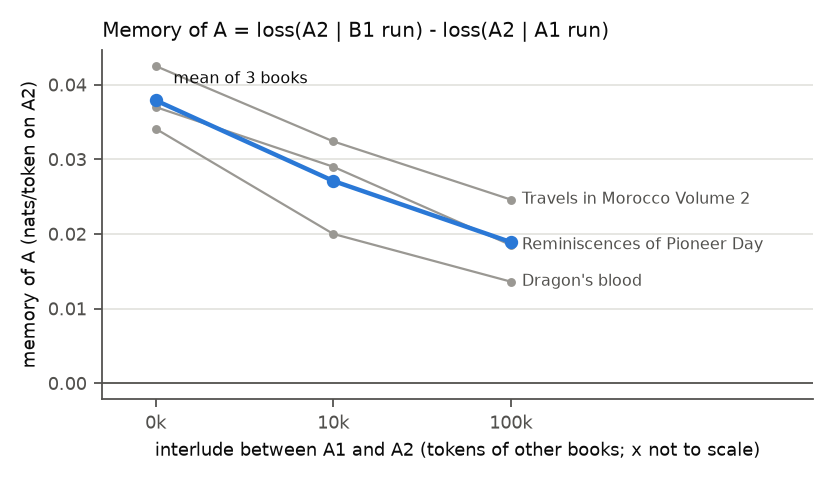

# Test 2: eviction

**Question.** After online learning on a book's first half, how much does it help on the second
half, and how fast do other books evict that memory?

**Answer.** Memory of A falls slowly: +0.038 nats/token with no interlude, +0.027 after 10k tokens
of other books, +0.019 after 100k (mean of 3 books, all three still clearly positive). The
comparison is matched (same interlude, A1 and B1 the same length), so memory of A halves over 100k
tokens, and the "cache size" is over 100k tokens at this learning rate. The A1 run's loss on A2
stays about the same at every interlude while the B1 run's improves. That does not show that the
A1 run keeps its memory of A: it is equally consistent with the A1 run losing A-specific memory
while gaining general adaptation. This test cannot tell the two apart.

## Setup

- **A books:** books 0, 1 and 2 (a memoir, a novel, a travel book). A1 is a book's first 10k
  tokens, A2 the next 10k.
- **B books:** for the i-th A, book 22 + i (not an A, not in the interlude); B1 is its first 10k
  tokens.
- **Interlude of I tokens:** the first I tokens of books 3, 4, 5, ... concatenated, the same for
  every run; I in {0, 10k, 100k}.

Online learning (Pythia-14M, lr 1e-4, from the pretrained weights each time) runs on
`A1 + interlude(I) + A2` and on `B1 + interlude(I) + A2`.

**Memory of A** = loss(A2 | B1 run) - loss(A2 | A1 run), the mean loss over A2's scored tokens. The
B1 run is needed because both runs have adapted to books in general by the time they reach A2; only
the A1 run has seen A. Both streams have the same length before A2, so A2 is cut into the same
chunks in both. Frozen loss on A2 (same chunks) is the reference.

## Results

`results.csv` (per book; mean rows at the end); per-token losses of every run in `losses.npz`.
Loss on A2 in nats/token.

| A | I | frozen | after A1 | after B1 | memory |
|---|---|---|---|---|---|
| Reminiscences of Pioneer Days in St. Paul | 0 | 4.2810 | 4.1923 | 4.2293 | +0.037 |
| | 10k | 4.2756 | 4.1927 | 4.2217 | +0.029 |
| | 100k | 4.2839 | 4.2016 | 4.2202 | +0.018 |
| Dragon's blood | 0 | 4.7237 | 4.6392 | 4.6733 | +0.034 |
| | 10k | 4.7250 | 4.6459 | 4.6659 | +0.020 |
| | 100k | 4.7167 | 4.6234 | 4.6369 | +0.014 |
| Travels in Morocco Volume 2 | 0 | 4.4948 | 4.4106 | 4.4531 | +0.043 |
| | 10k | 4.5030 | 4.4198 | 4.4522 | +0.032 |
| | 100k | 4.5024 | 4.4217 | 4.4463 | +0.025 |
| **mean** | 0 | 4.4998 | 4.4140 | 4.4519 | **+0.038** |
| | 10k | 4.5012 | 4.4195 | 4.4466 | **+0.027** |
| | 100k | 4.5010 | 4.4156 | 4.4345 | **+0.019** |

Gain over frozen on A2 (mean of the 3 books): A1 run +0.086, +0.082 and +0.085 at I = 0, 10k and
100k; B1 run +0.048, +0.055 and +0.067.

Runtime: 3 min 47 s for the 27 runs (18 online, 9 frozen) on CPU.

## Findings

1. **Reading A1 helps on A2 beyond general adaptation.** At I = 0, memory is +0.034 to +0.043 in
   all three books: 44% of the A1 run's gain over frozen (+0.086) is specific to the book; the
   rest comes from having read any book (the B1 run gets +0.048).
2. **Memory falls with the interlude but is still half its starting value after 100k tokens.**
   With three values of I, the point where it reaches zero can't be read off; it lies beyond 100k.
3. **Two readings of how memory falls.** The A1 run's gain on A2 is flat across I, while the B1
   run's grows with more books. Either the A1 run keeps its memory of A and the B1 run catches up
   through general adaptation, or the A1 run loses A-specific memory while gaining the same general
   adaptation, and the two cancel. This test cannot separate them.
4. **Book-level memory lasts longer than token-level gain.** In test 1 the gain on rare tokens had
   faded by 10k-100k tokens back, while here a book-level memory lasts over 100k. What lasts may be
   a book's style and vocabulary rather than specific tokens. Test 3 repeats this test with
   baselines.

## Caveats

- One model, one learning rate, one seed, three A books, short books (10k-token halves).
- The interlude is one fixed sequence of books (3-7), and each A has one B. A B close to A in style
  would give a smaller memory.
- Frozen loss on A2 moves slightly with I (up to 0.008) because the chunk boundaries move; the A1
  and B1 runs at the same I share their boundaries, so memory is not affected.
