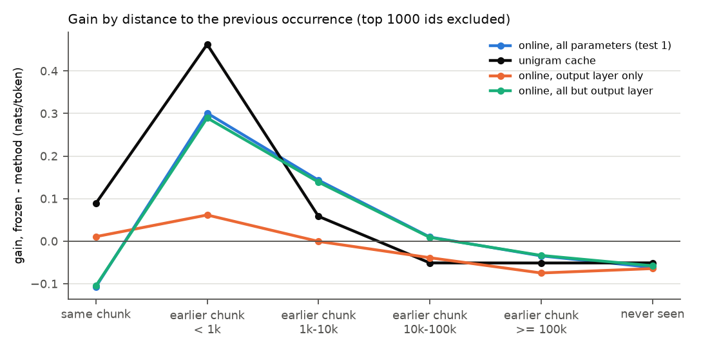

# Test 3: is the cache in the weights more than a word-frequency cache?

**Question.** Is the online gain of tests 1 and 2 just what a cache of recent token counts would
give, and which weights carry it?

**Answer.**
- **Against a unigram cache:** the online learner gains much more overall (+0.099 against +0.017)
  and from 1k tokens on (+0.143 against +0.058 at 1k-10k). The unigram cache is better within 1k
  tokens (+0.462 against +0.301) and on tokens repeated within the chunk.
- **Which weights:** the long-range gain lives below the output layer. Updating everything but the
  output layer reproduces the full learner (+0.094 overall, the same curve in every distance bin).
  Updating only the output layer is a short-range cache: at its best learning rate (3e-3, test 4)
  it gains +0.072 overall and +0.251 within 1k tokens, but only +0.066 at 1k-10k.
- **Book-level memory (test 2's eviction test):** the runs that update the network body have the
  largest memory of A; the unigram cache keeps almost none.

## Setup

Test 1's stream (25 books x 20k tokens), chunks (L = 256), distance bins (1000 most frequent ids
excluded) and frozen and online losses, compared token by token. Three new runs:

| run | what it does |
|---|---|
| unigram cache | frozen model, no training: p = (1 - lam) p_model + lam p_cache. p_cache = normalized, exponentially decaying counts (half-life h tokens) of the ids seen so far, updated once per chunk after scoring it. The first chunk of the stream has an empty cache and uses p_model |
| output only | online SGD as in test 1, updating only the output embedding (`embed_out`, named `lm_head.weight` in transformers 5; 6.44M of the 14.07M parameters, not tied to the input embedding, checked) |
| all but output | online SGD updating every parameter except the output embedding (mostly the 6.44M input embedding plus the 1.19M of the 6 layers) |

**Picks** (`picks.csv`, mean loss on the 2 check books; frozen 4.5474, full online learning
4.4775 at lr 1e-4; lam 0.02 and lr 3e-3 were added in test 4, `../test4_checks/checks.csv`):

| unigram cache | half-life 1k | half-life 10k |
|---|---|---|
| lam 0.02 (test 4) | 4.5254 | |
| lam 0.05 | **4.5242** | 4.5317 |
| lam 0.1 | 4.5377 | 4.5467 |
| lam 0.2 | 4.5886 | 4.5986 |

| lr | 1e-4 | 3e-4 | 1e-3 | 3e-3 (test 4) |
|---|---|---|---|---|
| output only | 4.5406 | 4.5316 | 4.5110 | **4.4800** |
| all but output | **4.4817** | 4.4835 | 4.7022 | |

The output-only runs in this test used lr 1e-3, the best of the first grid. Test 4 found 3e-3
better and reran output only on the stream; both are reported below. 3e-3 is again at the edge of
the grid.

Test 2's eviction test (same A, B and interlude books, I = 0 / 10k / 100k) was repeated for the
three runs (output only at lr 1e-3).

## Results

`distance.csv` (losses and gains), `position.csv`, `eviction.csv`, per-token losses of the test 1
stream in `losses.npz`. Gain over frozen in nats/token.

| bin | tokens | frozen loss | online, all parameters | unigram cache | output only, lr 1e-3 | output only, lr 3e-3 (test 4) | all but output |
|---|---|---|---|---|---|---|---|
| all tokens | 498046 | 4.3922 | +0.099 | +0.017 | +0.045 | +0.072 | +0.094 |
| same chunk | 9881 | 5.0194 | -0.107 | +0.089 | +0.011 | +0.092 | -0.105 |
| earlier chunk, < 1k | 17054 | 7.3382 | +0.301 | +0.462 | +0.061 | +0.251 | +0.290 |
| earlier chunk, 1k-10k | 34076 | 7.0001 | +0.143 | +0.058 | -0.001 | +0.066 | +0.139 |
| earlier chunk, 10k-100k | 44133 | 7.1181 | +0.010 | -0.051 | -0.039 | -0.054 | +0.009 |
| earlier chunk, >= 100k | 13178 | 7.8193 | -0.035 | -0.051 | -0.075 | -0.146 | -0.034 |
| never seen | 20959 | 8.1856 | -0.062 | -0.051 | -0.064 | -0.143 | -0.058 |

Gain by position in the book, mean over books 1-24 (`plots/gain_vs_position.png`):

| position (k tokens) | 0k-1k | 1k-2k | 2k-3k | 3k-4k | 5k-6k | 9k-10k | 14k-15k | 19k-20k |
|---|---|---|---|---|---|---|---|---|
| online, all parameters | +0.009 | +0.038 | +0.066 | +0.080 | +0.090 | +0.112 | +0.127 | +0.145 |
| unigram cache | -0.014 | -0.003 | +0.007 | +0.014 | +0.017 | +0.025 | +0.025 | +0.026 |
| output only, lr 1e-3 | +0.010 | +0.012 | +0.021 | +0.023 | +0.031 | +0.049 | +0.058 | +0.072 |
| all but output | +0.007 | +0.035 | +0.065 | +0.074 | +0.087 | +0.107 | +0.121 | +0.137 |

Memory of A in test 2's eviction test (mean of the 3 A books; per book in `eviction.csv`;
`plots/memory_vs_interlude.png`):

| interlude I | online, all parameters (test 2) | unigram cache | output only, lr 1e-3 | all but output |
|---|---|---|---|---|
| 0 | +0.038 | +0.008 | +0.025 | +0.035 |
| 10k | +0.027 | +0.000 | +0.019 | +0.024 |
| 100k | +0.019 | +0.000 | +0.014 | +0.016 |

Runtime: 6 min 42 s on CPU (picks 33 s; test 1 stream: output only 49 s, all but output 62 s;
eviction runs 4 min 14 s). Output only at lr 3e-3: 49 s (test 4).

## Findings

1. **The online learner beats the unigram cache overall, but not everywhere.** The cache is the
   better short-range copier: +0.462 against +0.301 within 1k tokens, and +0.089 against -0.107 on
   tokens repeated inside the chunk. From 1k tokens on, the online learner is better (+0.143
   against +0.058 at 1k-10k), and the cache is already negative at 10k-100k (-0.051). The cache's
   best half-life is short (1k; 10k was worse on the check books). Test 4 shows the two add up
   within 10k tokens.
2. **The long-range gain lives below the output layer.** All but output matches the full learner
   in every distance bin (+0.290 against +0.301 within 1k, +0.139 against +0.143 at 1k-10k) and at
   every position in the book. Output only depends on its learning rate: at lr 1e-3 it gains +0.045
   overall and almost nothing that depends on distance (+0.061 within 1k, -0.001 at 1k-10k); at its
   better rate 3e-3 it becomes a strong short-range cache (+0.251 within 1k, +0.092 in the same
   chunk) but still falls off fast (+0.066 at 1k-10k) and costs more beyond 10k (-0.146 at
   >= 100k, -0.143 on never-seen tokens).
3. **Book-level memory is larger when the network body is updated.** All but output keeps +0.035 /
   +0.024 / +0.016 at I = 0 / 10k / 100k, close to the full learner (+0.038 / +0.027 / +0.019).
   Output only (lr 1e-3) starts lower (+0.025) but decays more slowly (+0.014 at 100k). The unigram
   cache has +0.008 at I = 0 and nothing after 10k tokens, as expected with a 1k half-life.

## Caveats

- One model, one learning rate per run (quick picks; the output-only rate at the grid edge even
  after test 4's extension), one seed, short books (20k tokens), three A books.
- The eviction runs for output only were not repeated at lr 3e-3.
- The unigram cache is the simplest version: one global lam, no learned mixing, counts over all
  ids (including the frequent ones excluded from the bins).
- The distance bins mix distance with rarity (test 1).
