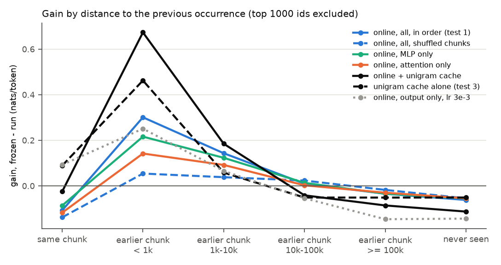

# Test 4: quick checks on test 3's result

**Question.** How much of the online gain is local (from recently seen material), and which parts
of the network carry it? Does mixing in a unigram cache add to the online learner? Were test 3's
baselines under-tuned? And could the books be in Pythia's training data?

**Answer.**
- **Local vs global:** 61% of the overall gain survives shuffling the chunks (+0.061 of
  +0.099), but the long-range gain is mostly local: only 18% survives within 1k tokens and 27% at
  1k-10k.
- **MLP vs attention:** updating only the MLPs keeps most of the long-range gain (+0.216 within 1k,
  +0.123 at 1k-10k); updating only attention keeps less. Both still pay a same-chunk cost.
- **Online + cache:** adding the unigram cache helps a lot up to 10k tokens (+0.673 within 1k) but
  hurts beyond, so overall it is only slightly better than online alone (+0.102 against +0.099).
- **Tuning:** the output-only baseline was under-tuned in test 3; at lr 3e-3 it gains +0.072
  overall (test 3's README now reports both rates). The unigram cache was not.
- **Contamination:** the Pile's PG-19 component is almost certainly PG-19's training split only, so
  these test books are very likely not in it.

## Setup

Test 1's stream, chunks (L = 256) and distance bins, compared token by token with test 1's frozen
losses. Gain = frozen - run.

| run | what it does |
|---|---|
| online, in order | test 1 (Pythia-14M, all parameters, lr 1e-4) |
| online, shuffled | the same learner on the same chunks in a random order (seed 0) across all books; losses put back in stream order |
| MLP only | online, updating only the MLP weights and biases of the 6 layers (790272 parameters), lr 1e-4 |
| attention only | online, updating only the attention weights and biases of the 6 layers (396288 parameters), lr 1e-4 |
| online + cache | test 1's online learner with test 3's unigram cache (lam 0.05, half-life 1k) mixed into its predictions. The cache depends only on token ids, so this is exact from test 1's per-token losses (no new run) |
| output only, lr 3e-3 | test 3's output-only run at the better learning rate |

**Locality** = gain in order - gain shuffled, per token: the part of the gain that needs recently
seen material. The shuffled run keeps what adapting to these books in general gives.

Grid extensions on the 2 check books (`checks.csv`): unigram cache lam 0.02 (half-life 1k) 4.5254,
not better than test 3's 4.5242; output only lr 3e-3 4.4800, better than test 3's 4.5110 (lr 1e-3),
so it was rerun on the stream.

For scale: the input and output embeddings have 6.44M parameters each, the 6 layers 1.19M in total.

## Results

`results.csv` (gains and the locality column); per-token losses of the new runs in `losses.npz`
(with the chunk order). Gain over frozen in nats/token.

| bin | tokens | online, in order | online, shuffled | locality | MLP only | attention only | online + cache | unigram cache (test 3) | output only, lr 3e-3 |
|---|---|---|---|---|---|---|---|---|---|
| all tokens | 498046 | +0.099 | +0.061 | +0.038 | +0.085 | +0.061 | +0.102 | +0.017 | +0.072 |
| same chunk | 9881 | -0.107 | -0.138 | +0.030 | -0.086 | -0.118 | -0.025 | +0.089 | +0.092 |
| earlier chunk, < 1k | 17054 | +0.301 | +0.054 | +0.247 | +0.216 | +0.142 | +0.673 | +0.462 | +0.251 |
| earlier chunk, 1k-10k | 34076 | +0.143 | +0.038 | +0.105 | +0.123 | +0.092 | +0.185 | +0.058 | +0.066 |
| earlier chunk, 10k-100k | 44133 | +0.010 | +0.023 | -0.014 | +0.013 | +0.003 | -0.041 | -0.051 | -0.054 |
| earlier chunk, >= 100k | 13178 | -0.035 | -0.018 | -0.017 | -0.035 | -0.030 | -0.086 | -0.051 | -0.146 |
| never seen | 20959 | -0.062 | -0.055 | -0.007 | -0.055 | -0.055 | -0.113 | -0.051 | -0.143 |

Runtime: 4 min 5 s on CPU (grid extensions 4 s, output only 49 s, shuffled 71 s, MLP only 57 s,
attention only 55 s).

## Findings

1. **61% of the overall gain survives shuffling; the long-range gain is mostly local.** With
   the chunks shuffled, the learner still gains +0.061 overall: adapting to PG-19 and old books in
   general does not need the order. But within 1k tokens only 18% survives (+0.054 of +0.301), and
   at 1k-10k 27% (+0.038 of +0.143). Beyond 10k, shuffling does slightly better: the in-order
   learner uses nothing that far back. The cache-like part of the gain is the locality of +0.247
   and +0.105 in the first two earlier-chunk bins.
2. **MLP only keeps most of the long-range gain; attention only less.** MLP only: +0.216 within 1k
   and +0.123 at 1k-10k (72% and 86% of the full learner), +0.085 overall, with 0.79M parameters.
   Attention only: +0.142, +0.092, +0.061 overall. The same-chunk cost shrinks with MLP only
   (-0.086 against -0.107) but does not go away; only runs that leave the network body frozen
   avoid it (output only +0.092, unigram cache +0.089).
3. **Online + cache beats both alone, but only up to 10k tokens.** Within 1k it gains +0.673
   (online +0.301, cache +0.462); at 1k-10k +0.185. It also recovers most of the same-chunk cost
   (-0.025). It is worse beyond 10k and on never-seen tokens (-0.113), so overall it is only slightly
   better than online alone (+0.102 against +0.099). Lam and the half-life were picked for the frozen model.
4. **Output only at lr 3e-3** is as good as the full learner within 1k tokens (+0.251) and better
   in the same chunk (+0.092), but falls off fast (+0.066 at 1k-10k) and costs more beyond 10k.

## Contamination check (no runs)

Pythia was trained on the Pile, which has a "Gutenberg (PG-19)" component.
- **Identity:** the Pile paper (Gao et al. 2020, section 2.12) says it is PG-19 itself: "The
  specific Project Gutenberg derived dataset we used, PG-19, consists of Project Gutenberg books
  from before 1919 (Rae et al. 2019)."
- **Size:** the Datasheet for the Pile (Biderman, Bicheno and Gao 2022, Dataset Composition) gives
  the component as "28,602 documents, totaling 10.88 GiB". 28,602 is exactly the number of books in
  PG-19's *training* split (the splits are 28,602 train, 50 validation, 100 test).
- **Wording:** the same datasheet also says "The entire Project Gutenberg 1919 dataset is contained
  in the Pile", but the document count contradicts a reading that includes validation and test.
- **Silence:** neither document mentions the PG-19 splits or excludes the test books explicitly.

**Conclusion:** the 25 test books are very likely not in the Pile's PG-19 component. The count
match is strong evidence but not a statement from the authors. The books could still be in the Pile
in other forms (other components with book text, web copies of Gutenberg pages, another edition in
PG-19's training split); this was not checked. The frozen loss on these books (4.3922 nats/token)
does not look like memorized text.

## Caveats

- One model, one seed, short books (20k tokens). MLP only and attention only use lr 1e-4 with no
  sweep (test 6 tunes single-layer MLP runs). The output-only lr 3e-3 is at the edge of its grid.
- One random chunk order. The shuffled run also mixes all books from the start, so "global"
  includes adapting to that mix.
- Online + cache uses test 3's lam and half-life, picked for the frozen model.
- The distance bins mix distance with rarity (test 1).
