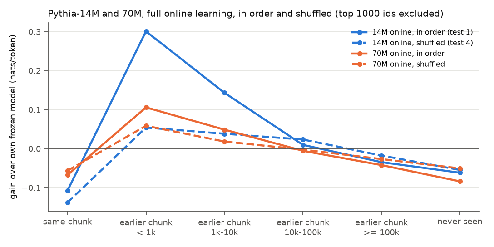
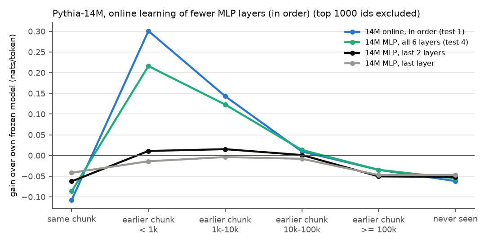

# Test 5: does the cache depend on capacity?

**Status.** Part A (same book vs earlier book) stands. **Parts B and C are superseded by test 6**,
which tuned the learning rates that this test left at grid edges or untuned:
- Part B (Pythia-70M): test 6 found a better rate for 70M (1e-5 instead of 3e-5) and reran it; at
  that rate 70M's locality is even smaller (+0.016 within 1k tokens). Use test 6's 70M numbers.
- Part C (fewer MLP layers): the collapse reported here was under-tuning. With tuned rates the last
  2 layers' MLPs keep +0.225 within 1k tokens and the last layer +0.108 (test 6).

The superseded numbers are kept below for the record.

**Question.** Is the long-range online gain about recency of the token or about being in the same
book? How does it change with a bigger model, and with a smaller adaptive part?

**Answer (Part A).** Mostly about being in the same book. At 1k-10k tokens back, same-book tokens
have a locality of +0.117 and earlier-book tokens +0.025. Same-book tokens 10k-20k back still have
+0.038, more than earlier-book tokens at 1k-10k, while earlier-book tokens at 10k-100k have none
(-0.020).

## Setup

Test 1's stream (25 books x 20k tokens), chunks (L = 256) and distance bins (1000 most frequent ids
excluded), per-token comparisons. Gain = the model's own frozen loss - run. Locality = gain in order
- gain shuffled (test 4's chunk order, seed 0).

- **Part A (no runs).** Each earlier-chunk bin is split by whether the token's previous occurrence
  is in the same book or in an earlier book (test 1's online run, test 4's shuffled and MLP-only
  runs, test 3's unigram cache). Sub-bins with fewer than 500 tokens are skipped. Every book is 20k
  tokens, so "same book" is never more than 20k tokens back, and the >= 100k bin is all earlier
  books.
- **Part B (superseded).** `EleutherAI/pythia-70m` (70.4M parameters, 6 layers, width 512; same
  tokenizer, checked), frozen, online in order and shuffled, full online learning; lr picked from
  {3e-5, 1e-4, 3e-4}: frozen 3.9719, 3e-5 **3.9660**, 1e-4 3.9859, 3e-4 4.1614 (`picks.csv`).
- **Part C (superseded).** Pythia-14M updating only the MLP of the last layer (131712 parameters)
  or of the last 2 layers (263424), lr 1e-4 as test 4's MLP-only run (all 6 layers, 790272), in
  order.

## Results

`results.csv` (one row per bin and book split, a column per run); per-token losses of the new runs
in `losses.npz`. Gain in nats/token.

**Part A: same book vs earlier book (Pythia-14M).** The < 1k bin is almost all same book (its
earlier-book part has 66 tokens and is skipped).

| bin | previous occurrence | tokens | online, in order | online, shuffled | locality | MLP only, all layers | unigram cache |
|---|---|---|---|---|---|---|---|
| earlier chunk, < 1k | all | 17054 | +0.301 ± 0.011 | +0.054 ± 0.008 | +0.247 ± 0.011 | +0.216 ± 0.009 | +0.462 ± 0.025 |
| earlier chunk, < 1k | same book | 16988 | +0.302 ± 0.011 | +0.054 ± 0.008 | +0.248 ± 0.011 | +0.216 ± 0.009 | +0.463 ± 0.025 |
| earlier chunk, 1k-10k | all | 34076 | +0.143 ± 0.009 | +0.038 ± 0.005 | +0.105 ± 0.006 | +0.123 ± 0.007 | +0.058 ± 0.008 |
| earlier chunk, 1k-10k | same book | 29680 | +0.155 ± 0.009 | +0.038 ± 0.005 | +0.117 ± 0.007 | +0.130 ± 0.008 | +0.069 ± 0.009 |
| earlier chunk, 1k-10k | earlier book | 4396 | +0.065 ± 0.009 | +0.040 ± 0.008 | +0.025 ± 0.009 | +0.076 ± 0.008 | -0.016 ± 0.004 |
| earlier chunk, 10k-100k | all | 44133 | +0.010 ± 0.006 * | +0.023 ± 0.004 | -0.014 ± 0.006 | +0.013 ± 0.005 | -0.051 ± 0.000 |
| earlier chunk, 10k-100k | same book | 4814 | +0.065 ± 0.012 | +0.027 ± 0.007 | +0.038 ± 0.010 | +0.063 ± 0.011 | -0.050 ± 0.000 |
| earlier chunk, 10k-100k | earlier book | 39319 | +0.003 ± 0.006 * | +0.023 ± 0.004 | -0.020 ± 0.006 | +0.007 ± 0.005 * | -0.051 ± 0.000 |
| earlier chunk, >= 100k | all | 13178 | -0.035 ± 0.009 | -0.018 ± 0.008 | -0.017 ± 0.007 | -0.035 ± 0.008 | -0.051 ± 0.000 |
| earlier chunk, >= 100k | earlier book | 13178 | -0.035 ± 0.009 | -0.018 ± 0.008 | -0.017 ± 0.007 | -0.035 ± 0.008 | -0.051 ± 0.000 |

Gains in nats/token, token-level means ± SE over books (paired per-book differences; test 10 part A); * = under 2 SE.

**Part B (superseded by test 6): Pythia-14M vs 70M at lr 3e-5**

| bin | book | tokens | 14M in order | 14M locality | 70M in order (lr 3e-5) | 70M shuffled | 70M locality |
|---|---|---|---|---|---|---|---|
| all tokens |  | 498046 | +0.099 | +0.038 | +0.025 | +0.016 | +0.009 |
| same chunk |  | 9881 | -0.107 | +0.030 | -0.068 | -0.057 | -0.011 |
| earlier chunk, < 1k |  | 17054 | +0.301 | +0.247 | +0.106 | +0.059 | +0.047 |
| earlier chunk, < 1k | same book | 16988 | +0.302 | +0.248 | +0.106 | +0.059 | +0.048 |
| earlier chunk, 1k-10k |  | 34076 | +0.143 | +0.105 | +0.049 | +0.018 | +0.030 |
| earlier chunk, 1k-10k | same book | 29680 | +0.155 | +0.117 | +0.051 | +0.019 | +0.031 |
| earlier chunk, 1k-10k | earlier book | 4396 | +0.065 | +0.025 | +0.036 | +0.011 | +0.026 |
| earlier chunk, 10k-100k |  | 44133 | +0.010 | -0.014 | -0.005 | -0.003 | -0.003 |
| earlier chunk, 10k-100k | same book | 4814 | +0.065 | +0.038 | +0.011 | -0.001 | +0.013 |
| earlier chunk, 10k-100k | earlier book | 39319 | +0.003 | -0.020 | -0.008 | -0.003 | -0.005 |
| earlier chunk, >= 100k |  | 13178 | -0.035 | -0.017 | -0.042 | -0.027 | -0.015 |
| never seen |  | 20959 | -0.062 | -0.007 | -0.084 | -0.051 | -0.033 |

**Part C (superseded by test 6): fewer MLP layers at lr 1e-4 (Pythia-14M, in order)**

| bin | tokens | MLP all 6 layers | MLP last 2 layers | MLP last layer |
|---|---|---|---|---|
| all tokens | 498046 | +0.085 | +0.030 | +0.020 |
| same chunk | 9881 | -0.086 | -0.062 | -0.042 |
| earlier chunk, < 1k | 17054 | +0.216 | +0.011 | -0.014 |
| earlier chunk, 1k-10k | 34076 | +0.123 | +0.015 | -0.004 |
| earlier chunk, 10k-100k | 44133 | +0.013 | +0.001 | -0.008 |
| earlier chunk, >= 100k | 13178 | -0.035 | -0.050 | -0.047 |
| never seen | 20959 | -0.055 | -0.052 | -0.047 |

Runtime: 11 min 3 s on CPU (MLP last layer 48 s, last 2 layers 50 s, 70M picks 58 s, 70M frozen
109 s, in order 196 s, shuffled 192 s).

## Findings

1. **Part A: the long-range gain is mostly about being in the same book.** At 1k-10k, same-book
   tokens gain +0.155 (locality +0.117), earlier-book tokens +0.065 (locality +0.025). Same-book
   tokens 10k-20k back still have a locality of +0.038, more than closer earlier-book tokens, and
   earlier-book tokens at 10k-100k have none (-0.020). So the fall of the gain with distance in test
   1 is largely the fall in the share of same-book tokens. Distance still matters within a book
   (locality +0.248, +0.117, +0.038). The unigram cache depends more on distance than on the book:
   at 1k-10k it gains +0.069 on same-book tokens and -0.016 on earlier-book ones, but at 10k-20k
   within the same book it already loses (-0.050), where online learning still gains +0.065.
2. **Part B (superseded):** at lr 3e-5, 70M's locality was 5x smaller than 14M's within 1k tokens
   (+0.047 against +0.247). Test 6 tuned 70M further and found it smaller still.
3. **Part C (superseded):** at lr 1e-4, updating only the last 1-2 layers' MLPs lost almost all the
   long-range gain. Test 6 shows this was under-tuning.

## Caveats

- One seed; Part A reuses runs with one learning rate each.
- Same-book and earlier-book tokens differ in more than book membership: same-book tokens 10k-20k
  back sit late in a book, after more adaptation to it; earlier-book tokens at 1k-10k sit early in
  a new book.
