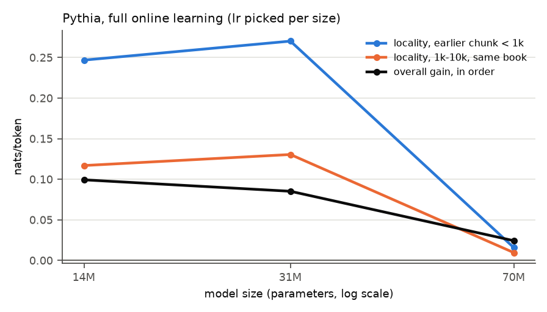
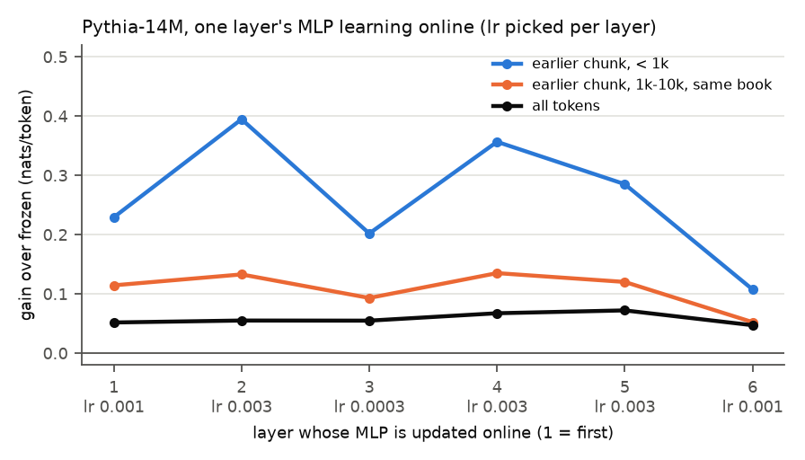

# Test 6: tuning gaps, where the cache lives, and a size curve

**Question.** Do test 5's conclusions survive tuning the learning rates? Which layers' MLPs hold
the context memory? How does locality change across three model sizes?

**Answer.**
- **70M after tuning:** its locality stays far below 14M's and gets smaller at its best rate
  (+0.016 within 1k tokens, against +0.247 for 14M). These runs replace test 5's 70M numbers.
- **Smaller adaptive parts:** test 5's collapse was under-tuning. Tuned, the last 2 layers' MLPs
  (263424 parameters) keep +0.225 within 1k tokens, about what all 6 MLPs keep at lr 1e-4 (+0.216);
  the last layer alone keeps +0.108.
- **Where the memory lives:** every layer's MLP can hold it except the last, which is the weakest.
  A single MLP in layer 2 or 4 (131712 parameters) gains more within 1k tokens than the full
  learner (+0.395 and +0.357 against +0.301), but at a higher learning rate (3e-3, at the grid
  edge), with lower overall gains (+0.055 and +0.067 against +0.099) and larger losses on
  never-seen tokens (-0.129 and -0.116 against -0.062).
- **Size curve:** not a steady fall. 31M's locality is as large as 14M's (+0.270 within 1k), and
  the drop happens between 31M and 70M.

## Setup

Test 1's stream, chunks (L = 256), distance bins (1000 most frequent ids excluded), test 5's
same-book / earlier-book split (sub-bins under 500 tokens skipped), per-token comparisons. Gain =
the model's own frozen loss - run. Locality = gain in order - gain shuffled (test 4's order, seed 0).

Learning rates are picked on the 2 check books (lowest mean loss). If the best is at the edge of
its grid, the grid is extended once by one step (1-3-10 ladder) in that direction.

| part | runs | grid |
|---|---|---|
| A | Pythia-70M (70426624 parameters), full online learning, in order and shuffled | {1e-5, 3e-5} |
| B | Pythia-14M, MLP of the last layer (131712 parameters) and of the last 2 layers (263424), in order | {1e-4, 3e-4, 1e-3} |
| C | Pythia-14M, MLP of a single layer i = 1..6 (131712 parameters each), in order; layer 6 is Part B's last layer | {1e-4, 3e-4, 1e-3} per layer |
| D | Pythia-31M (30494720 parameters, same tokenizer, checked), frozen, in order and shuffled | {3e-5, 1e-4, 3e-4} |

**Picks** (`picks.csv`, mean loss on the check books; * = grid extension; **bold** = chosen):

| run | frozen | 3e-6 | 1e-5 | 3e-5 | 1e-4 | 3e-4 | 1e-3 | 3e-3 |
|---|---|---|---|---|---|---|---|---|
| 70M | 3.9719 | 3.9672* | **3.9612** | 3.9660 | | | | |
| 31M | 4.2050 | | | 4.1795 | 4.1647 | **4.1483** | 4.1652* | |
| 14M MLP, layer 1 | 4.5474 | | | | 4.5242 | 4.5106 | **4.4953** | 4.6570* |
| 14M MLP, layer 2 | 4.5474 | | | | 4.5245 | 4.5090 | 4.4877 | **4.4863*** |
| 14M MLP, layer 3 | 4.5474 | | | | 4.5159 | **4.5056** | 4.5093 | |
| 14M MLP, layer 4 | 4.5474 | | | | 4.5324 | 4.5185 | 4.4970 | **4.4845*** |
| 14M MLP, layer 5 | 4.5474 | | | | 4.5374 | 4.5260 | 4.5063 | **4.4882*** |
| 14M MLP, layer 6 (last) | 4.5474 | | | | 4.5368 | 4.5255 | **4.5114** | 4.6089* |
| 14M MLP, last 2 layers | 4.5474 | | | | 4.5294 | 4.5128 | **4.4949** | 4.5894* |

Layers 2, 4 and 5 are still at the edge after the one extension (3e-3). 70M's best rate (1e-5) is
below test 5's 3e-5, so 70M was rerun in order and shuffled at 1e-5. Even tuned, 70M gains only
0.011 from online learning on the check books (3.9719 to 3.9612).

## Results

`results.csv` (one row per bin and book split, a column per run); per-token losses of the new runs
in `losses.npz`. Gain in nats/token. The >= 100k bin is all earlier book.

**Parts A and D: model size** (full online learning; gain over each model's own frozen loss;
learning rates 14M 1e-4, 31M 3e-4, 70M 1e-5; frozen loss over all tokens 4.3922, 4.0404, 3.8185)

| bin | book | tokens | 14M in order | 14M locality | 31M in order | 31M shuffled | 31M locality | 70M in order | 70M shuffled | 70M locality |
|---|---|---|---|---|---|---|---|---|---|---|
| all tokens |  | 498046 | +0.099 | +0.038 | +0.085 | +0.046 | +0.039 | +0.024 | +0.020 | +0.004 |
| same chunk |  | 9881 | -0.107 | +0.030 | -0.102 | -0.089 | -0.012 | -0.039 | -0.022 | -0.018 |
| earlier chunk, < 1k |  | 17054 | +0.301 | +0.247 | +0.373 | +0.103 | +0.270 | +0.048 | +0.032 | +0.016 |
| earlier chunk, < 1k | same book | 16988 | +0.302 | +0.248 | +0.375 | +0.103 | +0.271 | +0.048 | +0.032 | +0.016 |
| earlier chunk, 1k-10k |  | 34076 | +0.143 | +0.105 | +0.155 | +0.036 | +0.118 | +0.033 | +0.024 | +0.009 |
| earlier chunk, 1k-10k | same book | 29680 | +0.155 | +0.117 | +0.171 | +0.040 | +0.131 | +0.034 | +0.025 | +0.010 |
| earlier chunk, 1k-10k | earlier book | 4396 | +0.065 | +0.025 | +0.050 | +0.013 | +0.037 | +0.026 | +0.018 | +0.008 |
| earlier chunk, 10k-100k |  | 44133 | +0.010 | -0.014 | -0.010 | +0.011 | -0.021 | +0.018 | +0.014 | +0.004 |
| earlier chunk, 10k-100k | same book | 4814 | +0.065 | +0.038 | +0.059 | +0.020 | +0.038 | +0.019 | +0.015 | +0.005 |
| earlier chunk, 10k-100k | earlier book | 39319 | +0.003 | -0.020 | -0.018 | +0.009 | -0.028 | +0.018 | +0.014 | +0.004 |
| earlier chunk, >= 100k |  | 13178 | -0.035 | -0.017 | -0.035 | -0.009 | -0.025 | -0.015 | -0.003 | -0.012 |
| never seen |  | 20959 | -0.062 | -0.007 | -0.041 | -0.021 | -0.020 | -0.037 | -0.023 | -0.014 |

**Parts B and C: MLP of fewer or single layers** (Pythia-14M, in order; lr in brackets; "MLP all
6" is test 4's run)

| bin | book | all parameters [1e-4] | MLP all 6 [1e-4] | MLP last 2 [1e-3] | layer 1 [1e-3] | layer 2 [3e-3] | layer 3 [3e-4] | layer 4 [3e-3] | layer 5 [3e-3] | layer 6 [1e-3] |
|---|---|---|---|---|---|---|---|---|---|---|
| all tokens |  | +0.099 | +0.085 | +0.070 | +0.052 | +0.055 | +0.055 | +0.067 | +0.072 | +0.047 |
| same chunk |  | -0.107 | -0.086 | -0.076 | -0.079 | -0.137 | -0.088 | -0.093 | -0.076 | -0.053 |
| earlier chunk, < 1k |  | +0.301 | +0.216 | +0.225 | +0.229 | +0.395 | +0.202 | +0.357 | +0.285 | +0.108 |
| earlier chunk, < 1k | same book | +0.302 | +0.216 | +0.225 | +0.231 | +0.396 | +0.202 | +0.357 | +0.286 | +0.108 |
| earlier chunk, 1k-10k |  | +0.143 | +0.123 | +0.097 | +0.103 | +0.111 | +0.085 | +0.117 | +0.109 | +0.051 |
| earlier chunk, 1k-10k | same book | +0.155 | +0.130 | +0.104 | +0.115 | +0.133 | +0.093 | +0.135 | +0.120 | +0.052 |
| earlier chunk, 1k-10k | earlier book | +0.065 | +0.076 | +0.050 | +0.023 | -0.034 | +0.030 | -0.004 | +0.033 | +0.041 |
| earlier chunk, 10k-100k |  | +0.010 | +0.013 | -0.024 | -0.007 | -0.067 | -0.010 | -0.056 | -0.035 | -0.016 |
| earlier chunk, 10k-100k | same book | +0.065 | +0.063 | +0.029 | +0.049 | +0.002 | +0.026 | +0.015 | +0.028 | +0.009 |
| earlier chunk, 10k-100k | earlier book | +0.003 | +0.007 | -0.030 | -0.014 | -0.076 | -0.014 | -0.064 | -0.043 | -0.019 |
| earlier chunk, >= 100k |  | -0.035 | -0.035 | -0.095 | -0.056 | -0.127 | -0.044 | -0.112 | -0.092 | -0.085 |
| never seen |  | -0.062 | -0.055 | -0.095 | -0.054 | -0.129 | -0.058 | -0.116 | -0.090 | -0.084 |

Runtime: 21 min 25 s on CPU (14M picks 110 s and 7 runs of 48-54 s; 31M picks 35 s, frozen 87 s,
in order 108 s, shuffled 114 s; 70M picks 51 s, in order 203 s, shuffled 195 s).

## Findings

1. **70M's locality stays far below 14M's after tuning.** At its best rate (1e-5) it is +0.016
   within 1k tokens and +0.010 at 1k-10k (same book), against +0.247 and +0.117 for 14M (test 5
   had +0.047 and +0.031 at 3e-5). 70M barely gains from online learning at any rate on the check
   books, so this is not a tuning artefact.
2. **With tuned rates, a smaller adaptive part keeps much of the long-range gain.** Last 2 layers
   at 1e-3: +0.225 within 1k and +0.104 at 1k-10k (same book), close to all 6 MLPs at 1e-4 (+0.216,
   +0.130). Last layer at 1e-3: +0.108 and +0.052. Where the gain disappears hardly moves (positive
   within the book up to 10k, about zero or negative in earlier books beyond 10k), but within the
   book smaller parts fade sooner: at 10k-20k back, +0.029 and +0.009 against +0.063 for all 6. The
   higher rates also cost more on far and never-seen tokens (-0.095 and -0.084 against -0.055).
3. **Every layer's MLP except the last can hold the context memory, the middle ones best.** A
   single MLP of layer 2 or 4 (lr 3e-3) gains +0.395 and +0.357 within 1k, more than the full
   learner (+0.301), and +0.133 and +0.135 at 1k-10k (same book), close to it (+0.155). Layers 1, 3
   and 5 are a step lower; layer 3's best rate was 10x smaller (3e-4), which tracks its lower gain.
   The last layer is clearly the weakest (+0.108, +0.052). The larger short-range gains come with
   larger losses on tokens not seen recently (layer 2: -0.129 on never-seen tokens).
4. **Locality does not fall steadily with size.** 31M matches or slightly exceeds 14M (+0.270
   against +0.247 within 1k, +0.131 against +0.117 at 1k-10k same book, +0.039 against +0.038
   overall). The drop is between 31M and 70M (+0.016, +0.010). The overall in-order gain falls more
   gently: +0.099, +0.085, +0.024. With one seed and three sizes this looks more like something
   specific to how 70M responds to plain SGD than a smooth size trend.

## Caveats

- One seed, one learning rate per run (from a 3-4 value check). Three single-layer picks are still
  at the grid edge (3e-3), so those layers may gain more at higher rates.
- Comparisons across layers and sizes mix in the learning rate: higher rates give larger
  short-range gains and larger costs elsewhere.
- Three model sizes from one family; the picks optimize the overall check-book loss, not locality.
- Same-book and earlier-book tokens also differ in where they sit in a book (test 5).
