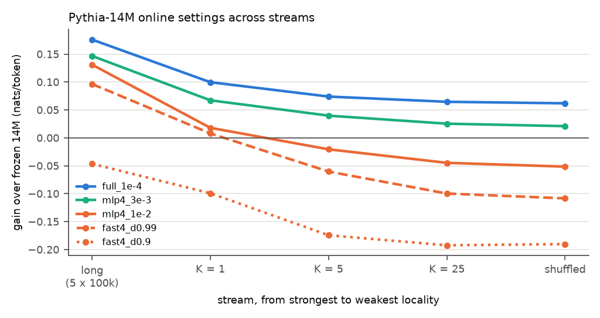
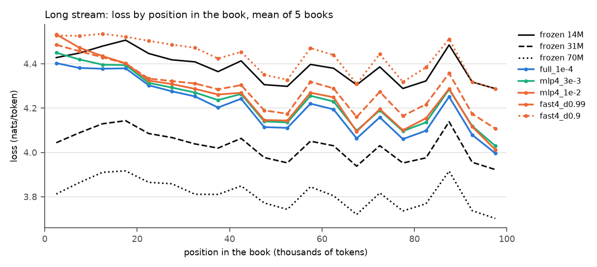

# Test 7: a more aggressive cache, and when it pays off

**Questions.**
1. Does a more aggressive cache gain more when the input has strong locality and lose more when it
   has little, so that the settings cross over as locality decreases?
2. With strong locality, how much of the gap between Pythia-14M and the bigger frozen models (31M,
   70M) can an aggressive 14M close?
3. Does an explicit decay (a fast part that fades back to the original weights) keep the cost low
   when locality is weak?

**Answers.**
1. **No crossover in these streams.** The conservative setting (`full_1e-4`) gains most on every
   stream, and the order of the five settings is the same everywhere. The aggressive settings do
   gain more where locality helps: on same-book tokens under 10k tokens back, +0.267 (`mlp4_1e-2`)
   and +0.295 (`fast4_d0.99`) against +0.210 on K = 1. They lose much more elsewhere: -0.292 and
   -0.234 against -0.059 on never-seen tokens. The gap between `full_1e-4` and `mlp4_1e-2` shrinks
   as locality grows (0.113 on shuffled, 0.082 on K = 1, 0.045 on the long books), so a crossover
   may exist at stronger locality than tested here.
2. **About half of the gap to 31M on the long books, and about 80% by the end of a book.** Over the
   long stream `full_1e-4` closes 50% of the 14M-31M gap (31% of the 14M-70M gap); the layer-4
   settings close less (41%, 37%, 27% and -13%, from `mlp4_3e-3` to `fast4_d0.9`). By the last 5k tokens of a 100k-token book `full_1e-4` closes 80%
   and `mlp4_1e-2` 75%, but no setting reaches frozen 31M at any position.
3. **No: decay makes the cost larger.** At the same layer and learning rate, the decaying fast part
   is worse than plain updates on every stream, and the shorter the half-life the worse: on
   shuffled -0.051 (no decay), -0.108 (decay 0.99), -0.190 (decay 0.9). Decay throws away the slowly
   accumulated general adaptation (most of the gain on weak-locality streams) while the large
   learning rate still adds noise.

## Setup

**Chunks.** Each book is chunked on its own (L = 256, remainder dropped), so every stream below
holds exactly the same chunks and frozen losses are identical across them; chunks are scored
independently, as in tests 1-6.
- **25-book chunk set:** the 25 stream books (20k tokens each): 78 chunks per book, 497250 scored
  tokens.
- **Long chunk set:** the first 5 PG-19 test books in dataset order (check books excluded) with at
  least 100k tokens, cut to 100k (`data.long_books()`; 12 shorter books skipped): Frank Merriwell
  Down South, On the Portraits of English Authors on Gardening, Laurence Sterne in Germany, The Life
  of Gordon Volume II, In Her Own Right. 390 chunks per book, 497250 scored tokens. All five are
  also among the 25 stream books (their first 20k tokens are in both chunk sets).

**Streams** (the locality knob), from strongest to weakest locality:
- **long:** the long books one after the other;
- **K = 1:** the 25 books one after the other;
- **K = 5:** groups of 5 books (stream order); inside a group, chunks round-robin (chunk 1 of each
  of the 5 books, then chunk 2 of each, ...);
- **K = 25:** round-robin across all 25 books;
- **shuffled:** all 25-book chunks in one random order (seed 0).

**Settings** (Pythia-14M, prequential: score a chunk, then update), from conservative to
aggressive; no learning-rate sweeps:

| setting | updated parameters | update |
|---|---|---|
| `full_1e-4` | all | SGD, lr 1e-4 (test 1) |
| `mlp4_3e-3` | MLP of layer 4 (weights and biases, 131712 parameters) | SGD, lr 3e-3 (test 6's pick) |
| `mlp4_1e-2` | MLP of layer 4 | SGD, lr 1e-2 |
| `fast4_d0.99` | MLP of layer 4 | fast part F, starting at 0: predict with W + F; after each chunk F <- 0.99 F - 1e-2 g, g the gradient at W + F; W never changes (F halves in about 69 chunks, 18k tokens) |
| `fast4_d0.9` | MLP of layer 4 | the same with decay 0.9 (half-life about 7 chunks, 1.7k tokens) |

With decay 1 the fast-part update is plain SGD; checked on 5k tokens, the two differ only by
float rounding (weights by at most 7.5e-9, mean loss by 1e-5 nats/token).

Divergence rule: a setting that gave NaN, or was worse than frozen by more than 0.05 nats/token on
every stream, would be rerun once at half its lr. None was: `fast4_d0.9` came closest (-0.046 on
the long stream).

**Frozen references:** Pythia-14M, 31M and 70M, once on each chunk set.

**Token classes for Table 2** (25-book chunk set): previous occurrence of the same token id in book
order (the K = 1 stream), test 1's bins (1000 most frequent ids excluded) and test 5's same-book
split. "Same book, < 10k" = previous occurrence in an earlier chunk of the same book, under 10k
tokens back (46767 tokens); "never seen" = first occurrence in book order (21046 tokens). The same
tokens are compared on K = 1 and shuffled.

## Results

`results.csv` (one row per setting and stream, with loss, gain, gap closed and seconds; frozen 31M
and 70M as rows), `bins.csv` (Table 2), `position.csv` (Plot 2), per-token losses in `losses.npz`
(float16, [book, chunk, position], frozen models and the long, K = 1 and shuffled runs; 19 MB).
Gain = frozen 14M loss - run loss, nats/token.

**Table 1a: gain over frozen 14M**

| setting | long | K = 1 | K = 5 | K = 25 | shuffled |
|---|---|---|---|---|---|
| `full_1e-4` | +0.176 ± 0.023 | +0.100 ± 0.006 | +0.074 | +0.065 | +0.062 ± 0.003 |
| `mlp4_3e-3` | +0.147 ± 0.023 | +0.067 ± 0.006 | +0.040 | +0.025 | +0.021 ± 0.003 |
| `mlp4_1e-2` | +0.131 ± 0.030 | +0.018 ± 0.013 * | -0.021 | -0.045 | -0.051 ± 0.004 |
| `fast4_d0.99` | +0.097 ± 0.023 | +0.008 ± 0.013 * | -0.060 | -0.100 | -0.108 ± 0.004 |
| `fast4_d0.9` | -0.046 ± 0.019 | -0.099 ± 0.011 | -0.174 | -0.192 | -0.190 ± 0.005 |
| frozen 31M (reference) | +0.354 ± 0.020 | +0.353 ± 0.007 | +0.353 | +0.353 | +0.353 ± 0.007 |
| frozen 70M (reference) | +0.572 ± 0.031 | +0.575 ± 0.009 | +0.575 | +0.575 | +0.575 ± 0.009 |

Gains in nats/token, token-level means ± SE over books (paired per-book differences; test 10 part A); * = under 2 SE. K = 5 and K = 25 have no SE (no per-token losses saved).

Frozen losses: 14M 4.3845 (long) and 4.3926 (25-book chunks), 31M 4.0301 and 4.0392, 70M 3.8129
and 3.8174.

**Table 1b: share of the gap closed**, (frozen14 - run) / (frozen14 - frozen31), and the same for
70M, as 31M / 70M:

| setting | long | K = 1 | K = 5 | K = 25 | shuffled |
|---|---|---|---|---|---|
| `full_1e-4` | 50% / 31% | 28% / 17% | 21% / 13% | 18% / 11% | 18% / 11% |
| `mlp4_3e-3` | 41% / 26% | 19% / 12% | 11% / 7% | 7% / 4% | 6% / 4% |
| `mlp4_1e-2` | 37% / 23% | 5% / 3% | -6% / -4% | -13% / -8% | -15% / -9% |
| `fast4_d0.99` | 27% / 17% | 2% / 1% | -17% / -10% | -28% / -17% | -31% / -19% |
| `fast4_d0.9` | -13% / -8% | -28% / -17% | -49% / -30% | -54% / -33% | -54% / -33% |

**Table 2: where gains and costs come from** (gain over frozen 14M on the same tokens)

| setting | K = 1: same book < 10k | K = 1: never seen | K = 1: all | shuffled: same book < 10k | shuffled: never seen | shuffled: all |
|---|---|---|---|---|---|---|
| `full_1e-4` | +0.210 ± 0.009 | -0.059 ± 0.013 | +0.100 ± 0.006 | +0.044 ± 0.005 | -0.055 ± 0.009 | +0.062 ± 0.003 |
| `mlp4_3e-3` | +0.215 ± 0.011 | -0.114 ± 0.013 | +0.067 ± 0.006 | +0.004 ± 0.006 * | -0.104 ± 0.009 | +0.021 ± 0.003 |
| `mlp4_1e-2` | +0.267 ± 0.020 | -0.292 ± 0.016 | +0.018 ± 0.013 * | -0.079 ± 0.009 | -0.227 ± 0.013 | -0.051 ± 0.004 |
| `fast4_d0.99` | +0.295 ± 0.021 | -0.234 ± 0.017 | +0.008 ± 0.013 * | -0.154 ± 0.007 | -0.227 ± 0.013 | -0.108 ± 0.004 |
| `fast4_d0.9` | +0.138 ± 0.016 | -0.191 ± 0.013 | -0.099 ± 0.011 | -0.182 ± 0.006 | -0.219 ± 0.010 | -0.190 ± 0.005 |

Gains in nats/token, token-level means ± SE over books (paired per-book differences; test 10 part A); * = under 2 SE.

**Plot 2: long stream, loss by position in the book** (bins of 5k tokens, mean of the 5 books;
frozen 31M and 70M as reference lines):

Share of the 14M-31M gap closed in the first and last 5k tokens of a book (`position.csv`):

| setting | 0k-5k | 95k-100k |
|---|---|---|
| `full_1e-4` | 6% | 80% |
| `mlp4_3e-3` | -6% | 71% |
| `mlp4_1e-2` | -27% | 75% |
| `fast4_d0.99` | -15% | 49% |
| `fast4_d0.9` | -26% | 0% |

**Runtimes** (CPU, wall time per run over 497250 scored tokens; total 32 min 17 s):

| run | seconds |
|---|---|
| frozen 14M (25-book chunks / long) | 81 / 82 |
| frozen 31M | 91 / 90 |
| frozen 70M | 114 / 121 |
| `full_1e-4`, any stream | 70-71 |
| layer-4 MLP settings, any stream | 50-51 |

The frozen runs score 16 chunks per batch; the online runs score one chunk and take one update at a
time. On this CPU an online 14M pass costs less wall time than a frozen 14M pass, and a frozen 70M
pass about 1.5 times as much.

## Findings

1. **The most conservative setting wins everywhere, but by less as locality grows.** The order of
   the settings never changes, so there is no crossover between long and shuffled. The aggressive
   settings trade a larger same-book gain for a much larger cost on everything else (Table 2), and
   only on the long stream does the trade come close to paying off: `mlp4_1e-2` is 0.045 behind
   `full_1e-4` there, against 0.113 on shuffled.
2. **Aggressive settings pay a switching cost at the start of each book and catch up later.** In
   the first 5k tokens of a long book `mlp4_1e-2` is 0.105 nats/token worse than frozen, while
   `full_1e-4` is already 0.025 better; by 95k-100k `mlp4_1e-2` closes 75% of the gap to 31M,
   ahead of `mlp4_3e-3` (71%) and close to `full_1e-4` (80%).
3. **Strong locality lets 14M close half of the gap to 31M, not more on average.** `full_1e-4`
   gains +0.176 over the long stream, half of 31M's +0.354 and about a third of 70M's +0.572, and
   reaches 80% of the 31M gap only late in a book. Frozen 31M stays better at every position.
4. **Decay does not protect against weak locality.** Both decaying settings are worse than the plain
   layer-4 updates at the same learning rate on every stream, and worse on shuffled than on K = 1.
   Their K = 1 gain on same-book tokens is the highest of all (+0.295 for decay 0.99), but the cost
   on everything else is larger.

## Caveats

- One seed, one learning rate per setting (no sweep; the decay settings reuse lr 1e-2), one model
  size for the online settings.
- Five long books, which are also in the 25-book set; the long stream is 500k tokens.
- The fast part covers only layer 4's MLP; a fast part on all parameters, or a smaller fast learning
  rate with decay, was not tried.
- Wall time is only a rough compute proxy: frozen and online runs batch differently, and CPU timing
  varies.
- Table 2's token classes use book order; in the shuffled stream "same book < 10k" tokens are no
  longer recent, which is the point of the comparison.
