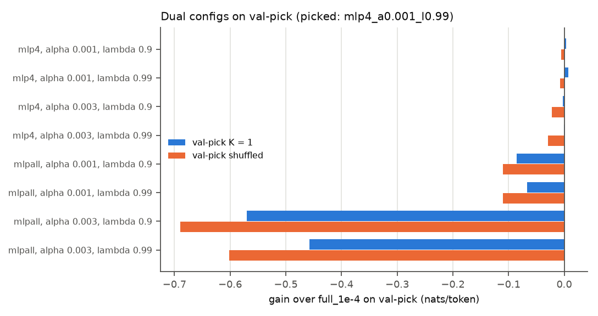
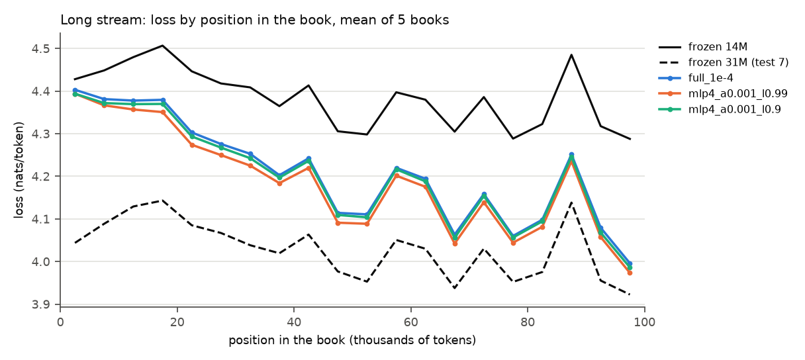

# Test 8: dual weights

**Question.** Does a fast, decaying part on top of the slow learner (test 7's `full_1e-4`) add
anything, and on which streams?

**Answer.** A small fast part on layer 4's MLP adds a little where locality is strong and costs a
little where it is weak. The picked config (alpha 1e-3, lambda 0.99) gains +0.012 nats/token over
`full_1e-4` on K = 1 and +0.021 on the long books, and loses 0.008 on shuffled. The gain comes
from recent same-book tokens (+0.058 over `full_1e-4` on K = 1), at almost no extra cost on
never-seen tokens (-0.006). Locality rises from +0.038 to +0.058. A fast part on all six MLPs
hurts on every validation stream, badly at alpha 3e-3.

## Setup

**Update rule** (`dual.py`): the model predicts with S + F; F starts at 0. After scoring a chunk,
with g the gradient of the chunk loss at S + F: S <- S - 1e-4 g on all parameters (exactly
`full_1e-4`), and F <- lambda F - alpha g on the tensors with a fast part. Without a fast part the
code reproduces test 7's `full_1e-4` exactly on all three test streams (same losses to 4 decimals;
bit-identical per-token losses in a direct check).

**Configs:** fast part on (a) layer 4's MLP weights (`mlp4`: the two weight matrices, no biases)
or (b) all six MLPs' weights (`mlpall`); alpha in {1e-3, 3e-3}; lambda in {0.9, 0.99}. 8 configs.

**Validation streams** (PG-19 validation split, `data.val_books()`): the 42 validation books
with at least 20k tokens (8 shorter ones skipped), cut to 20k, chunked per book like test 7.
- **val-pick:** the first 10 books, K = 1 and the same chunks shuffled (seed 0); 780 chunks.
- **val-meta-train / val-meta-heldout** (used in test 9): the next 26 books and the last 6.

No test book (stream, check or long books) is used for picking or meta-training.

**Pick:** the config with the lowest mean loss on val-pick K = 1, run on test 7's test streams
(K = 1, shuffled, long). The best config on val-pick shuffled was different, so it was run on the
test streams too.

## Results

`results.csv` (validation and test rows), `bins.csv`, `position.csv`, per-token losses of the
test-stream runs in `losses.npz` (float16).

**Validation (val-pick, 10 books):** mean loss; gain over `full_1e-4` in brackets. Frozen 14M
4.3354.

| config | K = 1 | shuffled |
|---|---|---|
| `full_1e-4` | 4.2565 | 4.2841 |
| `mlp4`, alpha 1e-3, lambda 0.9 | 4.2531 (+0.003) | **4.2899 (-0.006)** |
| `mlp4`, alpha 1e-3, lambda 0.99 | **4.2496 (+0.007)** | 4.2912 (-0.007) |
| `mlp4`, alpha 3e-3, lambda 0.9 | 4.2585 (-0.002) | 4.3067 (-0.023) |
| `mlp4`, alpha 3e-3, lambda 0.99 | 4.2575 (-0.001) | 4.3132 (-0.029) |
| `mlpall`, alpha 1e-3, lambda 0.9 | 4.3417 (-0.085) | 4.3939 (-0.110) |
| `mlpall`, alpha 1e-3, lambda 0.99 | 4.3232 (-0.067) | 4.3946 (-0.110) |
| `mlpall`, alpha 3e-3, lambda 0.9 | 4.8260 (-0.570) | 4.9740 (-0.690) |
| `mlpall`, alpha 3e-3, lambda 0.99 | 4.7139 (-0.457) | 4.8857 (-0.602) |

Picked on val-pick K = 1: **`mlp4`, alpha 1e-3, lambda 0.99**. Best on val-pick shuffled:
`mlp4`, alpha 1e-3, lambda 0.9, still worse than `full_1e-4` there: no dual config beats the slow
learner alone on shuffled validation chunks. Both picks are at the low edge of the alpha grid.

**Test streams** (gain over frozen 14M, and over `full_1e-4`, nats/token):

| config | K = 1 | shuffled | long | locality (K = 1 - shuffled) |
|---|---|---|---|---|
| `full_1e-4` | +0.100 ± 0.006 | +0.062 ± 0.003 | +0.176 ± 0.023 | +0.038 ± 0.004 |
| dual, alpha 1e-3, lambda 0.99 (pick) | +0.112 ± 0.007 (+0.012 ± 0.001) | +0.054 ± 0.003 (-0.008 ± 0.000) | +0.197 ± 0.025 (+0.021 ± 0.003) | +0.058 ± 0.005 |
| dual, alpha 1e-3, lambda 0.9 | +0.106 ± 0.006 (+0.006 ± 0.001) | +0.057 ± 0.003 (-0.005 ± 0.000) | +0.183 ± 0.023 (+0.007 ± 0.001) | +0.049 ± 0.004 |

Gain over frozen 14M, and over `full_1e-4` in brackets. Gains in nats/token, token-level means ± SE over books (paired per-book differences; test 10 part A); * = under 2 SE.

Frozen 14M: 4.3926 (25-book chunks), 4.3845 (long). On the long books the pick closes 55% of the
14M-31M gap (`full_1e-4`: 50%).

**Where gains and costs come from** (test 7's token classes on the 25-book chunks; gain over
frozen 14M, and over `full_1e-4` in brackets):

| config | K = 1: same book < 10k | K = 1: never seen | shuffled: same book < 10k | shuffled: never seen |
|---|---|---|---|---|
| `full_1e-4` | +0.210 ± 0.009 | -0.059 ± 0.013 | +0.044 ± 0.005 | -0.055 ± 0.009 |
| dual, lambda 0.99 (pick) | +0.268 ± 0.011 (+0.058 ± 0.004) | -0.065 ± 0.014 (-0.006 ± 0.003) | +0.035 ± 0.005 (-0.009 ± 0.001) | -0.066 ± 0.010 (-0.011 ± 0.003) |
| dual, lambda 0.9 | +0.237 ± 0.010 (+0.027 ± 0.002) | -0.060 ± 0.013 (-0.001 ± 0.002 *) | +0.039 ± 0.005 (-0.005 ± 0.001) | -0.058 ± 0.009 (-0.004 ± 0.002) |

Gains in nats/token, token-level means ± SE over books (paired per-book differences; test 10 part A); * = under 2 SE.

**Long stream, loss by position in the book** (5k bins, mean of 5 books; frozen 31M from test 7):
the pick is below `full_1e-4` in every bin, by 0.009 in the first 5k tokens and 0.022 in the last.
In the last 5k tokens it closes 86% of the 14M-31M gap (`full_1e-4`: 80%); frozen 31M stays better
at every position.

**Runtimes** (CPU): val-pick runs 28-29 s each (780 chunks), frozen 14M on val-pick 33 s; test
streams 69-70 s per run, frozen 14M 82 s per chunk set; 22 min 15 s in total.

## Findings

1. **The fast part adds a little on top of the slow learner, only with locality.** +0.012 on K = 1
   and +0.021 on the long books, -0.008 on shuffled. The added gain is concentrated on recent
   same-book tokens (+0.058 over `full_1e-4`), with a small cost elsewhere.
2. **Slow decay works better than fast decay** on K = 1 and long (lambda 0.99: half-life 69 chunks,
   about 18k tokens; lambda 0.9: 7 chunks); on shuffled the faster decay costs slightly less.
3. **A fast part on all six MLPs hurts** on every validation stream, even at alpha 1e-3 (-0.067 to
   -0.110); at alpha 3e-3 it is unstable (-0.46 to -0.69). One middle-layer MLP is enough.
4. Compared with test 7's aggressive settings (a fast part alone, lr 1e-2, no slow learner), adding
   the fast part on top of the slow learner keeps the slow learner's general adaptation, so the
   cost on weak locality stays small.

## Caveats

- One seed; 8 configs from a small grid, picks at the low edge of the alpha grid; one validation
  split of 10 books for the pick.
- The gains over `full_1e-4` are small (0.01-0.02 nats/token); with one seed, differences under
  about 0.005 are within noise.
- The fast part covers weight matrices only (no biases).
