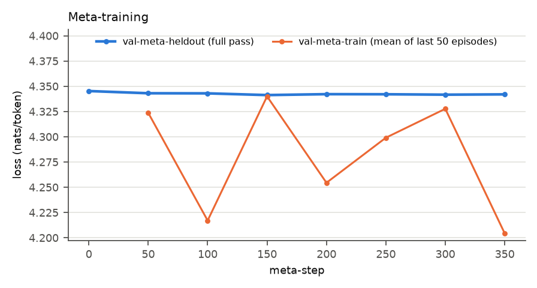
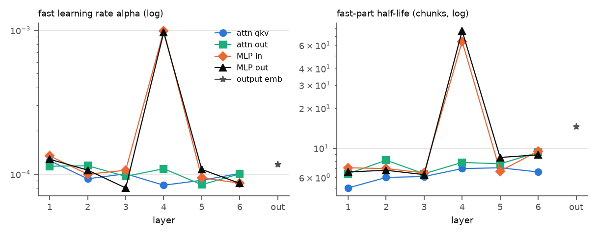

# Test 9: Meta-SGD lite

**Question.** Can a learned per-tensor fast learning rate and decay (Meta-SGD lite) beat the best
hand-picked dual config of test 8, and where does it put the fast learning?

**Answer.** No. Meta-training barely moved the values: the held-out loss improved by 0.004 nats/token
and then stopped improving, and every learned alpha stayed within a factor 0.8-1.34 of its starting
value. The learned rule is essentially test 8's pick (a fast part on layer 4's MLP, alpha 1e-3,
lambda 0.99) plus a small fast part (alpha about 1e-4, lambda about 0.9) on every other weight
matrix. On the test streams it ties test 8's pick on K = 1 (+0.012 over `full_1e-4`) and the long
books (+0.020 against +0.021), and loses more on shuffled (-0.020 against -0.008): the extra fast
parts add cost without adding gain.

## Setup

**Rule.** As in test 8 (`dual.py`): predict with S + F; after each chunk S <- S - 1e-4 g on all
parameters, F <- lambda F - alpha g on the fast tensors. Here every one of 25 weight matrices has a
fast part: per layer the attention qkv, attention output, MLP in and MLP out matrices, plus the
output embedding (no fast part on the input embedding, biases or layer norms). Each tensor has its
own alpha = exp(a) and lambda = sigmoid(b): 50 learned numbers.

**Initialization.** From test 8's pick: layer 4's two MLP matrices alpha 1e-3, lambda 0.99; the
other 23 tensors alpha 1e-4, lambda 0.9.

**Meta-training** on val-meta-train (26 PG-19 validation books, 20k tokens each, K = 1; see test
8). The stream is read continuously in episodes of T = 16 chunks, carrying S and F across episodes;
at the end of the stream a new pass starts from the pretrained weights with F = 0. The meta-loss is
the mean prequential loss over the episode's 16 chunks, backpropagated to (a, b) through the
episode's 16 updates with **exact second-order terms** (the state at the episode start is treated
as a constant). Adam on (a, b), lr 1e-2. Every 50 meta-steps (and before the first), a full
prequential pass over val-meta-heldout (the last 6 validation books) with the current values; the
best is kept. Stop after 30 minutes or 200 meta-steps without held-out improvement.

Exact meta-gradients fit easily (about 2.5 s per meta-step on CPU). They need an attention kernel
that can be differentiated twice, so meta-training runs the model with eager attention; all
evaluation passes use the default kernel (the two differ by float rounding, at most 1.4e-3 nats
per token in a check). A first-order meta-gradient (ignoring the second-order terms) was checked
once at the starting values and pointed elsewhere (cosine -0.59 with the exact one, 150 times
smaller), so it was not used.

## Results

`results.csv`, `bins.csv`, `position.csv`, `learned.csv`, `meta_curve.csv`, per-token losses in
`losses.npz` (float16).

**Meta-training.** Held-out loss 4.3453 with the starting values, best 4.3413 at meta-step 150;
no improvement in the next 200 meta-steps, so training stopped at meta-step 350 (14.9 minutes, a
little under 3 passes over val-meta-train). The training meta-loss moves with the books in each
window of episodes, not with training progress.

**Test streams** (gain over frozen 14M, and over `full_1e-4` in brackets, nats/token):

| config | K = 1 | shuffled | long | locality (K = 1 - shuffled) |
|---|---|---|---|---|
| `full_1e-4` | +0.100 ± 0.006 | +0.062 ± 0.003 | +0.176 ± 0.023 | +0.038 ± 0.004 |
| best dual (test 8: layer 4 MLP, alpha 1e-3, lambda 0.99) | +0.112 ± 0.007 (+0.012 ± 0.001) | +0.054 ± 0.003 (-0.008 ± 0.000) | +0.197 ± 0.025 (+0.021 ± 0.003) | +0.058 ± 0.005 |
| Meta-SGD lite | +0.112 ± 0.007 (+0.012 ± 0.002) | +0.042 ± 0.003 (-0.020 ± 0.001) | +0.196 ± 0.026 (+0.020 ± 0.004) | +0.070 ± 0.005 |

Gain over frozen 14M, and over `full_1e-4` in brackets. Meta-SGD lite against the best dual: K = 1 +0.000 ± 0.001 *, shuffled -0.012 ± 0.000, long -0.000 ± 0.001 *. Gains in nats/token, token-level means ± SE over books (paired per-book differences; test 10 part A); * = under 2 SE.

On the long books Meta-SGD lite closes 55% of the 14M-31M gap (as the best dual), and 87% in the
last 5k tokens of a book (best dual 86%, `full_1e-4` 80%).

**Where gains and costs come from** (test 7's token classes; gain over frozen 14M, over
`full_1e-4` in brackets):

| config | K = 1: same book < 10k | K = 1: never seen | shuffled: same book < 10k | shuffled: never seen |
|---|---|---|---|---|
| `full_1e-4` | +0.210 ± 0.009 | -0.059 ± 0.013 | +0.044 ± 0.005 | -0.055 ± 0.009 |
| best dual (test 8) | +0.268 ± 0.011 (+0.058 ± 0.004) | -0.065 ± 0.014 (-0.006 ± 0.003) | +0.035 ± 0.005 (-0.009 ± 0.001) | -0.066 ± 0.010 (-0.011 ± 0.003) |
| Meta-SGD lite | +0.289 ± 0.012 (+0.079 ± 0.005) | -0.067 ± 0.014 (-0.008 ± 0.003) | +0.022 ± 0.005 (-0.022 ± 0.002) | -0.077 ± 0.009 (-0.022 ± 0.002) |

Gains in nats/token, token-level means ± SE over books (paired per-book differences; test 10 part A); * = under 2 SE.

**Learned values** (`learned.csv`; half-life in chunks of 256 tokens):

| layer | tensor | alpha | lambda | half-life | start |
|---|---|---|---|---|---|
| 1 | attn qkv / attn out / MLP in / MLP out | 1.24e-4 / 1.14e-4 / 1.34e-4 / 1.27e-4 | 0.870 / 0.897 / 0.907 / 0.900 | 5.0 / 6.4 / 7.1 / 6.6 | 1e-4, 0.9 |
| 2 | attn qkv / attn out / MLP in / MLP out | 9.29e-5 / 1.15e-4 / 9.99e-5 / 1.07e-4 | 0.891 / 0.918 / 0.905 / 0.903 | 6.0 / 8.1 / 7.0 / 6.8 | 1e-4, 0.9 |
| 3 | attn qkv / attn out / MLP in / MLP out | 1.01e-4 / 9.66e-5 / 1.07e-4 / 8.03e-5 | 0.892 / 0.897 / 0.899 / 0.896 | 6.1 / 6.4 / 6.5 / 6.3 | 1e-4, 0.9 |
| 4 | attn qkv / attn out | 8.39e-5 / 1.09e-4 | 0.906 / 0.915 | 7.0 / 7.8 | 1e-4, 0.9 |
| 4 | **MLP in / MLP out** | **9.90e-4 / 9.66e-4** | **0.989 / 0.991** | **64.0 / 77.0** | 1e-3, 0.99 |
| 5 | attn qkv / attn out / MLP in / MLP out | 9.07e-5 / 8.45e-5 / 9.43e-5 / 1.08e-4 | 0.907 / 0.912 / 0.902 / 0.922 | 7.1 / 7.6 / 6.7 / 8.5 | 1e-4, 0.9 |
| 6 | attn qkv / attn out / MLP in / MLP out | 1.01e-4 / 1.01e-4 / 8.67e-5 / 8.64e-5 | 0.901 / 0.929 / 0.929 / 0.925 | 6.6 / 9.3 / 9.5 / 8.9 | 1e-4, 0.9 |
| out | output embedding | 1.17e-4 | 0.953 | 14.5 | 1e-4, 0.9 |

The values moved only a little. The decay slowed most in the output embedding (lambda 0.953) and in
layer 6 apart from its qkv matrix (0.925-0.929), and sped up most in layer 1's attention qkv
(0.870). Alpha rose slightly in all four layer-1 tensors (1.14-1.34 times the start) and moved by
less than 20% everywhere else. No tensor became markedly more aggressive, and none was switched
off.

**Runtimes** (CPU): meta-training 14.9 min (about 2.5 s per meta-step, including a held-out pass
every 50 steps); test streams: frozen 14M 77-79 s per chunk set, `full_1e-4` 70 s, Meta-SGD lite 78-79 s per
stream; 24 min 58 s in total. `full_1e-4` through `dual.py` again reproduced test 7 exactly.

## Findings

1. **Meta-SGD lite does not beat the best dual config.** It ties it on K = 1 (+0.1121 against
   +0.1117 over frozen) and on the long books (+0.1964 against +0.1966), and loses on shuffled.
2. **The meta-gradient signal is weak.** The best held-out loss is only 0.004 below the starting
   rule's, and the learned values moved little from their initialization; the per-tensor values
   that matter (layer 4's MLP) were already set by test 8's pick.
3. **The small fast parts on the other 23 tensors add cost, not gain.** They raise the gain on
   recent same-book tokens on K = 1 (+0.079 over `full_1e-4`, against +0.058 for the best dual)
   but cost more on everything else, most visibly on shuffled (-0.022 on both token classes).
4. **Recommendation on test 10: not worth running as specified.** Neither criterion is met:
   Meta-SGD lite does not beat the best dual on K = 1 and long, and the learned values did not
   concentrate the fast learning anywhere new (layer 4's MLP was the most aggressive because it
   started that way). A per-parameter version on that MLP would fit about 262k numbers instead of
   50 from the same weak meta-gradient and 26 books. If meta-learning is pursued, the more useful
   change is upstream: initialize the other tensors with no fast part (alpha near 0), use longer
   episodes or more meta-training data, and check whether the meta-gradient can move alpha at all
   before adding parameters.

## Caveats

- One seed, one meta-training run, 26 training and 6 held-out validation books.
- Truncated meta-gradients over 16 chunks (4k tokens): effects of the fast part beyond an episode
  (a half-life of 64-77 chunks for layer 4's MLP) are not seen by the meta-gradient.
- Adam at lr 1e-2 on log-alpha and logit-lambda moves each value by at most about 1% per step;
  150 steps may simply be too few. The stopping rule (200 steps without held-out improvement)
  ended training early.
- Gains over `full_1e-4` are 0.01-0.02 nats/token; differences under about 0.005 are within noise.
